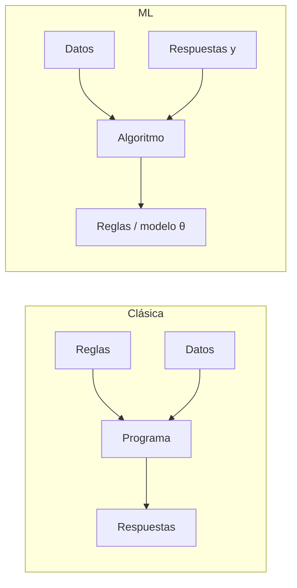
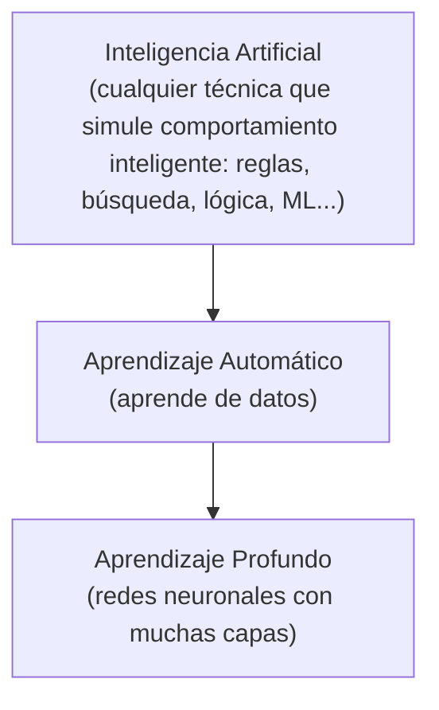
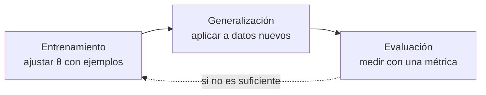
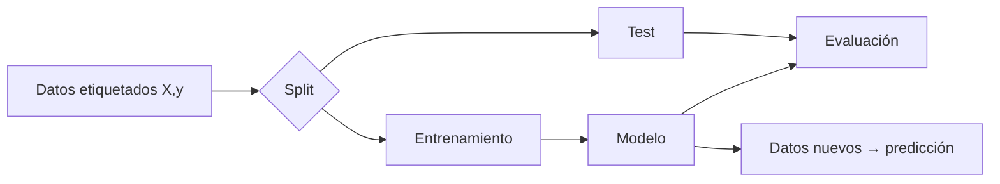
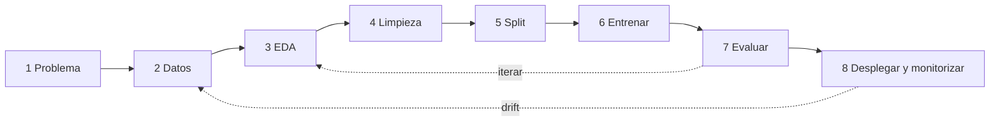
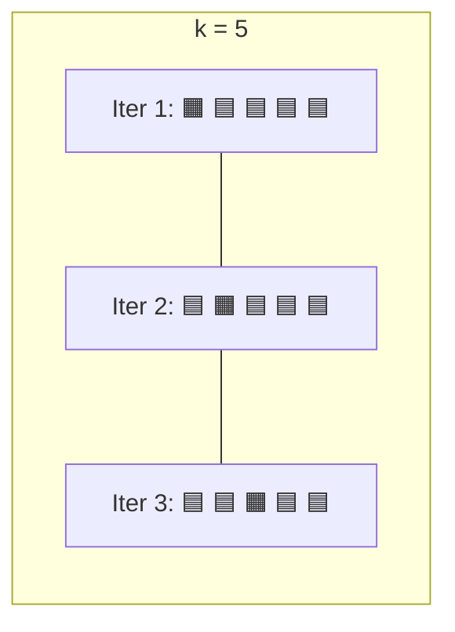

# Unidad 1 · Introducción al Aprendizaje Automático
---

## Índice

1. [Introducción: datos, Big Data y aprendizaje automático](#1-introducción-datos-big-data-y-aprendizaje-automático)
2. [¿Qué entendemos por «aprender»?](#2-qué-entendemos-por-aprender)
3. [Orígenes históricos: ¿pueden aprender las máquinas?](#3-orígenes-históricos-pueden-aprender-las-máquinas)
4. [Definición formal de aprendizaje automático](#4-definición-formal-de-aprendizaje-automático)
5. [¿Cómo aprenden las máquinas?](#5-cómo-aprenden-las-máquinas)
6. [Aplicaciones y límites del aprendizaje automático](#6-aplicaciones-y-límites-del-aprendizaje-automático)
7. [Tipos de aprendizaje](#7-tipos-de-aprendizaje)
8. [Componentes de una solución de ML](#8-componentes-de-una-solución-de-ml)
9. [Etapas de un proyecto de ML](#9-etapas-de-un-proyecto-de-ml)
10. [Generalización: sobreajuste, subajuste y validación](#10-generalización-sobreajuste-subajuste-y-validación)
11. [Métricas de rendimiento](#11-métricas-de-rendimiento)
12. [Elección del modelo](#12-elección-del-modelo)
13. [Conclusiones](#13-conclusiones)
- [Glosario](#glosario)
- [Notas de discrepancias y erratas](#notas-de-discrepancias-y-erratas)
- [Mapa de cobertura](#mapa-de-cobertura)
- [Fuentes](#fuentes)

---

## Objetivos de la unidad

Al terminar esta unidad deberías ser capaz de:

1. Explicar qué es el aprendizaje automático y en qué se diferencia de otras ramas de la IA y de la estadística tradicional.
2. Identificar los cuatro tipos de aprendizaje (supervisado, no supervisado, semi-supervisado, por refuerzo) y sus aplicaciones típicas.
3. Reconocer las etapas de un proyecto: adquisición, limpieza, preprocesamiento, entrenamiento, validación y evaluación.
4. Entender el papel del modelo y la hipótesis, y el de los datos, atributos y algoritmos.
5. Conocer las métricas de clasificación y regresión (accuracy, precision, recall, F1, MAE, MSE, RMSE, R²) y cuándo usar cada una.
6. Valorar la importancia del diseño experimental y la evaluación objetiva.
7. Disponer de la base conceptual para el resto de la asignatura.

---

## 1. Introducción: datos, Big Data y aprendizaje automático

Vivimos en una sociedad impulsada por datos. Cada interacción digital —una búsqueda, una compra online, un «me gusta»— genera información. Al conjunto de **grandes volúmenes de datos, generados a gran velocidad y en formatos muy variados** se le llama **Big Data**. Esa explosión de datos plantea retos (almacenamiento, gestión, calidad) pero también una oportunidad enorme: extraer valor mediante análisis y automatización.

El **aprendizaje automático** (*Machine Learning*, ML) es la disciplina clave en este contexto: permite que un sistema **aprenda patrones a partir de datos** y tome decisiones **sin haber sido programado explícitamente para cada caso**.

Sus aplicaciones abarcan salud, finanzas, logística, entretenimiento, educación…

**Enfoque de la unidad.** Esta unidad es introductoria y establece:
- qué es el ML y cómo se relaciona con el Big Data;
- los tipos de aprendizaje;
- las fases de un proyecto, desde la adquisición de datos hasta la evaluación;
- con especial atención a la **validación**, el **sobreajuste** y la **interpretación de métricas**.

> 📌 **Idea central del curso:** más allá de los algoritmos, el éxito de un sistema de ML depende de un **enfoque integral**: diseño experimental + calidad de los datos + elección adecuada de técnicas.

---

## 2. ¿Qué entendemos por «aprender»?

Antes de hablar de máquinas conviene preguntarse qué es aprender. Distintos autores han dado definiciones influyentes:

| Autor | Definición (resumida) | Idea clave |
|---|---|---|
| **Marvin Minsky** | Aprender es hacer cambios útiles en nuestra mente. | Cambio **útil** |
| **H. Simon (1983)** | Cualquier cambio en un sistema que le permita realizar la misma tarea de forma más eficiente la próxima vez. | **Eficiencia** futura |
| **R. Michalski** | Modificar la representación del mundo que se percibe. | **Representación** interna |
| **T. Mitchell (1997)** | Se aprende una tarea si, con la experiencia, mejora la capacidad de realizarla según una medida. | **Experiencia + tarea + medida** |
| **RAE** (del lat. *apprehendĕre*) | Adquirir el conocimiento de algo por medio del estudio o la experiencia. | **Estudio / experiencia** |

**Denominador común:** el aprendizaje implica una **adaptación como consecuencia de la experiencia previa**, con una **mejora del sistema** de acuerdo con algún **criterio de evaluación**.

> 💡 **Intuición:** si no puedes medir que algo ha mejorado, no puedes afirmar que ha aprendido. Por eso en ML siempre hay una **métrica** (la P de Mitchell).

---

## 3. Orígenes históricos: ¿pueden aprender las máquinas?

La pregunta lleva debatiéndose más de un siglo.

### 3.1 Lady Lovelace (1843)
**Ada Augusta Byron (Lady Lovelace)**, considerada la primera programadora de la historia, escribió sobre la máquina analítica de Babbage que *no tiene la pretensión de originar nada: puede hacer lo que sepamos ordenarle que haga*.

Refleja la limitación de las máquinas de su época: actuar solo según **reglas predefinidas**. Hoy los sistemas ajustan su comportamiento con algoritmos que **generalizan a partir de datos**. Las máquinas sí «aprenden», aunque **no como los humanos**: aprenden de datos y experiencia mejorando en **tareas específicas**.

### 3.2 Alan Turing
- **1936:** propone la **máquina universal**, capaz de simular cualquier proceso computacional con las instrucciones adecuadas. Base de la informática moderna. No «aprendía», pero introdujo la idea de que **comportamiento complejo puede surgir de reglas simples**.
- **1950:** plantea «¿pueden pensar las máquinas?» y propone el **juego de la imitación** (test de Turing).

> 💡 El ML puede verse como una extensión de la idea de Turing: las máquinas ya no solo **ejecutan** reglas, sino que **aprenden** esas reglas a partir de ejemplos.

### 3.3 Arthur Samuel
Trabajó en **IBM** y creó uno de los primeros programas que aprendían: un sistema de **damas** que mejoraba **jugando contra sí mismo** (desarrollado a partir de 1952). Almacenaba información y estilos de juego y adaptaba su comportamiento en cada partida.

En **1959** definió el ML como *el campo de estudio que da a los ordenadores la capacidad de aprender sin ser explícitamente programados*.

### 3.4 Línea temporal (profesor)

| Año | Hito | Por qué importa |
|---|---|---|
| 1950 | Turing y el test de la imitación | Plantea la pregunta de la inteligencia artificial |
| 1957 | **Perceptrón** (Frank Rosenblatt) | Primera neurona artificial que aprende (la animación de la portada de la clase) |
| 1959 | Término *machine learning* (Samuel) | Programa de damas que aprende jugando |
| años 70-80 | **Inviernos de la IA** | Las promesas superan a los resultados; se recorta financiación |
| 1986 | **Backpropagation** (Rumelhart, Hinton, Williams) | Se popularizó cómo entrenar redes de varias capas |
| 1997 | Deep Blue vence a Kasparov | Era **búsqueda + reglas expertas, no aprendizaje**: ejemplo de que **IA ≠ ML** |
| 2009 | **ImageNet** (Fei-Fei Li) | ~14 M de imágenes etiquetadas; los datos pasan a ser protagonistas |
| 2012 | **AlexNet** | Red profunda entrenada en GPU arrasa en ImageNet: empieza la era del *deep learning* |
| 2016 | AlphaGo 4 – Lee Sedol 1 | Aprendizaje por refuerzo en el juego de tablero más complejo |
| 2017 | «Attention is all you need» | Nace el **Transformer**, base de los LLM actuales |
| 2022 | ChatGPT | ~100 M de usuarios en ~2 meses; el ML llega al público general |
| 2024 | **Dos premios Nobel** | Física: Hopfield y Hinton (redes neuronales). Química: Hassabis y Jumper (AlphaFold) |

> 🆕 🔎 **Más allá:** el Nobel de Química 2024 también reconoció a David Baker (diseño computacional de proteínas), que compartió el premio con Hassabis y Jumper.

> 🆕 ⚠️ **Matiz histórico:** las fuentes sitúan los primeros trabajos de Samuel con las damas hacia 1952 y su artículo clásico sobre aprendizaje con damas en 1959. El material usa «1952» para el programa y «1959» para el término. Ambas fechas son coherentes.

---

## 4. Definición formal de aprendizaje automático

### 4.1 Definición de Mitchell (1997)

> *Un programa de ordenador **aprende** de una experiencia **E** respecto a una tarea **T** y una medida de rendimiento **P**, si su rendimiento en T, medido por P, mejora con E.*

| Elemento | Significado | Ejemplo 1 (animales) | 🆕 Ejemplo 2 (spam) | 🆕 Ejemplo 3 (damas) |
|---|---|---|---|---|
| **T** (tarea) | Lo que queremos resolver | Clasificar imágenes de animales | Clasificar correos como spam o no | Jugar a las damas |
| **E** (experiencia) | Datos de los que aprende | Imágenes etiquetadas (perro, gato…) | Correos marcados por usuarios | Partidas jugadas contra sí mismo |
| **P** (rendimiento) | Cómo medimos la mejora | Accuracy | Precision/recall sobre spam | % de partidas ganadas |

> 💡 **Test mental:** ante cualquier problema de ML, intenta rellenar T, E y P. Si no puedes, el problema está mal planteado.

### 4.2 Programación tradicional vs aprendizaje automático

| Paradigma | Entradas | Salida |
|---|---|---|
| **Programación tradicional** | **Datos + Reglas** | Resultado |
| **Aprendizaje automático** | **Datos + Resultados esperados** | **Reglas aprendidas (modelo)** |



- En programación clásica el humano **escribe todas las reglas**.
- En ML se entregan **datos y respuestas** y el sistema **aprende las reglas**. El resultado es un **modelo capaz de generalizar** a datos nuevos.

> 🧪 **Ejemplo (detector de spam).**
> *Clásico:* escribir `if "premio" in texto and "urgente" in texto: spam`. Hay que anticipar cada truco del spammer.
> *ML:* dar 10 000 correos etiquetados; el algoritmo descubre qué combinaciones de palabras, remitentes y formatos predicen spam, incluso patrones que nadie habría escrito.

**Formalización (idea clave del profesor):** en lugar de programar una función $f(x)$, el algoritmo aprende una aproximación $f(x;\theta)$ **minimizando una función de error sobre ejemplos**. Los $\theta$ son los **parámetros** del modelo.

### 4.3 IA ⊃ ML ⊃ DL



- **IA:** campo amplio. Incluye sistemas basados en reglas y búsqueda (p. ej. **Deep Blue**).
- **ML:** subconjunto de la IA que **aprende de datos**.
- **Deep Learning:** subconjunto del ML basado en redes neuronales profundas.

### 4.4 ¿Por qué ahora? La convergencia de disciplinas

El ML se ha disparado gracias a la unión de **estadística, informática y bases de datos**, impulsada por:

1. **Más datos digitales.** El material cita que la cantidad de datos almacenados se duplica cada ~20 meses y que se generan ~2,5 quintillones de bytes al día. *(⚠️ Cifras muy citadas pero antiguas y orientativas; úsalas como orden de magnitud, no como dato actual.)*
2. **Métodos estadísticos más sofisticados**, capaces de modelar fenómenos complejos.
3. **Hardware más barato y potente**, sobre todo **GPUs** (procesamiento paralelo).
4. **Infraestructura tecnológica**: bases de datos masivas, redes rápidas, ecosistemas de software científico (Python, etc.).

> 📌 **Más datos → mejor puede aprender un modelo**, pero también más retos de almacenamiento, procesamiento y **calidad**.

### 4.5 ML vs minería de datos

| | Minería de datos | Aprendizaje automático |
|---|---|---|
| Objetivo | **Descubrir** patrones y estructura ocultos en grandes volúmenes (D2K: *Data to Knowledge*) | **Entrenar modelos** para tareas concretas (clasificar, predecir, agrupar) |
| Enfoque | Exploratorio, descriptivo | Predictivo / operativo |

Están muy relacionados y comparten técnicas.

### 4.6 🆕 ML vs estadística clásica

| | Estadística clásica | Aprendizaje automático |
|---|---|---|
| Énfasis | **Inferencia**: entender el mecanismo, contrastar hipótesis | **Predicción**: acertar con datos nuevos |
| Supuestos | Modelo con supuestos explícitos (normalidad, linealidad…) | Menos supuestos; modelos flexibles |
| Interpretabilidad | Alta (coeficientes, p-valores) | Variable; a veces *caja negra* |
| Evaluación | Contrastes, intervalos de confianza | **Rendimiento sobre datos no vistos** (test, validación cruzada) |

No son opuestos: la regresión lineal es a la vez un método estadístico clásico y un algoritmo de ML. La diferencia es de **objetivo y de cultura de evaluación**.

---

## 5. ¿Cómo aprenden las máquinas?

### 5.1 No piensan: ajustan

A diferencia de la computación clásica (reglas lógicas deterministas), el ML usa **modelos matemáticos y estadísticos** que identifican patrones. Estos modelos **no «piensan» ni razonan** como un humano: aprenden mediante un **proceso de ajuste y prueba**.

Consecuencias:
- Un modelo puede ser **estadísticamente correcto y aun así fallar en casos individuales**.
- «Automático» **no** significa «autónomo»: sigue dependiendo de **datos, calidad del modelo y supervisión humana**.

### 5.2 Abstracción: de los datos a la regla general

Para aprender hacen falta datos. Con ellos se entrena un modelo que **abstrae** relaciones útiles: extraer lo esencial, descartando lo accesorio.

> 🧪 **Ejemplo de la manzana.** Observas caer una manzana y registras tiempo y velocidad. Con muchas observaciones llegas a una regla general: los objetos cerca de la Tierra caen con aceleración constante $g \approx 9{,}8\ \text{m/s}^2$. Esa regla **no describe una manzana ni un árbol**, sino un patrón general. Los modelos de ML hacen lo mismo: observan muchos ejemplos y extraen una regla que **generaliza**.

### 5.3 El ciclo de aprendizaje

Una vez entrenado, el modelo aplica lo aprendido a situaciones nuevas. El ciclo se descompone en tres fases:



### 5.4 🆕 El motor matemático: modelo, hipótesis, pérdida y optimizador

El material de la plataforma menciona estos conceptos (en las conclusiones) sin desarrollarlos; el profesor los muestra en su demo de «el cocinero». Aquí está el desarrollo completo.

| Concepto | Qué es | Ejemplo (regresión lineal simple) |
|---|---|---|
| **Modelo / hipótesis** $f(x;\theta)$ | Familia de funciones con **parámetros ajustables** | $\hat y = w\,x + b$, con $\theta=(w,b)$ |
| **Función de pérdida** $L(\theta)$ | Mide el **error** entre predicción y realidad | MSE $=\frac1n\sum(\hat y_i - y_i)^2$ |
| **Algoritmo de optimización** | Ajusta $\theta$ para **minimizar** $L$ | Descenso de gradiente |

> 💡 **Analogía del profesor:** el modelo es una **receta con huecos** (parámetros); el optimizador es el **cocinero** que prueba, falla, ajusta y vuelve a probar.

**Descenso de gradiente (*gradient descent*).** Idea: desde el punto actual, moverse en la dirección en que la pérdida **baja más rápido** (opuesta al gradiente):

$$\theta \leftarrow \theta - \eta\,\nabla_\theta L(\theta)$$

donde $\eta$ es la **tasa de aprendizaje** (*learning rate*). Para MSE con $\hat y = wx+b$:

$$\frac{\partial L}{\partial w}=\frac{2}{n}\sum_i(\hat y_i-y_i)\,x_i,\qquad \frac{\partial L}{\partial b}=\frac{2}{n}\sum_i(\hat y_i-y_i)$$

> 🧪 **Ejemplo resuelto a mano.** Datos: $(1,2),\ (2,3),\ (3,5)$. Empezamos con $w=0,\ b=0$ y $\eta=0{,}1$.
>
> **Iteración 1:** predicciones $\hat y=(0,0,0)$, errores $\hat y-y=(-2,-3,-5)$.
> - MSE $=(4+9+25)/3 = 12{,}667$
> - $\partial L/\partial w=\frac{2}{3}(-2\cdot1-3\cdot2-5\cdot3)=\frac{2}{3}(-23)=-15{,}333$
> - $\partial L/\partial b=\frac{2}{3}(-10)=-6{,}667$
> - Actualización: $w=0-0{,}1\cdot(-15{,}333)=1{,}533$; $b=0-0{,}1\cdot(-6{,}667)=0{,}667$
>
> **Iteración 2:** MSE baja a $0{,}216$; tras actualizar, $w=1{,}369$, $b=0{,}587$.
> **Iteración 3:** MSE $=0{,}067$.
> Converge a la solución de mínimos cuadrados: $w=1{,}5$, $b=0{,}333$.

```python
import numpy as np

x = np.array([1, 2, 3.0]); y = np.array([2, 3, 5.0])
w = b = 0.0; lr = 0.1

for i in range(3):
    e = w * x + b - y                      # error de predicción
    mse = (e ** 2).mean()
    gw, gb = 2 * (e * x).mean(), 2 * e.mean()   # gradientes
    print(f"it {i}: w={w:.4f} b={b:.4f} MSE={mse:.4f}")
    w -= lr * gw; b -= lr * gb

for _ in range(500):                        # seguimos hasta converger
    e = w * x + b - y
    w -= lr * 2 * (e * x).mean(); b -= lr * 2 * e.mean()
print("final:", round(w, 4), round(b, 4), "| solución exacta:", np.polyfit(x, y, 1).round(4))
# it 0: w=0.0000 b=0.0000 MSE=12.6667
# it 1: w=1.5333 b=0.6667 MSE=0.2163
# it 2: w=1.3689 b=0.5867 MSE=0.0671
# final: 1.5 0.3333 | solución exacta: [1.5    0.3333]
```

**Qué observar en la demo del profesor (gráfica de pérdida):**

| Observación | Explicación |
|---|---|
| La pérdida baja rápido al principio y luego se **aplana** | Lejos del mínimo el gradiente es grande (pasos grandes); cerca, el gradiente es pequeño (pasos pequeños) |
| Con $\eta$ **pequeña** (🐢) | Converge, pero muy lento |
| Con $\eta$ **adecuada** (👌) | Converge rápido y estable |
| Con $\eta$ **demasiado grande** (💥) | **Diverge**: cada corrección se pasa de largo y el error crece («el cocinero sala cada vez más el plato») |
| Al añadir un **outlier** | La recta se desplaza hacia él: el MSE **eleva al cuadrado** los errores y castiga mucho los grandes (se verá en U3) |

> ⚠️ **Error típico:** pensar que más iteraciones siempre mejoran el modelo. Mejoran la pérdida **en entrenamiento**; no garantizan generalizar (ver §10).

---

## 6. Aplicaciones y límites del aprendizaje automático

### 6.1 Aplicaciones actuales

El ML forma parte de la vida cotidiana y de muchos sectores. Ejemplos del material:

- Filtrar **spam** del correo.
- **Diagnóstico médico**: detectar tumores en imágenes.
- Predecir resultados de **elecciones**.
- Prever **actividad delictiva**.
- Automatizar **señales de tráfico** según las condiciones de la carretera.
- Estimaciones financieras de **tormentas y desastres naturales**.
- Analizar la **rotación de clientes** (*churn*).
- **Pilotos automáticos** y coches autónomos.
- Identificar **personas con capacidad para donar**.
- **Publicidad dirigida** a tipos de consumidor.
- **Control de procesos industriales**.

**¿Por qué es importante?**
1. Automatiza tareas complejas **difíciles de programar a mano**.
2. **Se adapta a los cambios**: si cambian los datos, se reentrena.
3. Se aplica en **prácticamente todos los sectores** (educación, salud, finanzas, industria, transporte…).

> 🆕 **Ejemplos adicionales por sector:**
> | Sector | Aplicación | Tipo de problema |
> |---|---|---|
> | Banca | Detección de fraude en transacciones | Clasificación muy **desbalanceada** / anomalías |
> | Retail | Recomendación de productos | Reglas de asociación, filtrado colaborativo |
> | Salud | Predicción de reingreso hospitalario | Clasificación |
> | Energía | Predicción de consumo eléctrico | Regresión / series temporales |
> | Industria | Mantenimiento predictivo | Clasificación / detección de anomalías |
> | Marketing | Segmentación de clientes | Clustering |

### 6.2 ¿Qué NO es el aprendizaje automático?

| Idea | Explicación |
|---|---|
| **No es magia** | Necesita **datos de calidad**. Sin datos fiables no puede aprender bien. |
| **No siempre es la mejor solución** | A veces un sistema de **reglas explícitas** es más adecuado (simple, auditable, sin datos). |
| **No es neutral** | Aprende de los datos que se le dan; si estos contienen **sesgos**, el modelo los reproduce. Ej.: un modelo de contratación entrenado con histórico sesgado contra personas racializadas **perpetuará** esa desigualdad. |

### 6.3 Limitaciones (profesor)

- **No entiende causalidad:** detecta correlaciones, no causas.
- **No razona:** es una función matemática.
- **Requiere datos:** sin datos suficientes o con sesgo, no hay buen modelo.
- **Se degrada con el tiempo:** los patrones cambian (**data drift**) y el modelo se queda obsoleto.
- **Hereda sesgos** de los datos.

> 🧪 **Ejemplo: correlación espuria (Tyler Vigen).** Entre 1999 y 2009, el número de películas de Nicolas Cage al año y los ahogamientos en piscinas en EE. UU. muestran en la gráfica del profesor una correlación de $r\approx0{,}67$. Un modelo entrenado con esos datos «aprendería» que Cage debería dejar el cine para salvar vidas. **Correlación ≠ causalidad.** Con suficientes variables, siempre aparecerá alguna pareja que se mueve junta por pura casualidad.

> 🆕 🔎 **Más allá:** a esto se le llama *búsqueda de correlaciones espurias* o *multiple comparisons problem*: si pruebas miles de pares de variables, algunas saldrán «significativas» por azar. En ML se combate con **datos de test separados** y con validación cruzada.

> 📌 **Mentalidad correcta:** el ML es una **herramienta estadística potente, no magia**. La calidad del resultado depende de **problema + datos + validación**.

---

## 7. Tipos de aprendizaje

El ML se clasifica según la **disponibilidad de etiquetas** y la **forma de recibir retroalimentación**.

| Tipo | ¿Qué recibe el modelo? | ¿Qué busca aprender? | Ejemplo |
|---|---|---|---|
| **Supervisado** | Datos **con etiquetas** $(X, y)$ | Una función entrada → salida | Clasificar correos como spam / no spam |
| **No supervisado** | Datos **sin etiquetas** (solo $X$) | Patrones, agrupaciones, estructura latente | Agrupar clientes por comportamiento |
| **Semi-supervisado** | **Pocos** datos etiquetados + **muchos** sin etiquetar | Generalizar a partir de pocos ejemplos marcados | Reconocimiento de imágenes con pocas etiquetas |
| **Por refuerzo** | **Recompensas / penalizaciones** por acciones en un entorno | Una **política** que maximice la recompensa | Aprender a jugar al ajedrez |

> 📌 **En este curso:** U3-U4 → supervisado; U5-U6 → no supervisado. Semi-supervisado y refuerzo se verán en otras asignaturas.

### 7.1 Aprendizaje supervisado

El modelo aprende de un conjunto de datos donde **cada entrada tiene una respuesta correcta asociada (etiqueta)**. Recibe pares **entrada–salida** y aprende la correspondencia entre las características y el resultado deseado.

**Anatomía de un dataset:**

| Término | Sinónimos | Significado |
|---|---|---|
| **Dataset** | conjunto de datos | Tabla completa |
| **Instancia** | ejemplo, observación, fila | Una observación individual |
| **Atributos** $X$ | características, *features*, variables explicativas | Columnas de entrada (el vector de atributos) |
| **Etiqueta** $y$ | clase, variable objetivo, *target* | Lo que se quiere predecir |

> 🧪 **Ejemplo con el Titanic (el «hola mundo» del ML), ejemplo del profesor:**
>
> | pclass | sexo | edad | tarifa (£) | embarque | **sobrevive** |
> |---|---|---|---|---|---|
> | 3 | hombre | 22 | 7,25 | Southampton | **0** |
> | 1 | mujer | 38 | 71,28 | Cherbourg | **1** |
> | 3 | mujer | 26 | 7,93 | Southampton | **1** |
> | 1 | hombre | 54 | 51,86 | Southampton | **0** |
> | 2 | mujer | 14 | 30,07 | Cherbourg | **?** |
>
> - **Instancias** = filas (cada pasajero).
> - **Atributos $X$** = pclass, sexo, edad, tarifa, embarque.
> - **Etiqueta $y$** = sobrevive. La última fila tiene `?`: es un caso **nuevo** que el modelo debe predecir.

A partir del dataset etiquetado, el algoritmo aprende una **regla general (modelo predictivo)** que permite predecir etiquetas de observaciones nuevas.



**Dos tipos de tarea según la salida:**

| Tarea | Salida | Ejemplo |
|---|---|---|
| **Clasificación** | **Discreta** (categorías/clases) | Dataset **Iris**: 3 especies (setosa, versicolor, virginica) según largo/ancho de sépalos y pétalos |
| **Regresión** | **Continua** (número) | Precio de una vivienda según habitaciones, m², ubicación, antigüedad |

```python
# 🆕 Clasificación supervisada con Iris: tres algoritmos, mismo protocolo
from sklearn.datasets import load_iris
from sklearn.model_selection import train_test_split
from sklearn.pipeline import make_pipeline
from sklearn.preprocessing import StandardScaler
from sklearn.linear_model import LogisticRegression
from sklearn.neighbors import KNeighborsClassifier
from sklearn.tree import DecisionTreeClassifier
from sklearn.metrics import confusion_matrix

X, y = load_iris(return_X_y=True)
Xtr, Xte, ytr, yte = train_test_split(X, y, test_size=0.2, stratify=y, random_state=42)

modelos = {
    "regresión logística": make_pipeline(StandardScaler(), LogisticRegression(max_iter=200)),
    "k-NN (k=5)":          make_pipeline(StandardScaler(), KNeighborsClassifier(5)),
    "árbol de decisión":   DecisionTreeClassifier(random_state=42),
}
for nombre, m in modelos.items():
    m.fit(Xtr, ytr)
    print(f"{nombre:20s} train={m.score(Xtr, ytr):.3f}  test={m.score(Xte, yte):.3f}")
print(confusion_matrix(yte, m.predict(Xte)))
# regresión logística  train=0.958  test=0.933
# k-NN (k=5)           train=0.975  test=0.933
# árbol de decisión    train=1.000  test=0.933
# [[10  0  0]
#  [ 0  9  1]
#  [ 0  1  9]]
```

> 💡 **Qué observar:** el árbol saca **1.000 en train** (memoriza) pero **0.933 en test**, igual que los otros. Ese hueco train–test es la señal de **sobreajuste** (§10).

**Enfoques de implementación (los dos que presenta la plataforma):**

| Enfoque | Cómo funciona | Ejemplos |
|---|---|---|
| **Basados en modelos** | Construyen una **representación compacta** (parámetros $\theta$) durante el entrenamiento y luego **descartan los datos** | Regresión lineal/logística, árboles, redes neuronales |
| **Basados en instancias** | **Almacenan los ejemplos** y predicen comparando el caso nuevo con los guardados (similitud) | **k-NN** (*k vecinos más cercanos*) |

> ⚠️ **Nota:** la plataforma solo muestra los títulos de estos dos enfoques (el contenido se perdió en la extracción). La explicación anterior es complemento 🆕.

### 7.2 Aprendizaje no supervisado

Trabaja con **datos no etiquetados**: no hay variable objetivo que guíe el entrenamiento. El objetivo es **descubrir patrones, estructuras o relaciones ocultas** sin que ninguna característica sea prioritaria. Produce modelos **descriptivos** (resumir, reorganizar, visualizar). Es especialmente valioso en **fases exploratorias**, o cuando **etiquetar es costoso o inviable**.

| Tarea | Qué hace | Ejemplo | Algoritmos |
|---|---|---|---|
| **Clustering** (agrupamiento) | Agrupa instancias **similares**; las del mismo grupo se parecen entre sí y se diferencian de las de otros | **Segmentación de clientes** (frecuencia de compra, gasto medio, tipos de producto): «compradores frecuentes con bajo gasto», «clientes de lujo» | **K-Means**, DBSCAN |
| **Reducción de dimensionalidad** | Transforma datos complejos en **menos dimensiones**, conservando la estructura esencial | Pasar de 1000 características por documento a 2-3 para **visualizar** agrupaciones temáticas o anomalías | **PCA**, t-SNE |
| **Reglas de asociación** | Descubre **co-ocurrencias** frecuentes | **Cesta de la compra**: «pan + mantequilla → leche» (alimenta recomendadores y la colocación de productos) | **Apriori**, **FP-Growth** |

**Algoritmos clave:**
- **K-Means:** organiza las instancias en $k$ grupos calculando **centroides** y asignando cada instancia al más cercano (se repite hasta estabilizarse).
- **PCA (Análisis de Componentes Principales):** genera **nuevas variables no correlacionadas** como combinaciones lineales de las originales, ordenadas por la varianza que explican.
- **Apriori / FP-Growth:** encuentran **conjuntos frecuentes** y reglas en datos transaccionales.

```python
# 🆕 K-Means y PCA sobre Iris, ignorando las etiquetas
from sklearn.datasets import load_iris
from sklearn.cluster import KMeans
from sklearn.decomposition import PCA
import numpy as np

X, y = load_iris(return_X_y=True)

km = KMeans(n_clusters=3, n_init=10, random_state=0).fit(X)
print("tamaño de cada clúster:", np.bincount(km.labels_))      # [62 50 38]

pca = PCA(n_components=2).fit(X)
print("varianza explicada:", pca.explained_variance_ratio_.round(3),
      "→ total", pca.explained_variance_ratio_.sum().round(3))
# varianza explicada: [0.925 0.053] → total 0.978  (2 componentes bastan para conservar el 98 % de la varianza)
```

**Ventajas y límites:**
- ✅ Útil sin etiquetas; descubre patrones desconocidos; sirve como **paso previo** a tareas más complejas.
- ⚠️ **Sin «respuesta correcta»**, evaluar la calidad es **difícil** y los resultados pueden ser **ambiguos**. Muchos algoritmos requieren **definir parámetros de antemano** (p. ej. el número de clústeres $k$).

### 7.3 Aprendizaje semi-supervisado

Combina lo supervisado y lo no supervisado: parte de los datos **etiquetados** y parte **sin etiquetar**. Muy útil cuando **etiquetar es costoso, lento o requiere expertos**, pero sobran datos sin etiquetar.

- Los **etiquetados** aportan una base fiable.
- Los **no etiquetados** ayudan a capturar la **estructura general**.

**Funcionamiento:** el modelo se entrena primero con los ejemplos etiquetados y luego **extiende** ese conocimiento al resto buscando patrones, cercanía o similitud.
**Supuestos:** (1) datos **cercanos en el espacio de características** pertenecen a la **misma clase**; (2) etiquetados y no etiquetados provienen de la **misma distribución**.

| Tarea | Descripción | Ejemplo |
|---|---|---|
| **Clasificación semi-supervisada** | Aprende con pocas etiquetas y explora patrones en el resto | **Imágenes médicas**: pocas anotadas por especialistas, miles sin anotar |
| **Few-shot learning** | Aprendizaje con muy pocas instancias etiquetadas | **Voz personalizada**: reconoce a un usuario con unas pocas grabaciones etiquetadas |
| **Análisis de texto especializado** | Dominios donde etiquetar requiere experto | **Documentos legales**: se etiquetan unos pocos como «contrato», «demanda»… y el modelo categoriza el resto |

**Técnicas:** **propagación de etiquetas** (extender etiquetas a datos similares); **autoencoders / modelos generativos** (aprenden representaciones con todos los datos); **modelos híbridos** (pérdida supervisada + pérdida no supervisada).

✅ Reduce la necesidad de etiquetas (y costes) y capta mejor la distribución real.
⚠️ Si las etiquetas no representan bien todas las clases, **aprende patrones incorrectos**; la implementación es más compleja (equilibrar la influencia de ambos tipos de datos).

> 🧪 **Ejemplo del profesor (juego):** filtro de spam con **500 correos etiquetados a mano y 2 millones sin etiquetar** → semi-supervisado.

### 7.4 Aprendizaje por refuerzo

Un **agente** aprende **interactuando con un entorno**. No recibe instrucciones directas: **toma decisiones y obtiene recompensas o penalizaciones**. Objetivo: aprender una **estrategia óptima** (política) que **maximice la recompensa acumulada a largo plazo**.

| Elemento | Significado |
|---|---|
| **Estado** | Situación actual del entorno |
| **Acción** | Decisión del agente |
| **Recompensa** | Retroalimentación que guía el aprendizaje |


**Ejemplos:** ajedrez (aprende de victoria/derrota); robot autónomo (evita obstáculos y optimiza su recorrido); **AlphaGo / AlphaZero** (juegan millones de partidas contra sí mismos); robot que anda (+1 si avanza, −1 si cae).

Útil cuando **las decisiones tienen consecuencias a lo largo del tiempo**. Se aplica en **robótica, videojuegos, control inteligente y recomendaciones adaptativas**. ⚠️ Puede ser **lento y costoso**: requiere muchísimas pruebas.

> 🆕 🔎 **Más allá:** la recompensa **retardada** es lo que lo distingue: una jugada de ajedrez no recibe «nota» hasta el final de la partida (el problema de la *asignación de crédito*). Algoritmos clásicos: **Q-learning**, **SARSA**; modernos: **DQN**, **PPO**.

### 7.5 Juego de repaso (profesor): ¿qué tipo de aprendizaje es?

| Caso | Tipo | Razón |
|---|---|---|
| Predecir el precio de un piso con miles de ventas pasadas | **Supervisado** (regresión) | Hay etiqueta conocida: el precio |
| Agrupar usuarios de Spotify por hábitos, sin etiquetas | **No supervisado** (clustering) | Solo $X$, buscamos grupos |
| Robot que anda: +1 si avanza, −1 si cae | **Refuerzo** | Agente + entorno + recompensa |
| Filtro de spam: 500 etiquetados + 2 M sin etiquetar | **Semi-supervisado** | Pocas etiquetas + muchos datos sin ellas |
| Detectar neumonía en radiografías con diagnóstico | **Supervisado** (clasificación) | Etiqueta = diagnóstico |
| «Quien compra pañales compra cerveza» en tickets | **No supervisado** (reglas de asociación) | Sin etiqueta, co-ocurrencia |
| AlphaZero aprende ajedrez contra sí mismo | **Refuerzo** | Gana/pierde = recompensa |
| Marcar transacciones «raras» sin saber cuáles son fraude | **No supervisado** (detección de anomalías) | Sin etiquetas |
| Predecir si un cliente se dará de baja con histórico | **Supervisado** (clasificación) | Etiqueta = se fue / no se fue |

> 💡 **Regla rápida:** pregúntate **«¿tengo la respuesta correcta para los ejemplos?»**
> Sí, para todos → supervisado · Para ninguno → no supervisado · Para pocos → semi-supervisado · No hay «respuesta», solo recompensas tras actuar → refuerzo.

---

## 8. Componentes de una solución de ML

Toda solución se apoya en **tres componentes fundamentales**, que interactúan entre sí; la calidad final depende de su **equilibrio y adecuación**:

1. **Los datos**
2. **La ingeniería de atributos** (*feature engineering*)
3. **El modelo**

> ⚠️ **Nota:** la plataforma solo muestra estos tres títulos (el contenido de las pestañas no se extrajo). El desarrollo siguiente es complemento 🆕 coherente con el resto de la unidad.

### 8.1 Los datos
Son la materia prima. Importan su **calidad, cantidad, estructura y relevancia** (ver §9.1). *Un modelo solo es tan bueno como lo permitan los datos que recibe.*

### 8.2 🆕 Ingeniería de atributos (*feature engineering*)
Es transformar los datos crudos en **atributos informativos** para el modelo. Incluye: crear variables nuevas, transformar, codificar, escalar, seleccionar. Los datos solo serán útiles si **se han transformado adecuadamente**.

> 🧪 **Ejemplo:** de una columna `fecha_compra` = `2026-03-14 18:30` se pueden extraer `día_de_la_semana`, `mes`, `hora`, `es_fin_de_semana`. Un modelo difícilmente deduce esto de una cadena de texto.

Ver las operaciones concretas en §9.2.

### 8.3 El modelo
Es la **función con parámetros ajustables** $f(X;\theta)$ que, una vez entrenada, hace predicciones. Se necesitan además:
- **Función de pérdida** (mide el error) y
- **Algoritmo de optimización** (ajusta $\theta$).

(Ver §5.4.)

### 8.4 Algoritmo ≠ modelo

| | Qué es | Analogía |
|---|---|---|
| **Algoritmo** | Conjunto de reglas/instrucciones que definen **cómo aprender** de los datos | La **receta** |
| **Modelo** | **Resultado** concreto de aplicar el algoritmo a un dataset concreto: estructura **ya entrenada** y lista para predecir | El **plato cocinado** |

> 🧪 **Ejemplo:** *regresión lineal* es el algoritmo; «$\hat y = 1{,}5x + 0{,}33$» es el modelo que resulta de aplicarlo a unos datos concretos. Con otros datos, el mismo algoritmo da otro modelo.

### 8.5 🆕 Parámetros vs hiperparámetros

| | Parámetros $\theta$ | Hiperparámetros |
|---|---|---|
| Quién los fija | **Aprendidos** por el algoritmo durante el entrenamiento | **Elegidos por la persona** antes de entrenar |
| Ejemplos | Pesos $w$ de una recta; pesos de una red | Profundidad máxima de un árbol, $k$ en k-NN, tasa de aprendizaje $\eta$, regularización |
| Se ajustan con | Conjunto de **entrenamiento** | Conjunto de **validación** / validación cruzada |

---

## 9. Etapas de un proyecto de ML

El desarrollo **no se limita a elegir un algoritmo**: es un **proceso estructurado**. Y **no es lineal**: es un **ciclo iterativo** en el que se retrocede, ajusta y mejora constantemente.



| Etapa (profesor) | Qué se hace | Se ve en |
|---|---|---|
| 1. **Problema** | ¿Qué predecir/descubrir y para qué? ¿Cómo medir el éxito? *Un problema mal planteado no lo salva ningún algoritmo.* | U1 |
| 2. **Datos** | Recoger, integrar, entender el origen. ¿Son representativos? ¿Hay sesgos? | U2 |
| 3. **EDA** | Análisis exploratorio: distribuciones, correlaciones, outliers, gráficos | U2 · Actividad 1 |
| 4. **Limpieza** | Nulos, duplicados, tipos, codificar categóricas, escalar | U2 · Actividad 1 |
| 5. **Split** | Separar train / validación / test **antes** de mirar demasiado; evita **fugas de información** | U3 |
| 6. **Entrenar** | Elegir algoritmo, ajustar parámetros e hiperparámetros; se repite con varios modelos | U3 · U4 · U5 |
| 7. **Evaluar** | Métricas adecuadas, comparar con un *baseline*, analizar errores | U3 · U4 · Actividad 2 |
| 8. **Desplegar** | Poner en producción, **monitorizar el drift**, reentrenar | Otras asignaturas |

La plataforma resume las etapas en cinco bloques: **adquisición → preprocesamiento → visualización/exploración → entrenamiento → validación y evaluación** (más despliegue). Es la misma secuencia con otra agrupación.

> ⚠️ **Error típico del alumno (profesor):** saltarse la EDA y entrenar directamente. *Si no entiendes tus datos, tu modelo será una caja negra.*

### ¿En qué se va el tiempo realmente?

Encuesta Anaconda *State of Data Science 2020* (~2.300 profesionales), según el profesor:

| Actividad | % del tiempo |
|---|---|
| Limpieza de datos | 26 % |
| Visualización | 21 % |
| Carga de datos | 19 % |
| Entrenar y puntuar modelos | 12 % |
| Selección de modelo | 11 % |
| Despliegue | 11 % |

**Carga + limpieza ≈ 45 %.** Entrenar, lo «glamuroso», es solo ~12 %.

> ⚠️ **Discrepancia:** la plataforma afirma que «hasta el **80 %** del esfuerzo» se dedica al preprocesamiento (cifra muy repetida en la industria, de origen difuso). El profesor aporta una encuesta concreta con ~45 %. **Mensaje común:** la preparación de datos consume la **mayor parte** del tiempo. Cita la cifra con su fuente.

---

### 9.1 Adquisición de datos

Todo proyecto **comienza con los datos**. Etapa a menudo subestimada y **crítica**: su calidad, cantidad, estructura y relevancia influyen en el rendimiento y hasta en **qué algoritmos se pueden usar**.

**Fuentes habituales:**

| Fuente | Uso típico |
|---|---|
| **Sensores / IoT** | Industria, domótica, salud |
| **Bases de datos relacionales** (SQL) | Registros históricos, ventas, clientes |
| **APIs** públicas/privadas | Meteorología, redes sociales, mercados, noticias |
| **Archivos planos** (CSV, JSON, XML, Excel) | Datos estructurados o semiestructurados |
| **Web scraping** | Cuando no hay API |
| **Plataformas abiertas** | **Kaggle**, **UCI Machine Learning Repository**, **Google Dataset Search**, **Hugging Face Datasets** |

**Librerías de Python para acceder a datos:**

| Librería | Qué ofrece |
|---|---|
| `sklearn.datasets` | Colecciones clásicas (Iris, Digits, Wine, California Housing…) |
| `tensorflow_datasets` | Datasets listos para TensorFlow |
| `datasets` (Hugging Face) | Muy usado en NLP |
| `pandas.read_*` | Cargar CSV, Excel, SQL, JSON… |

> ⚠️ **Discrepancia:** el material menciona el dataset **Boston Housing** dentro de `scikit-learn.datasets`. Fue **eliminado de scikit-learn** (en la versión 1.2) por problemas éticos de una de sus variables. Alternativa estándar: **California Housing** (`fetch_california_housing`). Es una errata frecuente en materiales antiguos.

**Tipos de datos de entrada:**

| Tipo | Descripción | Ejemplos | Consideraciones |
|---|---|---|---|
| **Numéricos** | Cuantitativos: continuos o discretos | Temperatura, edad, ingresos | Algunos algoritmos requieren **escalar/normalizar** (SVM, redes) |
| **Categóricos** | Categorías, **nominales** (sin orden) u **ordinales** (con orden) | Estado civil, tipo de producto | Necesitan **codificación** (one-hot, label) |
| **Texto** | Lenguaje natural, no estructurado | Comentarios, tweets | **Vectorización** y modelos para texto (RNN, transformers) |
| **Imágenes** | Matrices de píxeles | Fotografías médicas, satélite | Extracción de características / **CNN** |
| **Series temporales** | Secuencias ordenadas en el tiempo | Precios, consumo eléctrico | Autocorrelación, tendencia, estacionalidad; **ARIMA**, **LSTM** |
| **Multivariantes / combinados** | Mezcla de tipos | Texto + imagen, numérico + temporal | Arquitecturas híbridas, preprocesamiento por tipo |

**Tipos de etiqueta** (determinan problema, algoritmo y métrica):

| Etiqueta | Descripción | Ejemplos | Problema | Algoritmos |
|---|---|---|---|---|
| **Binaria** | 2 clases | Spam/no spam, perro/gato | Clasificación binaria | Regresión logística, SVM, árboles |
| **Multiclase** | >2 clases **excluyentes** | Perro, gato, vaca, ave | Clasificación multiclase | Redes neuronales, Random Forest, SVM multiclase |
| **Multietiqueta** | Varias etiquetas **a la vez** | Correo con varias etiquetas | Clasificación multilabel | Redes neuronales, k-NN multilabel |
| **Regresión** | Continua | Precio de una casa, temperatura | Regresión | Regresión lineal, árboles de regresión, SVR |
| **Sin etiqueta** | Se buscan patrones | — | Clustering, anomalías, reducción | K-means, DBSCAN, PCA |

> 🆕 ⚠️ **Multiclase ≠ multietiqueta:** en multiclase cada instancia tiene **una** clase (una foto es *o* perro *o* gato); en multietiqueta puede tener **varias a la vez** (una noticia puede ser «política» y «economía»).

**Dificultades en esta etapa** (la plataforma lista los títulos; desarrollo 🆕):

| Dificultad | Qué significa | Ejemplo |
|---|---|---|
| **Calidad** | Errores, ruido, valores faltantes, duplicados | Edades negativas, sensor que falla |
| **Representatividad** | Los datos no reflejan la población real | Modelo médico entrenado solo con adultos jóvenes |
| **Sesgos** | Distorsiones sistemáticas heredadas | Histórico de contratación discriminatorio |
| **Formato y estructura** | Datos dispersos, heterogéneos, mal tipados | Fechas en 5 formatos distintos |
| **Volumen** | Demasiados o muy pocos datos | 200 filas para una red profunda |

**Cómo condiciona la naturaleza de los datos las decisiones técnicas:**
- **Pocas muestras** → modelos **simples** o **regularización** para evitar sobreajuste.
- **Muchas variables y pocos ejemplos** → **reducir dimensionalidad** o seleccionar atributos.
- **Datos secuenciales** (texto, series) → modelos que capturen dependencias (LSTM, Transformers).
- **Ruido o incertidumbre** → enfoques **probabilísticos o robustos**.

La adquisición implica **evaluar suficiencia y calidad**: ¿hay que recolectar más?, ¿aumentar datos (*data augmentation*)?, ¿replantear el problema?

### 9.2 Preprocesamiento

Limpiar, corregir y transformar los datos crudos hasta dejarlos en formato adecuado. Los datos reales rara vez están perfectos: errores, faltantes, ruido, formatos inadecuados.

**Para qué sirve:** reducir errores · mejorar rendimiento (escala y formato correctos) · evitar sesgos y sobreajuste · **acelerar el entrenamiento** · garantizar interpretabilidad.

#### a) Valores faltantes (*missing values*)
Causas: fallos de sensor, errores de registro, falta de respuesta en encuestas.

| Estrategia | Descripción | Cuándo |
|---|---|---|
| **Identificación** | Detectar qué variables/registros tienen faltantes | Siempre, primero |
| **Eliminación** | Borrar filas o columnas con demasiados faltantes | Cuando el impacto sea mínimo |
| **Imputación simple** | Media, mediana (numéricas) o moda (categóricas) | Pocos faltantes; la **mediana** es robusta a outliers |
| **Imputación con modelos** | KNN, regresión, árboles | Cuando el faltante depende de otras variables |

> 🆕 ⚠️ **Matiz:** a veces *«que falte»* ya es información (p. ej. un ingreso no declarado). Una columna indicadora `edad_faltante` puede ayudar al modelo.

#### b) Valores atípicos (*outliers*)
Distorsionan el aprendizaje, sobre todo en **regresión lineal** o **clustering**.
- **Detección:** estadísticos (**z-score**, **IQR**), visualizaciones (**boxplot**, scatterplot), métodos automáticos.
- **Acciones:** eliminar, transformar o ajustar **según el contexto**.

> 🆕 **Regla IQR:** un valor es atípico si queda fuera de $[Q_1 - 1{,}5\,\text{IQR},\ Q_3 + 1{,}5\,\text{IQR}]$, con $\text{IQR}=Q_3-Q_1$.
> **z-score:** $z=(x-\mu)/\sigma$; suele considerarse atípico $|z|>3$.
> ⚠️ **No todo outlier es un error:** un cliente que gasta 100 veces más puede ser el cliente más valioso.

#### c) Normalización y escalado
Muchos algoritmos (**SVM, KNN, redes neuronales**) funcionan mejor con variables en rangos similares.

| Técnica | Fórmula | Resultado |
|---|---|---|
| **Normalización (min-max)** | $x'=\dfrac{x-x_{\min}}{x_{\max}-x_{\min}}$ | Rango $[0,1]$ |
| **Estandarización (z-score)** | $x'=\dfrac{x-\mu}{\sigma}$ | Media 0, desviación 1 |

> 🧪 **Por qué importa (k-NN):** si `edad` ∈ [0,100] y `ingresos` ∈ [0,100 000], la distancia euclídea la dominan los ingresos y la edad **apenas cuenta**. Escalar equilibra la influencia.
> 🆕 Los **árboles de decisión** y Random Forest **no necesitan** escalado.

#### d) Codificación de variables categóricas

| Técnica | Cómo funciona | Cuándo |
|---|---|---|
| **One-hot encoding** | Una columna binaria por categoría | Categorías **sin orden** (ciudad, color) |
| **Label encoding** | Un entero por categoría | Variables **ordinales** (bajo < medio < alto) |
| **Target encoding** | Sustituye la categoría por la media de la variable objetivo | Muchas categorías; **con cuidado**: riesgo de sobreajuste y **fuga de información** |

> ⚠️ **Error típico:** aplicar label encoding a una variable **nominal** (rojo=0, verde=1, azul=2). El modelo interpreta que azul > verde > rojo y que hay distancias entre ellos.

#### e) Filtrado y selección de atributos
- **Eliminar irrelevantes** (por conocimiento del dominio o análisis estadístico).
- **Eliminar redundantes** (correlaciones altas, análisis de varianza).
- **Selección automática:** *forward selection*, *backward elimination*, o basada en modelos (**LASSO**, árboles).

#### f) Transformaciones adicionales
- **Generación de variables** (día, mes, hora a partir de una fecha).
- **Discretización** (*binning*): continua → categorías.
- **Reducción de dimensionalidad:** **PCA**, **t-SNE**.

**Flujo típico (plataforma):**
1. Cargar datos con pandas → 2. Explorar y detectar faltantes/atípicos → 3. Imputar o eliminar → 4. Escalar numéricas → 5. Codificar categóricas → 6. Seleccionar atributos → 7. Guardar datos preprocesados.

```python
# 🆕 Preprocesamiento correcto: todo dentro de un Pipeline / ColumnTransformer
import numpy as np, pandas as pd
from sklearn.compose import ColumnTransformer
from sklearn.impute import SimpleImputer
from sklearn.pipeline import Pipeline
from sklearn.preprocessing import StandardScaler, OneHotEncoder

df = pd.DataFrame({
    "edad":      [22, 38, 26, 54, np.nan, 14],
    "tarifa":    [7.25, 71.28, 7.93, 51.86, 30.07, np.nan],
    "sexo":      ["hombre", "mujer", "mujer", "hombre", "mujer", "hombre"],
    "embarque":  ["S", "C", "S", "S", None, "C"],
    "sobrevive": [0, 1, 1, 0, 1, 0],
})
X, y = df.drop(columns="sobrevive"), df["sobrevive"]

numericas  = Pipeline([("imp", SimpleImputer(strategy="median")), ("esc", StandardScaler())])
categoricas = Pipeline([("imp", SimpleImputer(strategy="most_frequent")),
                        ("ohe", OneHotEncoder(handle_unknown="ignore"))])

prep = ColumnTransformer([("num", numericas, ["edad", "tarifa"]),
                          ("cat", categoricas, ["sexo", "embarque"])])
Xp = prep.fit_transform(X)
print(Xp.shape)                       # (6, 6): 6 filas × (2 numéricas + 2 sexo + 2 embarque)
print(prep.get_feature_names_out())

# regla IQR para outliers
q1, q3 = df["tarifa"].quantile([.25, .75]); iqr = q3 - q1
print("límites IQR:", round(q1 - 1.5 * iqr, 2), round(q3 + 1.5 * iqr, 2))   # -57.96 117.75
```

> 💡 **Por qué dentro de un `Pipeline`:** el escalador y el imputador **aprenden** parámetros (media, mediana). Si los ajustas con **todos** los datos antes de dividir, el test «ya ha influido» en el entrenamiento → **fuga de información** (§10.6).

### 9.3 División del dataset: train / validación / test

Una vez preparados los datos hay que dividirlos en subconjuntos **independientes**. Sin esta separación, las estimaciones son demasiado optimistas.

> 💡 **Analogía del examen:** si te dan **todas las preguntas con antelación** y solo estudias esas, sacarás nota alta cuando te las pregunten, pero eso no prueba que hayas aprendido. Para saber si **aprendiste y no memorizaste**, hay que examinarse con preguntas **nuevas**.

| Conjunto | Para qué | Cuándo se usa |
|---|---|---|
| **Entrenamiento (train)** | Ajustar los **parámetros** $\theta$ | Continuamente |
| **Validación (val)** | Ajustar **hiperparámetros** y **comparar modelos**; se rota con *cross-validation* | Durante el desarrollo |
| **Test** | Evaluar el rendimiento **final** y la capacidad de generalización | **Una sola vez**, al final |

Proporción habitual del profesor: **70 % / 15 % / 15 %** (convención, no ley; 80/10/10 o 60/20/20 también se usan según el tamaño del dataset).

> 📌 **Regla de oro:** el test se toca **una sola vez**. Si lo miras para decidir (elegir modelo, ajustar umbrales), **deja de ser test** y tu métrica final deja de valer. (En la presentación del profesor, el botón del test te regaña: «¡Pecado capital!».)

> ⚠️ **Discrepancia de orden (importante):** la plataforma indica dividir **después** del preprocesamiento. El profesor y la documentación de scikit-learn recomiendan separar **antes** de cualquier transformación que *aprenda de los datos* (escalado, imputación, PCA, selección de atributos, target encoding) y ajustarla **solo con el train**. Las transformaciones sin aprendizaje (corregir tipos, quitar duplicados, parsear fechas) pueden hacerse antes sin riesgo.

```python
# 🆕 Split estratificado 70/15/15
import numpy as np
from sklearn.datasets import load_iris
from sklearn.model_selection import train_test_split

X, y = load_iris(return_X_y=True)
X_tmp, X_test, y_tmp, y_test = train_test_split(X, y, test_size=0.15, stratify=y, random_state=0)
X_train, X_val, y_train, y_val = train_test_split(X_tmp, y_tmp, test_size=0.15/0.85,
                                                  stratify=y_tmp, random_state=0)
print(len(X_train), len(X_val), len(X_test))        # 104 23 23
print(np.bincount(y_train), np.bincount(y_val), np.bincount(y_test))  # [34 35 35] [8 7 8] [8 8 7] → clases equilibradas en los tres
```

> 🆕 **`stratify=y`** mantiene la proporción de cada clase en cada subconjunto (clave si hay clases minoritarias). En **series temporales** no se baraja: se divide **cronológicamente** (entrenar con el pasado, evaluar con el futuro).

### 9.4 Visualización y análisis exploratorio (EDA)

No es una etapa aislada: es una **herramienta transversal** que se usa en todo el proceso (tras adquirir, tras preprocesar, antes de entrenar).

**Qué aporta en cada momento:**
- **Adquisición:** detectar columnas constantes, errores, anomalías.
- **Preprocesamiento:** boxplots (outliers), histogramas (distribuciones), scatterplots y heatmaps de correlación (relaciones). **Volver a visualizar tras imputar o normalizar** para confirmar el efecto.
- **Antes de entrenar:** comprender el dataset final, **detectar desequilibrios, redundancias y errores** de fases previas.

**Qué gráfico usar:**

| Qué quiero ver | Gráfico |
|---|---|
| Distribución de una variable numérica | **Histograma**, KDE |
| Outliers | **Boxplot** |
| Relación entre dos numéricas | **Scatterplot** (dispersión) |
| Correlaciones entre muchas variables | **Heatmap** de correlación |
| Frecuencia de categorías / balance de clases | **Barras** (o *pie chart*) |
| Evolución temporal | **Línea** (serie temporal) |
| Estructura en alta dimensión | Proyección **PCA / t-SNE** a 2D |

**Puntos clave:**
- Histograma/KDE: ¿normal, sesgada, concentrada? → decide transformaciones o discretización.
- **Distribución de la variable objetivo:** en datos **desbalanceados** el modelo tiende a favorecer la clase mayoritaria → rendimiento **engañosamente alto**. Soluciones: **re-equilibrado** (*oversampling*, *undersampling*, **SMOTE**) o **métricas apropiadas** (F1 en lugar de accuracy).
- Proyecciones PCA/t-SNE: ¿clases separadas? ¿clústeres naturales? ¿solapamiento? → inspiran la elección del modelo (¿lineal o no?).
- En regresión: visualizar atributo vs objetivo para intuir si la relación es **lineal, polinómica o más compleja**.

**Herramientas Python:** **Matplotlib**, **Seaborn**, **Plotly**, **Altair**.

> 📌 *Antes de alimentar cualquier modelo con datos, hay que observarlos, analizarlos y comprenderlos.*

### 9.5 Entrenamiento

Presentar al algoritmo un conjunto de ejemplos (etiquetados en supervisado, sin etiquetar en no supervisado) para que aprenda patrones. El modelo **ajusta sus parámetros internos** para minimizar el error y **generalizar** a datos que no ha visto.

**El ciclo:**
1. El modelo recibe datos y genera una **predicción**.
2. Se **compara con la etiqueta real**.
3. Del error se calculan **ajustes** de los parámetros.
4. Se repite **iterativamente** hasta que el modelo **converge** (encuentra una configuración que minimiza razonablemente el error de entrenamiento).

**Cada algoritmo aprende a su manera:** unos ajustan **pesos por gradientes** (regresión, redes), otros **construyen árboles**, otros **calculan distancias** (k-NN), otros **actualizan probabilidades** (Naive Bayes). Se verán en U3-U6.

El resultado es un **modelo entrenado**: función matemática/computacional que ha capturado, en mayor o menor medida, los patrones. **Debe validarse rigurosamente** antes de confiar en él.

> 🆕 **Baseline:** antes de entrenar un modelo complejo, entrena uno trivial (predecir siempre la clase mayoritaria o la media). Si tu modelo no lo mejora claramente, no vale la pena la complejidad.

### 9.6 Despliegue y monitorización 🆕

Poner el modelo en producción **no es el final**:
- **Data drift:** cambian las distribuciones de entrada (los clientes de 2026 no son los de 2022).
- **Concept drift:** cambia la relación entre entradas y salida (qué es «fraude» evoluciona).
- Hay que **monitorizar métricas en producción** y **reentrenar** cuando se degraden.

Se estudia con más profundidad en otras asignaturas.

---

## 10. Generalización: sobreajuste, subajuste y validación

Terminado el entrenamiento hay que comprobar si el modelo **generaliza** o solo **memorizó**. Pregunta central: **¿es buena la hipótesis aprendida?** ¿Se comporta bien con datos nuevos o solo con los que ha visto?

> ⚠️ Evaluar solo sobre el conjunto de entrenamiento da una **falsa sensación de eficacia**: el modelo puede haber **sobreajustado** (aprender demasiado bien los datos, incluidos ruido y excepciones).

### 10.1 Underfitting, buen ajuste y overfitting

| | **Subajuste** (*underfitting*) | **Buen ajuste** (*good fit*) | **Sobreajuste** (*overfitting*) |
|---|---|---|---|
| Complejidad | Demasiado **simple** | Adecuada | Demasiado **compleja** |
| Error en train | **Alto** | Bajo | **Muy bajo** |
| Error en test | **Alto** | Bajo (similar a train) | **Alto** |
| Causa principal | **Sesgo (bias) alto** | Equilibrio | **Varianza alta** |
| Qué hacer | Más features, modelo más complejo | — | Más datos, regularizar, modelo más simple, *early stopping* |

> 💡 **Analogía del estudiante:** el que no estudia (underfitting) suspende en todo. El que se **memoriza** los exámenes de años anteriores (overfitting) saca 10 en esos y suspende uno nuevo. El que **entiende** (buen ajuste) aprueba ambos.

**Causas del sobreajuste:**
- **Ruido** en los datos (errores de recogida, ejemplos mal etiquetados, variables irrelevantes que introducen regularidades falsas). Ejemplo: si un positivo se etiqueta por error como negativo, el modelo puede aprender una regla incorrecta para ese caso anómalo.
- **Conjuntos de entrenamiento pequeños**, que impiden captar patrones generalizables.
- **Modelos demasiado complejos** para la cantidad de datos.

**Prevención:** más datos, modelos más simples, **regularización**, selección de atributos, **early stopping** (detener el entrenamiento antes de ajustar por completo; común en redes), validación cruzada.

### 10.2 Demo numérica: la «U» del error de test

El profesor ajusta polinomios de grado $d$ a 14 puntos con ruido alrededor de $\sin(2\pi x)$. Versión equivalente (los números exactos de la demo del HTML pueden diferir ligeramente porque usa otro generador de ruido, pero la forma de «U» es la misma):

```python
import numpy as np
from sklearn.pipeline import make_pipeline
from sklearn.preprocessing import PolynomialFeatures, StandardScaler
from sklearn.linear_model import LinearRegression
from sklearn.metrics import mean_squared_error

rng = np.random.default_rng(42)
f = lambda x: np.sin(2 * np.pi * x)
x_tr = (np.arange(14) + .5) / 14;       y_tr = f(x_tr) + rng.normal(0, .25, 14)   # 14 puntos de train
x_te = rng.uniform(.02, .98, 50);       y_te = f(x_te) + rng.normal(0, .25, 50)   # 50 de test

print("grado  RMSE_train  RMSE_test")
for d in [1, 3, 5, 9, 12]:
    m = make_pipeline(PolynomialFeatures(d), StandardScaler(), LinearRegression()).fit(x_tr[:, None], y_tr)
    rm = lambda a, b: np.sqrt(mean_squared_error(b, m.predict(a[:, None])))
    print(f"{d:5d}  {rm(x_tr, y_tr):10.3f}  {rm(x_te, y_te):9.3f}")
# grado  RMSE_train  RMSE_test
#     1       0.473      0.436      ← underfitting: ambos altos
#     3       0.196      0.208      ← buen ajuste: ambos bajos y parecidos
#     5       0.192      0.212
#     9       0.105      0.291      ← train baja, test sube
#    12       0.090      0.320      ← overfitting: train muy bajo, test alto
```

**Lectura:**
- El **error de train baja siempre** al aumentar la complejidad.
- El **error de test baja y luego sube** (forma de **U**): el mejor modelo está en el **fondo de la U**, no a la derecha.
- **Regla práctica:** si el modelo **mejora en train pero empeora en test**, estás sobreajustando.

### 10.3 🆕 Compromiso sesgo–varianza (*bias–variance tradeoff*)

El error esperado de un modelo en datos nuevos se descompone en tres términos:

$$\mathbb{E}\big[(y-\hat f(x))^2\big] = \underbrace{\text{Sesgo}^2}_{\text{error sistemático}} + \underbrace{\text{Varianza}}_{\text{sensibilidad a la muestra}} + \underbrace{\sigma^2}_{\text{ruido irreducible}}$$

| Término | Qué mide | Dominante en |
|---|---|---|
| **Sesgo** | Cuánto se **desvía de media** el modelo de la verdad por ser demasiado simple (supuestos erróneos) | **Underfitting** |
| **Varianza** | Cuánto **cambia** el modelo si se entrena con otra muestra | **Overfitting** |
| **Ruido irreducible** $\sigma^2$ | Aleatoriedad intrínseca de los datos | Ningún modelo lo elimina |

**Relación:** al aumentar la complejidad, el **sesgo baja y la varianza sube**; el error total tiene un mínimo en el punto intermedio.

| Mando de complejidad | Complejidad baja (sesgo alto) | Complejidad alta (varianza alta) |
|---|---|---|
| Grado del polinomio | Grado 1 | Grado 12 |
| $k$ en k-NN | $k$ muy grande (suaviza demasiado) | $k=1$ (se ajusta a cada punto) |
| Profundidad del árbol | Muy poco profundo | Muy profundo |
| Regularización | Muy fuerte | Muy débil |

> ⚠️ Un error de entrenamiento bajo **no demuestra nada** sobre generalización.

### 10.4 Técnicas de validación

#### a) Validación simple (*hold-out*)
Dividir una vez en **train y test** (p. ej. 80/20). Barato y simple, pero la estimación **depende de la partición concreta** (puedes tener suerte o mala suerte).

#### b) Validación cruzada (*cross-validation*, k-fold)
1. Dividir los datos en $k$ **pliegues** (*folds*) del mismo tamaño.
2. Repetir $k$ veces: entrenar con $k-1$ pliegues y **validar** con el restante.
3. Promediar las $k$ métricas (y mirar su desviación).

Cada dato se usa **$k-1$ veces para entrenar y 1 vez para validar**. Con $k=5$ entrenas 5 modelos: estimación **más estable**, pero **$k$ veces más cara**.


*(🟧 = validación, 🟦 = entrenamiento; así hasta el pliegue 5.)*

```python
from sklearn.datasets import load_iris
from sklearn.model_selection import StratifiedKFold, cross_val_score
from sklearn.neighbors import KNeighborsClassifier
from sklearn.pipeline import make_pipeline
from sklearn.preprocessing import StandardScaler

X, y = load_iris(return_X_y=True)
cv = StratifiedKFold(n_splits=5, shuffle=True, random_state=0)
modelo = make_pipeline(StandardScaler(), KNeighborsClassifier(5))
scores = cross_val_score(modelo, X, y, cv=cv)
print(scores.round(3), "→ media", scores.mean().round(3), "± desv.", scores.std().round(3))
# [0.967 1.    0.933 0.967 0.9  ] → media 0.953 ± desv. 0.034
```

**Elección de $k$:** valores típicos 5 o 10. $k$ pequeño → más sesgo y menos coste; $k$ grande → menos sesgo y más coste. *Leave-one-out* ($k=n$) es el extremo.
**Variantes 🆕:** *Stratified k-fold* (mantiene proporción de clases), *Group k-fold* (datos del mismo paciente/usuario juntos), *TimeSeriesSplit* (series temporales).

#### c) Bootstrapping
Se generan muestras **con reemplazo** del mismo tamaño que el dataset original; lo que no sale en una muestra (*out-of-bag*) sirve para validar.

> 🆕 **Dato útil:** en cada remuestreo entra en torno al **63,2 %** de los datos distintos ($1-1/e$) y ≈36,8 % queda *out-of-bag*.

```python
import numpy as np
rng = np.random.default_rng(0); n = 10_000
idx = rng.integers(0, n, n)                       # muestreo con reemplazo
print(len(np.unique(idx)) / n, 1 - 1/np.e)        # ≈ 0.635  vs  0.632
```

### 10.5 Hiperparámetros y curvas de aprendizaje

Las técnicas anteriores sirven también para ajustar **hiperparámetros** (profundidad máxima de un árbol, $k$ en k-NN, tasa de regularización): se prueban varios valores y se elige el de mejor rendimiento en **validación**. **Nunca en test.**

**Curvas de aprendizaje:** muestran el rendimiento en función del **número de ejemplos de entrenamiento**.

| Patrón | Diagnóstico | Qué hacer |
|---|---|---|
| Train y validación **altos y juntos** (error) | **Underfitting** | Modelo más complejo, más atributos; **más datos no ayudan** |
| Train **bajo**, validación **alta**, brecha grande | **Overfitting** | **Más datos**, regularizar, simplificar |
| Ambas curvas convergen a un buen valor | Buen ajuste | — |

### 10.6 🆕 Fuga de información (*data leakage*)

**Qué es:** cuando información del conjunto de validación/test «se cuela» en el entrenamiento (directa o indirectamente). Resultado: métricas **demasiado optimistas** que luego **no se reproducen en producción**. *Es como mirar la hoja de respuestas antes del examen.*

**Formas habituales:**
1. **Preprocesamiento antes de dividir:** ajustar el escalador/imputador/PCA/selección de atributos con **todo** el dataset.
2. **Re-equilibrado antes de dividir** (SMOTE sobre todo el dataset).
3. **Duplicados** entre train y test.
4. **Atributos que contienen la respuesta** (p. ej. `fecha_baja` para predecir si un cliente se dará de baja).
5. **Mirar el test para decidir** (modelo, umbral, hiperparámetros).

**Demostración con datos puramente aleatorios** (no hay nada que aprender: el acierto honesto debe rondar el 50 %):

```python
import numpy as np
from sklearn.feature_selection import SelectKBest, f_classif
from sklearn.linear_model import LogisticRegression
from sklearn.model_selection import cross_val_score
from sklearn.pipeline import make_pipeline

rng = np.random.default_rng(0)
X = rng.normal(size=(100, 5000))          # 100 muestras, 5000 atributos de ruido
y = rng.integers(0, 2, 100)               # etiquetas aleatorias

# ❌ MAL: seleccionar atributos con TODOS los datos y luego validar
X_sel = SelectKBest(f_classif, k=20).fit_transform(X, y)
print("con fuga:", cross_val_score(LogisticRegression(), X_sel, y, cv=5).mean().round(2))   # 0.85

# ✅ BIEN: la selección ocurre DENTRO de cada pliegue (Pipeline)
pipe = make_pipeline(SelectKBest(f_classif, k=20), LogisticRegression())
print("sin fuga:", cross_val_score(pipe, X, y, cv=5).mean().round(2))                       # 0.48
```

> 📌 Con la fuga el modelo «acierta» un 85 % en datos **sin ninguna señal**. Sin fuga: ~50 %, que es lo honesto. **Solución estándar: `Pipeline`** de scikit-learn, que ejecuta cada transformación solo con el subconjunto adecuado en cada pliegue.

### 10.7 Mirada cualitativa
Un modelo con accuracy alta puede **fallar sistemáticamente en clases minoritarias** o en ciertos tipos de instancias. No basta el número final: hay que analizar **cómo y por qué** acierta o falla en distintas circunstancias (matriz de confusión, errores por subgrupo).

---

## 11. Métricas de rendimiento

La evaluación **no se completa con una sola cifra**: hacen falta métricas específicas según el tipo de problema (**clasificación** o **regresión**). Permiten comparar modelos, identificar sobreajuste y estimar la **capacidad real de generalización**.

### 11.1 Clasificación

#### Matriz de confusión
Tabla que enfrenta **clase real** vs **clase predicha**. Permite una evaluación granular y detectar errores sistemáticos entre clases.

|  | **Predice NO** (negativo) | **Predice SÍ** (positivo) |
|---|---|---|
| **Real NO** | **TN** — verdadero negativo ✓ | **FP** — falso positivo ✗ (*falsa alarma*, error tipo I) |
| **Real SÍ** | **FN** — falso negativo ✗ (*se escapa*, error tipo II) | **TP** — verdadero positivo ✓ |

#### Métricas derivadas

| Métrica | Fórmula | Pregunta que responde | Úsala cuando… |
|---|---|---|---|
| **Accuracy** (exactitud) | $\dfrac{TP+TN}{TP+TN+FP+FN}$ | ¿Qué % de predicciones es correcto? | Clases **balanceadas** y errores de coste similar |
| **Precision** (precisión) | $\dfrac{TP}{TP+FP}$ | De los que **predije positivos**, ¿cuántos lo eran? | Los **FP cuestan caro** (spam legítimo a la basura, acusar a un inocente) |
| **Recall** (sensibilidad, TPR) | $\dfrac{TP}{TP+FN}$ | De los **positivos reales**, ¿cuántos detecté? | Los **FN cuestan caro** (cáncer no detectado, fraude) |
| **F1-score** | $2\cdot\dfrac{P\cdot R}{P+R}=\dfrac{2TP}{2TP+FP+FN}$ | Compromiso entre precision y recall (media **armónica**) | Hay desbalance y interesan ambos errores |
| 🆕 **Especificidad** | $\dfrac{TN}{TN+FP}$ | De los **negativos reales**, ¿cuántos identifiqué como tales? | Complementa al recall |
| 🆕 **$F_\beta$** | $(1+\beta^2)\dfrac{P\cdot R}{\beta^2 P+R}$ | Pondera el recall $\beta$ veces más que la precision | $\beta=2$ si prima el recall |

> ⚠️ **Discrepancia de terminología:** la plataforma etiqueta *Precision* como «precisión positiva o **especificidad predictiva**». Eso **no es** la especificidad. La **especificidad** es $TN/(TN+FP)$ (tasa de verdaderos negativos). Lo que la plataforma llama «especificidad predictiva» es el **valor predictivo positivo (PPV)** = precision. Y no confundir **accuracy** (exactitud global) con **precision**: en español ambas pueden traducirse como «precisión».

> 💡 **Por qué la media armónica en F1:** castiga los desequilibrios. Si precision=1,0 y recall=0,01, la media aritmética es 0,505 (engañosa) pero F1 = 0,02.

> 🧪 **Ejemplo resuelto.** Un detector con $TP=40,\ FP=10,\ FN=20,\ TN=130$ (200 casos, 60 positivos reales):
> - Accuracy $=\dfrac{40+130}{200}=0{,}85$
> - Precision $=\dfrac{40}{40+10}=0{,}80$
> - Recall $=\dfrac{40}{40+20}=0{,}667$
> - F1 $=2\cdot\dfrac{0{,}80\cdot0{,}667}{0{,}80+0{,}667}=0{,}727$
> - Especificidad $=\dfrac{130}{130+10}=0{,}929$
>
> Lectura: cuando dice «positivo» acierta el 80 %, pero se le **escapa un tercio** de los positivos reales.

#### La paradoja de la accuracy (datos desbalanceados)

> 🧪 **Ejemplo.** Detector de fraude con 1 % de fraudes (10 de 1000). Un «modelo» que **siempre responde NO**:
> - Accuracy $=990/1000=\mathbf{99\%}$ 🎉
> - Recall $=0/10=\mathbf{0\%}$ — **no detecta ni un solo fraude**.
>
> Un modelo inútil con una métrica preciosa. **La accuracy sola no basta en problemas desbalanceados.**

```python
import numpy as np
from sklearn.dummy import DummyClassifier
from sklearn.datasets import make_classification
from sklearn.model_selection import train_test_split
from sklearn.metrics import accuracy_score, recall_score

X, y = make_classification(n_samples=2000, weights=[.99], flip_y=0, n_informative=4, random_state=0)
Xa, Xb, ya, yb = train_test_split(X, y, stratify=y, random_state=0)
nunca = DummyClassifier(strategy="most_frequent").fit(Xa, ya)
p = nunca.predict(Xb)
print("positivos en test:", yb.sum(), "de", len(yb))                       # 5 de 500
print("accuracy:", accuracy_score(yb, p), "| recall:", recall_score(yb, p))  # 0.99 | 0.0
```

#### El umbral de decisión (demo del profesor)

Un modelo suele dar una **puntuación (probabilidad) entre 0 y 1**; tú decides **a partir de qué valor** lo marcas como positivo (**umbral**, por defecto 0,5).

| Si… | Efecto |
|---|---|
| **Subes** el umbral | Menos falsas alarmas (↑ **precision**), pero se escapan más positivos (↓ **recall**) |
| **Bajas** el umbral | Detectas casi todo (↑ recall), pero llenas de falsas alarmas (↓ precision) |

> 📌 **No existe el umbral perfecto**: depende de **qué error te cueste más**. En diagnóstico médico bajas el umbral (priorizas recall); en un filtro que borra correos, lo subes (priorizas precision).

#### Otras métricas

| Métrica | Qué hace |
|---|---|
| **Kappa de Cohen** | Mide el acuerdo entre predicción y realidad **corrigiendo el azar** ($\kappa=0$: no mejor que el azar; $\kappa=1$: acuerdo perfecto) |
| **Curva ROC / AUC** (binaria) | Relación entre **TPR (recall)** y **FPR** ($=FP/(FP+TN)$) **para todos los umbrales**; el **AUC** resume en un número lo bien que el modelo **ordena** positivos por encima de negativos (0,5 = azar; 1 = perfecto) |
| 🆕 **Curva Precision-Recall / PR-AUC** | Ignora los TN; **preferible con eventos raros** (muy desbalanceado) |

> 🆕 ⚠️ **Matiz:** ROC-AUC mide la calidad del **ranking** independientemente del umbral; F1 depende del umbral elegido. Un modelo puede tener buen AUC y mal F1 solo porque el umbral 0,5 no es el adecuado para él.

**Multiclase:** precision, recall y F1 se calculan **por clase** y se promedian: **macro** (promedio simple de clases: da el mismo peso a cada clase), **micro** (agregando TP/FP/FN globales) y **weighted** (ponderado por soporte).

```python
from sklearn.datasets import load_iris
from sklearn.linear_model import LogisticRegression
from sklearn.model_selection import train_test_split
from sklearn.metrics import classification_report

X, y = load_iris(return_X_y=True)
Xtr, Xte, ytr, yte = train_test_split(X, y, test_size=.3, stratify=y, random_state=3)
print(classification_report(yte, LogisticRegression(max_iter=300).fit(Xtr, ytr).predict(Xte)))
```

### 11.2 Regresión

El modelo predice un **valor numérico continuo**. Las métricas cuantifican la **distancia entre el valor real y el predicho**.

| Métrica | Fórmula | Características |
|---|---|---|
| **MAE** (*Mean Absolute Error*) | $\dfrac1n\sum\lvert y_i-\hat y_i\rvert$ | Fácil de interpretar; **menos sensible a extremos** |
| **MSE** (*Mean Squared Error*) | $\dfrac1n\sum(y_i-\hat y_i)^2$ | **Penaliza más los errores grandes**; unidades al cuadrado |
| **RMSE** | $\sqrt{\text{MSE}}$ | **Mismas unidades** que la variable objetivo; también penaliza errores grandes |
| **R²** (coef. de determinación) | $1-\dfrac{\sum(y_i-\hat y_i)^2}{\sum(y_i-\bar y)^2}$ | Proporción de **varianza explicada**. Cuanto más cerca de 1, mejor |

> ⚠️ **Sobre R²:** la plataforma indica «entre 0 y 1, aunque puede ser **negativo** si el modelo es peor que una simple media». Correcto: $R^2=0$ equivale a predecir siempre la media $\bar y$; negativo = peor que eso. (Evaluado en **test** puede ser negativo con facilidad.)

> 🧪 **Ejemplo resuelto.** Valores reales $y=(3;\ 5;\ 2{,}5;\ 7)$, predichos $\hat y=(2{,}5;\ 5;\ 4;\ 8)$.
>
> | $i$ | $y_i$ | $\hat y_i$ | error | $\lvert e\rvert$ | $e^2$ | $(y_i-\bar y)^2$ |
> |---|---|---|---|---|---|---|
> | 1 | 3 | 2,5 | −0,5 | 0,5 | 0,25 | 1,891 |
> | 2 | 5 | 5 | 0 | 0 | 0 | 0,391 |
> | 3 | 2,5 | 4 | 1,5 | 1,5 | 2,25 | 3,516 |
> | 4 | 7 | 8 | 1 | 1 | 1 | 6,891 |
> | **Σ** | | | | **3** | **3,5** | **12,6875** |
>
> $\bar y=4{,}375$ ·
> **MAE** $=3/4=0{,}75$ ·
> **MSE** $=3{,}5/4=0{,}875$ ·
> **RMSE** $=\sqrt{0{,}875}=0{,}935$ ·
> **R²** $=1-3{,}5/12{,}6875=0{,}724$

```python
from sklearn.metrics import mean_absolute_error, mean_squared_error, r2_score
y_real = [3, 5, 2.5, 7]; y_pred = [2.5, 5, 4, 8]
print(mean_absolute_error(y_real, y_pred),               # 0.75
      mean_squared_error(y_real, y_pred),                # 0.875
      round(mean_squared_error(y_real, y_pred) ** .5, 3),# 0.935
      round(r2_score(y_real, y_pred), 3))                # 0.724
```

**MAE vs RMSE:** si un solo error enorme te arruina el día (predecir demanda eléctrica), usa **RMSE**; si quieres un indicador robusto frente a valores extremos, usa **MAE**. RMSE ≥ MAE siempre; cuanto mayor sea la diferencia, más **dispersos** son los errores.

> 🆕 En scikit-learn, las funciones `*_score` se **maximizan** y las `*_error`/`*_loss` se **minimizan**; en validación cruzada las pérdidas se exponen como `neg_mean_squared_error` (negativas) para poder maximizar siempre.

---

## 12. Elección del modelo

Cada métrica responde a una necesidad distinta:

| Contexto | Prioridad | Métrica |
|---|---|---|
| **Diagnóstico médico** | Minimizar **falsos negativos** (que no se escape un enfermo) | **Recall** alto |
| **Sistema de recomendación / filtro de spam** | Evitar **falsos positivos** | **Precision** alta |
| **Regresión con errores graves costosos** | Penalizar errores grandes | **RMSE** |
| **Regresión con valores extremos** | Robustez | **MAE** |
| **Clases desbalanceadas** | Equilibrio P-R | **F1**, PR-AUC |

**Por eso se usan varias métricas en paralelo** y se decide considerando: el contexto, el tipo de datos, el desequilibrio entre clases y las **consecuencias prácticas** de los errores.

**Las métricas sirven para:** validar, **comparar algoritmos**, elegir el más adecuado y evitar errores como el sobreajuste. Recordatorios:
- Alta accuracy con bajo recall → puede ser **inútil**.
- Bajo error de entrenamiento con alto error de prueba → **sobreajuste**.
- **Curvas de aprendizaje** y **validación cruzada** orientan sobre ajustar hiperparámetros o recolectar más datos.

> 📌 **No hay un algoritmo universalmente mejor** (*no free lunch*). La elección depende del tipo de problema, el formato y calidad de los datos, el número de ejemplos, la dimensionalidad y el **coste de cada tipo de error**. *Las métricas son la brújula.*

**Receta práctica de elección 🆕:**
1. Define la **métrica de negocio** y qué error cuesta más.
2. Entrena un **baseline** trivial.
3. Prueba 2-3 familias de modelos con **la misma validación cruzada**.
4. Ajusta hiperparámetros del/los mejor(es) **en validación**.
5. Evalúa **una sola vez** en test.
6. Revisa **errores cualitativos** y despliega con monitorización.

---

## 13. Conclusiones

La unidad recorre los fundamentos del ML entendido como un **proceso experimental, iterativo y orientado a resultados**:

1. Se parte de una **tarea o problema**, traducido a un **conjunto de datos representativo**.
2. Se define una **hipótesis inicial y un modelo entrenable** $f(x;\theta)$.
3. Se **preprocesan** los datos (selección y transformación de atributos, normalización) y se **entrena** (ajuste de parámetros, p. ej. descenso de gradiente).
4. Se **valida y ajusta** con criterios objetivos: conjunto de test, validación cruzada, bootstrapping; se vigilan **sobreajuste y subajuste**.
5. Se **evalúa** con métricas adecuadas: clasificación (accuracy, precision, recall, F1, matriz de confusión) y regresión (MAE, MSE, RMSE, R²).

**Ideas fuerza:**
- ML = **datos + resultados → reglas** (modelo).
- Los tres pilares: **datos, ingeniería de atributos, modelo**.
- El rendimiento final depende de un **pipeline coherente**, no solo del algoritmo.
- El test se toca **una vez**.
- **Accuracy sola no basta** con clases desbalanceadas.
- El ML es **estadística potente, no magia**: hereda los sesgos de los datos.

---

## Glosario

| Español | English | Definición breve |
|---|---|---|
| Aprendizaje automático | Machine Learning (ML) | Sistemas que mejoran su rendimiento con la experiencia/datos sin ser programados para cada caso |
| Aprendizaje profundo | Deep Learning | ML con redes neuronales de muchas capas |
| Instancia | Instance / sample | Una observación (fila) |
| Atributo / característica | Feature | Variable de entrada (columna) |
| Etiqueta / variable objetivo | Label / target | Valor a predecir |
| Modelo | Model | Función entrenada $f(x;\theta)$ |
| Algoritmo | Algorithm | Procedimiento para entrenar un modelo |
| Parámetros | Parameters | Valores que el modelo aprende ($\theta$) |
| Hiperparámetros | Hyperparameters | Valores elegidos antes de entrenar |
| Función de pérdida | Loss function | Mide el error entre predicción y realidad |
| Descenso de gradiente | Gradient descent | Optimizador que reduce la pérdida siguiendo el gradiente |
| Tasa de aprendizaje | Learning rate | Tamaño del paso en el descenso de gradiente |
| Sobreajuste | Overfitting | El modelo memoriza el entrenamiento y generaliza mal |
| Subajuste | Underfitting | El modelo es demasiado simple y falla incluso en entrenamiento |
| Generalización | Generalization | Capacidad de funcionar con datos nuevos |
| Sesgo / varianza | Bias / variance | Error por simplicidad / por sensibilidad a la muestra |
| Validación cruzada | Cross-validation | Rotar particiones train/validación para estimar rendimiento |
| Hold-out | Hold-out | Una única partición train/test |
| Remuestreo con reemplazo | Bootstrapping | Muestras con reemplazo del dataset |
| Fuga de información | Data leakage | Información de test que se cuela en el entrenamiento |
| Deriva de datos | Data drift | Cambio en la distribución de los datos con el tiempo |
| Valor atípico | Outlier | Dato muy alejado del resto |
| Imputación | Imputation | Rellenar valores faltantes |
| Codificación one-hot | One-hot encoding | Una columna binaria por categoría |
| Ingeniería de atributos | Feature engineering | Crear/transformar atributos informativos |
| Matriz de confusión | Confusion matrix | Tabla real vs predicho |
| Verdadero/falso positivo | True/False positive (TP/FP) | Aciertos y falsas alarmas |
| Verdadero/falso negativo | True/False negative (TN/FN) | Aciertos y casos que se escapan |
| Precisión (positiva) | Precision | $TP/(TP+FP)$ |
| Exhaustividad / sensibilidad | Recall / sensitivity | $TP/(TP+FN)$ |
| Especificidad | Specificity | $TN/(TN+FP)$ |
| Exactitud | Accuracy | % de aciertos totales |
| Curva ROC / AUC | ROC curve / AUC | TPR vs FPR para todos los umbrales / área bajo ella |
| MAE, MSE, RMSE | MAE, MSE, RMSE | Errores medios absoluto, cuadrático y su raíz |
| Coeficiente de determinación | R² | Proporción de varianza explicada |
| Agente | Agent | Quien toma decisiones en refuerzo |
| Recompensa | Reward | Señal que guía el aprendizaje por refuerzo |
| Política | Policy | Estrategia estado → acción |
| Agrupamiento | Clustering | Agrupar instancias similares |
| Reducción de dimensionalidad | Dimensionality reduction | Representar datos con menos variables |
| Reglas de asociación | Association rules | Co-ocurrencias frecuentes entre ítems |
| Línea base | Baseline | Modelo trivial de referencia |

---

## Notas de discrepancias y erratas

Resumen de puntos donde el material de partida es impreciso, desfasado o ambiguo (todos señalados en el texto con ⚠️):

| # | Dónde | Qué dice el material | Corrección / matiz |
|---|---|---|---|
| 1 | Plataforma, métricas | *Precision* = «especificidad predictiva» | La **especificidad** es $TN/(TN+FP)$; la «predictiva» sería el **valor predictivo positivo** = precision |
| 2 | Plataforma, adquisición | *Boston Housing* en `sklearn.datasets` | Eliminado de scikit-learn (v1.2); usar **California Housing** |
| 3 | Plataforma vs profesor | Dividir **tras** el preprocesamiento vs dividir **antes** | Separar antes de cualquier transformación que *aprenda* de los datos; usar `Pipeline` |
| 4 | Plataforma vs profesor | «Hasta 80 %» del esfuerzo en preprocesamiento vs ~45 % (Anaconda 2020) | Ambos coinciden en que es la mayor parte; el 80 % es folclore, el 45 % tiene fuente concreta |
| 5 | Plataforma, Big Data | «Se duplica cada 20 meses» y «2,5 quintillones de bytes/día» | Cifras muy citadas pero antiguas; tomar como orden de magnitud |
| 6 | Plataforma, extracción | Pestañas sin cuerpo: *datos / ingeniería de atributos / modelo*, *algoritmos basados en modelos / instancias*, *calidad / representatividad / sesgos / formato / volumen*, *sobreajuste / subajuste*, *accuracy / precision / recall / F1*, *holdout / CV / bootstrapping* | Contenido perdido en el scraping; reconstruido con material 🆕 |
| 7 | Plataforma, aprendizaje no supervisado | Texto cortado al final («el número de…») | Completado: p. ej. el número de clústeres $k$ |
| 8 | Plataforma, conclusiones | Menciona «hipótesis», «función de pérdida» y «descenso del gradiente» como ya vistos | No se desarrollan en las lecciones; desarrollados en §5.4 |
| 9 | Plataforma, R² | «Entre 0 y 1» | Puede ser negativo (la propia plataforma lo aclara después) |
| 10 | Plataforma, regresión (Lec. 18) | La lección 19 aparece con el encabezado «Lección 18» | Error de maquetación, sin impacto en el contenido |

---

## Mapa de cobertura

| Tema del material | Origen | Sección |
|---|---|---|
| Introducción y Big Data | Plataforma | §1 |
| Definiciones de «aprender» | Plataforma | §2 |
| Orígenes (Lovelace, Turing, Samuel) | Plataforma | §3.1-3.3 |
| Línea temporal de 12 hitos | Profesor | §3.4 |
| Definición de Mitchell (T, E, P) | Plataforma | §4.1 |
| Clásico vs ML; IA ⊃ ML ⊃ DL | Plataforma + profesor | §4.2-4.3 |
| Convergencia de disciplinas; ML vs minería de datos | Plataforma | §4.4-4.5 |
| ML vs estadística | Externo 🆕 | §4.6 |
| Abstracción, ciclo de aprendizaje | Plataforma | §5.1-5.3 |
| Modelo, pérdida, optimizador, descenso de gradiente | Profesor + 🆕 | §5.4 |
| Aplicaciones; qué no es ML; limitaciones; correlación espuria | Plataforma + profesor | §6 |
| Supervisado, no supervisado, semi, refuerzo | Plataforma + profesor | §7 |
| Juego de tipos de aprendizaje | Profesor | §7.5 |
| Componentes (datos, features, modelo); algoritmo vs modelo | Plataforma + 🆕 | §8 |
| 8 etapas; reparto del tiempo | Profesor | §9 |
| Adquisición: fuentes, librerías, tipos de datos y etiquetas, dificultades | Plataforma | §9.1 |
| Preprocesamiento (6 operaciones) | Plataforma + 🆕 | §9.2 |
| Split train/val/test | Plataforma + profesor | §9.3 |
| Visualización | Plataforma | §9.4 |
| Entrenamiento; despliegue | Plataforma + 🆕 | §9.5-9.6 |
| Sobreajuste/subajuste; demo polinómica | Plataforma + profesor | §10.1-10.2 |
| Sesgo-varianza | Externo 🆕 | §10.3 |
| Holdout, CV, bootstrapping; hiperparámetros; curvas de aprendizaje | Plataforma + 🆕 | §10.4-10.5 |
| Data leakage | Externo 🆕 (+ profesor, mención) | §10.6 |
| Métricas de clasificación | Plataforma + profesor + 🆕 | §11.1 |
| Métricas de regresión | Plataforma | §11.2 |
| Elección del modelo | Plataforma | §12 |
| Conclusiones | Plataforma | §13 |

---

## Fuentes

**Material de la asignatura**
- Unidad 1. *Introducción al Aprendizaje Automático* (plataforma Blackboard, U-tad; extraído como `unit_1.md`).
- Presentación interactiva `clase_U1.html` (profesor), incluyendo: Anaconda *State of Data Science 2020*; Tyler Vigen, *Spurious Correlations*.

**Material externo consultado 🆕**
- scikit-learn, *Common pitfalls and recommended practices* (data leakage y `Pipeline`): https://scikit-learn.org/stable/common_pitfalls.html
- scikit-learn, *Model evaluation* (métricas de clasificación, precision/recall/F-beta, ROC-AUC): https://scikit-learn.org/stable/modules/model_evaluation.html
- Towards Data Science, *How to avoid data leakage while evaluating the performance of a machine learning model* (leakage en validación cruzada con imputación y escalado).
- IBM, *What is bias-variance tradeoff?* — https://www.ibm.com/topics/bias-variance-tradeoff
- DataCamp, *Bias-Variance Tradeoff* — https://www.datacamp.com/tutorial/bias-variance-tradeoff
- Metricgate, *Underfitting vs Overfitting: Bias-Variance* (descomposición sesgo–varianza).
- Mitchell, T. (1997). *Machine Learning*. McGraw-Hill. (definición T, E, P)
- Samuel, A. (1959). *Some Studies in Machine Learning Using the Game of Checkers*. IBM Journal of Research and Development.

> Todos los fragmentos de código de este documento han sido ejecutados y los resultados indicados en los comentarios corresponden a esa ejecución (scikit-learn 1.9, NumPy 2.5; con `random_state` fijado).
