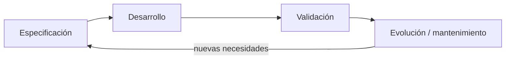
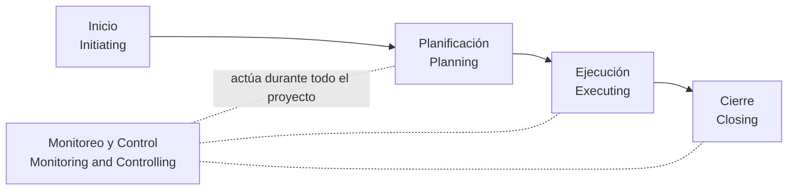
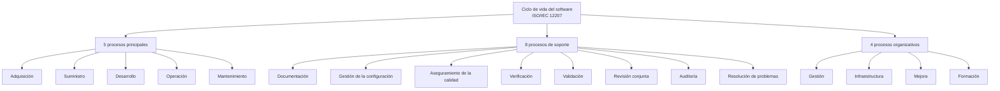
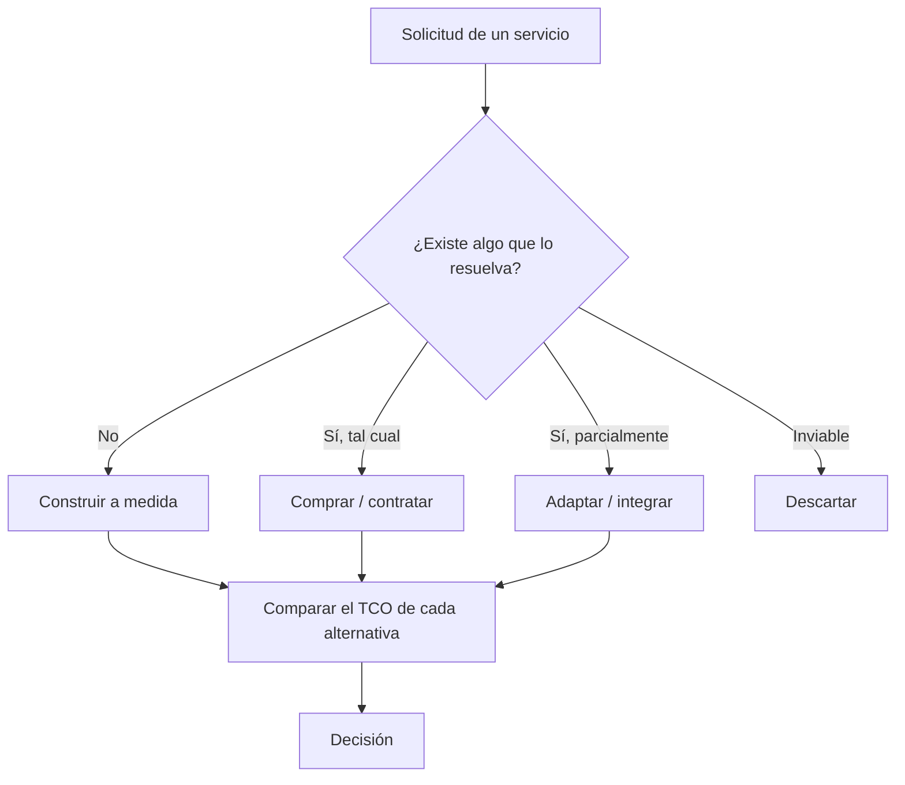

# Unidad 1 · Introducción a la Ingeniería del Software

**Asignatura:** Ingeniería del Software (INSD4_ISOF) · U-tad · Grado en Ingeniería del Software y Matemáticas

> **Convención de marcas.** El texto sin marca procede del material de la universidad (limpio de ruido del scraper y ampliado con explicaciones). Los bloques con **🆕** proceden de fuera del material: investigación, contenido que se perdió en el scraping y reconstruido, o ejemplos propios. Los avisos **⚠️** señalan discrepancias entre el material y las fuentes externas: para examinarte, usa el criterio del profesor; para trabajar, conoce ambos.

---

## Índice

- [1. El software: qué es y cómo es](#1-el-software-qué-es-y-cómo-es)
  - [1.1 Qué es el software](#11-qué-es-el-software)
  - [1.2 Características distintivas del software](#12-características-distintivas-del-software)
  - [1.3 Atributos de calidad (requisitos no funcionales)](#13-atributos-de-calidad-requisitos-no-funcionales)
  - [1.4 De "el hardware manda" a "el software se come el mundo"](#14-de-el-hardware-manda-a-el-software-se-come-el-mundo)
  - [1.5 Diversidad de sistemas](#15-diversidad-de-sistemas)
- [2. Ingeniería](#2-ingeniería)
- [3. Origen de la Ingeniería del Software y sus retos](#3-origen-de-la-ingeniería-del-software-y-sus-retos)
  - [3.1 Evolución: del hardware a la nube](#31-evolución-del-hardware-a-la-nube)
  - [3.2 Los retos que justifican la disciplina](#32-los-retos-que-justifican-la-disciplina)
  - [3.3 La conferencia de 1968](#33-la-conferencia-de-1968)
  - [3.4 Por qué siguen fracasando proyectos](#34-por-qué-siguen-fracasando-proyectos)
- [4. Definición y alcance](#4-definición-y-alcance)
  - [4.1 Definiciones relevantes](#41-definiciones-relevantes)
  - [4.2 Ingeniería del software frente a programación personal](#42-ingeniería-del-software-frente-a-programación-personal)
  - [4.3 La esencia: análisis y diseño](#43-la-esencia-análisis-y-diseño)
  - [4.4 Métodos predictivos frente a ágiles](#44-métodos-predictivos-frente-a-ágiles)
- [5. Teoría de Sistemas y actividades fundamentales](#5-teoría-de-sistemas-y-actividades-fundamentales)
  - [5.1 Principios heredados de la Teoría de Sistemas](#51-principios-heredados-de-la-teoría-de-sistemas)
  - [5.2 Pasos para analizar una aplicación software](#52-pasos-para-analizar-una-aplicación-software)
  - [5.3 Las cuatro actividades fundamentales del proceso](#53-las-cuatro-actividades-fundamentales-del-proceso)
- [6. Campo de acción: procesos del ciclo de vida](#6-campo-de-acción-procesos-del-ciclo-de-vida)
  - [6.1 Qué es un proceso de software](#61-qué-es-un-proceso-de-software)
  - [6.2 Actividades según el PMI](#62-actividades-según-el-pmi)
  - [6.3 ISO/IEC 12207: procesos del ciclo de vida](#63-isoiec-12207-procesos-del-ciclo-de-vida)
  - [6.4 Actividades del proceso de Desarrollo](#64-actividades-del-proceso-de-desarrollo)
  - [6.5 PMI frente a ISO/IEC 12207](#65-pmi-frente-a-isoiec-12207)
- [7. Industrialización del software](#7-industrialización-del-software)
  - [7.1 Qué es y por qué importa](#71-qué-es-y-por-qué-importa)
  - [7.2 Más allá de los requisitos del usuario final](#72-más-allá-de-los-requisitos-del-usuario-final)
  - [7.3 En qué se basa](#73-en-qué-se-basa)
  - [7.4 Qué debe hacer una organización](#74-qué-debe-hacer-una-organización)
  - [7.5 Implicaciones](#75-implicaciones)
  - [7.6 Industrial frente a académico](#76-industrial-frente-a-académico)
- [8. Ingeniería y programación](#8-ingeniería-y-programación)
- [9. Total Cost of Ownership (TCO)](#9-total-cost-of-ownership-tco)
  - [9.1 Por qué el TCO: decidir comprar, adaptar o construir](#91-por-qué-el-tco-decidir-comprar-adaptar-o-construir)
  - [9.2 Definición](#92-definición)
  - [9.3 Componentes del TCO y el iceberg](#93-componentes-del-tco-y-el-iceberg)
  - [9.4 Cómo se calcula](#94-cómo-se-calcula)
  - [9.5 Ejemplo resuelto 🆕](#95-ejemplo-resuelto-)
  - [9.6 Errores típicos al aplicar el TCO](#96-errores-típicos-al-aplicar-el-tco)
- [10. Tipología de aplicaciones](#10-tipología-de-aplicaciones)
  - [10.1 Clasificación por función](#101-clasificación-por-función)
  - [10.2 Clasificación por modelo de creación y provisión](#102-clasificación-por-modelo-de-creación-y-provisión)
- [11. Integración de sistemas](#11-integración-de-sistemas)
  - [11.1 Qué es y por qué es inevitable](#111-qué-es-y-por-qué-es-inevitable)
  - [11.2 Ventajas e inconvenientes](#112-ventajas-e-inconvenientes)
  - [11.3 ¿Cuándo integrar?](#113-cuándo-integrar)
  - [11.4 Motivos de integración](#114-motivos-de-integración)
  - [11.5 Problemas y soluciones](#115-problemas-y-soluciones)
- [12. SaaS](#12-saas)
  - [12.1 Definición y contexto](#121-definición-y-contexto)
  - [12.2 SaaS, ASP y software bajo demanda](#122-saas-asp-y-software-bajo-demanda)
  - [12.3 SaaS dentro del TCO](#123-saas-dentro-del-tco)
- [13. Conclusiones](#13-conclusiones)
- [14. Ejercicios](#14-ejercicios)
- [15. Glosario](#15-glosario)
- [16. Fuentes](#16-fuentes)
- [17. Apéndice: discrepancias y erratas](#17-apéndice-discrepancias-y-erratas)

---

## 1. El software: qué es y cómo es

### 1.1 Qué es el software

**Definición.** El software es mucho más que "código". Según el material, se compone de cuatro cosas:

| Componente | Qué es | Ejemplo (tienda online) |
|---|---|---|
| **Instrucciones** (programas) | Código que, al ejecutarse, da la función y el rendimiento deseados | El backend que procesa pedidos |
| **Estructuras de datos** | Lo que permite a los programas manipular la información | Tablas de clientes, productos, pedidos |
| **Documentos** | Describen la construcción y el uso: requisitos, diseños, manuales | Especificación de requisitos, diagrama de arquitectura, manual de operación |
| **Configuraciones y parametrizaciones** | Hacen que todo funcione en equipos físicos o virtuales | Variables de entorno, ficheros de despliegue, parámetros de la pasarela de pago |

**Intuición.** Si te llevas solo el código a otro equipo y falta lo demás, no tienes el producto: tienes una pieza.

> ⚠️ **Error típico:** responder "software = programas" en un examen. La definición completa incluye datos, documentación y configuración.

### 1.2 Características distintivas del software

Según Pressman (recogido en el material), el software tiene rasgos que lo distinguen de cualquier producto físico:

1. **Se desarrolla o modifica con el intelecto; no se fabrica en el sentido clásico.** Producir software se parece más a *diseñar* que a *manufacturar*. El coste está en pensar, no en repetir.
2. **No se estropea, pero se degrada.** Es intangible: no tiene desgaste, fatiga ni caducidad física. Sin embargo, con el tiempo y los cambios su calidad interna empeora.
3. **Se hace mucho "a medida".** La industria física tiende a ensamblar componentes estandarizados; en software, todavía en un gran porcentaje, cada sistema es único.
4. **El coste de réplica es prácticamente nulo.** Casi todo el coste está en el desarrollo. Copiar el programa cuesta casi nada.

> 🧪 **Ejemplo (coste de réplica):** desarrollar un videojuego puede costar millones; fabricar la copia número un millón cuesta céntimos. En un coche ocurre lo contrario: cada unidad cuesta materiales y mano de obra.

**La cita de Augustine** (recogida en el material): el software es como la entropía; difícil de asir, no pesa y obedece la segunda ley de la termodinámica: siempre aumenta. Es una forma ingeniosa de decir que los sistemas crecen en complejidad si nadie lo evita.

> 🆕 **🔎 Más allá: la curva de fallos de Pressman.** Un componente de hardware tiene una curva de fallos "en bañera": muchos fallos al principio (mortalidad infantil), pocos en la vida útil y muchos al final por desgaste. El software no tiene ese tramo final por desgaste. La curva *idealizada* se queda plana, pero la *real* tiene un pico tras cada cambio (cada modificación introduce defectos nuevos) y el "suelo" va subiendo: eso es la **degradación**. *(Diagrama clásico de Pressman, citado de memoria.)*
>
> ```
> Fallos
>   ^
>   |  hardware           software idealizado      software real
>   | \                    \                       \  /\  /\  /\
>   |  \____          ___  _\____________           \/  \/  \/   (el suelo sube)
>   |       \_____/‾‾‾                               
>   +--------------------------------------> tiempo
> ```

> 📌 **Recordar:** *no se desgasta* ≠ *no envejece*. Degradación (por cambios mal hechos y entorno que evoluciona) sí existe.

### 1.3 Atributos de calidad (requisitos no funcionales)

Para ser bueno, el software no basta con que "funcione": debe ser **mantenible, confiable, seguro, eficiente y aceptable para los usuarios**. Estas cualidades afectan no solo al comportamiento en ejecución, sino a la estructura interna, la documentación y la facilidad de uso. Se llaman **atributos de calidad** o **requisitos no funcionales** (*non-functional requirements, NFR*), y se estudiarán más adelante en el curso.

| Atributo | Definición (material) | Ejemplo concreto |
|---|---|---|
| **Confiabilidad** (*reliability*) | Correcto funcionamiento según los requisitos *y* las necesidades de los clientes (no tienen por qué coincidir) | Una transferencia bancaria cumple la especificación ("llega en 24 h") pero el cliente necesitaba inmediatez: es correcta pero no satisfactoria |
| **Mantenibilidad** (*maintainability*) | Capacidad de adaptarse a requisitos futuros | Cambia un tipo de IVA: si está en un parámetro, se cambia en minutos; si está escrito a mano en 200 sitios, es un proyecto |
| **Eficiencia** (*efficiency*) | Consumo proporcional de recursos | Una búsqueda que recorre toda la tabla en lugar de usar un índice gasta CPU y tiempo sin necesidad |
| **Usabilidad** (*usability*) | Elementos adecuados y documentados de comunicación con los usuarios (interfaz) | Un formulario con mensajes de error claros |
| Otros | Seguridad, cumplimiento (*compliance*), escalabilidad, accesibilidad, operatividad… | Ver abajo |

> 🧪 **Ejemplo (el atributo depende del dominio):** un sistema bancario debe ser sobre todo **seguro**; un videojuego debe ser muy **interactivo y receptivo**; un control embebido en un dispositivo médico prioriza la **confiabilidad**.

> ⚠️ **Error típico:** confundir *confiabilidad* con *"cumple la especificación"*. El material insiste en que lo que pide el cliente y lo que necesita pueden ser distintos.

### 1.4 De "el hardware manda" a "el software se come el mundo"

En los comienzos de la computación el protagonismo (y la inversión) era del hardware, caro y sofisticado. Con el tiempo se invirtió: hoy el software es lo más relevante y el hardware es prácticamente una **commodity** estandarizada. Además, el software es un recurso clave para la industria, los gobiernos y la sociedad.

El vídeo del material parte de la frase "El software se está comiendo el mundo" (*software is eating the world*). *(El vídeo no se extrajo; la frase se atribuye comúnmente a Marc Andreessen, 2011; dato de memoria, sin verificar en esta sesión.)*

### 1.5 Diversidad de sistemas

No todos los sistemas son iguales ni piden los mismos métodos. Un sistema de control embebido en un dispositivo médico tiene requisitos muy distintos de los de un videojuego o una aplicación web. Por eso **no existe una única metodología de Ingeniería del Software universal**: hay que adaptar métodos, herramientas y técnicas a cada proyecto.

| Tipo de sistema | Lo que más pesa | Consecuencia metodológica |
|---|---|---|
| Control médico embebido | Seguridad y confiabilidad | Verificación rigurosa, documentación exhaustiva |
| Aplicación web de negocio | Cambio rápido, usabilidad | Iteraciones cortas, despliegue frecuente |
| Videojuego | Rendimiento e interactividad | Prototipado, pruebas de jugabilidad |

---

## 2. Ingeniería

**Etimología.** *Ingeniería* viene de *ingenio*: la "facultad del ser humano para discurrir o inventar con prontitud y facilidad", o la "industria, maña y artificio" para conseguir lo que se desea. Tradicionalmente "ingenio" también designaba máquinas o *artificios mecánicos*.

**Definición formal** (material): *conjunto de conocimientos orientados a la invención y utilización de técnicas para el aprovechamiento de los recursos naturales o para la actividad industrial.*

**Idea central:** es el uso de **principios científicos** para diseñar y construir máquinas, estructuras y otros elementos artificiales (puentes, túneles, caminos, vehículos, edificios, sistemas y procesos), aprovechando el conocimiento tecnológico para innovar, inventar, desarrollar y mejorar técnicas y herramientas que resuelvan necesidades y problemas técnicos de personas y sociedad.

> 💡 **Intuición:** un ingeniero no "hace cosas que funcionan por casualidad": aplica conocimiento científico para obtener resultados **predecibles** frente a unas restricciones (coste, tiempo, seguridad). La Ingeniería del Software traslada esa actitud al software.

> 🧪 **Ejemplo (misma actitud en dos campos):** un ingeniero civil calcula cargas antes de construir un puente; un ingeniero del software estima carga y rendimiento antes de desplegar un sistema.

---

## 3. Origen de la Ingeniería del Software y sus retos

### 3.1 Evolución: del hardware a la nube

La Ingeniería del Software se ha desarrollado rápido y **sin mucho orden**, al mismo ritmo que la propia industria informática. Hoy conviven empresas que desarrollan *ad hoc*, sin metodología, con otras que aplican métodos complejos y efectivos con rigor.

El software se mueve en un perpetuo cambio por dos frentes:

- **Evolución tecnológica:** ordenadores a medida → *mainframes* → microcomputadores → PC → Internet → servidores → móviles → IoT → computación distribuida → *cloud*.
- **Necesidad de adaptación:** cambios de contexto, requisitos y necesidades del cliente, a veces con capacidad de reacción medida en **horas**.

**Décadas de 1940 a 1960.** La atención y la inversión estaban en el hardware. Los programas eran independientes y de propósito único, hechos a medida de ordenadores que a veces también eran a medida. La aplicación principal era el cálculo, casi sin interacción con el usuario: los creaban especialistas para especialistas, sobre sistemas aislados, sin dependencias ni conexiones.

### 3.2 Los retos que justifican la disciplina

Al difundirse los ordenadores y crecer la escala de los sistemas y los proyectos aparecieron problemas. Son a la vez los **principales retos** de la Ingeniería del Software y la **justificación de su existencia**:

| Reto | Cómo se manifiesta |
|---|---|
| **Plazos** | Los proyectos tienden a tardar más de lo previsto |
| **Costes** | Suelen exceder lo estimado |
| **Calidad** | El producto final presenta fallos y *bugs* |
| **Adecuación** | El resultado no siempre se parece a lo esperado; a veces, aunque se ajuste a lo pedido, no resuelve el problema para el que se diseñó |
| **Mantenimiento** | Es mucho más costoso (tiempo y esfuerzo) de lo previsto |
| **Medición** | Es muy complicado medir el progreso y los resultados del desarrollo |

> 🧪 **Ejemplo (adecuación):** un cliente pide "un informe en Excel con las ventas mensuales". Se entrega exactamente eso, pero lo que necesitaba era detectar a tiempo caídas de ventas por región. Cumple lo pedido y no resuelve el problema.

### 3.3 La conferencia de 1968

Todo ello llevó a convocar en **1968** la conferencia de la Ingeniería del Software, punto de partida de la disciplina.

> 🆕 **Datos de contraste.** La conferencia, patrocinada por el *NATO Science Committee*, se celebró en **Garmisch (Alemania) del 7 al 11 de octubre de 1968**, con más de cincuenta asistentes de once países, entre usuarios, fabricantes y docentes. El término *software engineering* fue elegido como título de la conferencia y se asocia a **Friedrich L. Bauer**. Hubo una segunda conferencia en Roma en 1969.
>
> 🔎 **Más allá (matiz histórico).** Varios historiadores advierten de que la narrativa "crisis del software → nace la ingeniería del software" es una simplificación: el diagnóstico de la "crisis" se presentó junto con una receta para resolverla, y las ideas asociadas a la disciplina ya circulaban antes. Para el examen basta la versión del profesor; para tu cultura general, ten el matiz presente.

**Objetivo de la Ingeniería del Software:** definir la forma de trabajar **más eficiente posible** y crear **metodologías abstractas** que permitan a los equipos adaptarse a los cambios tecnológicos y de contexto constantes.

### 3.4 Por qué siguen fracasando proyectos

Pese a los avances, aún se reportan muchos fracasos. El material los atribuye a dos factores:

1. **Exigencias crecientes** de mercado y usuarios: sistemas más complejos, rápidos y funcionales, que superan las capacidades de las técnicas tradicionales.
2. **Desarrollo sin principios de ingeniería:** muchas organizaciones producen software caro, poco confiable y difícil de mantener.

**Solución propuesta:** mejor **educación y formación profesional** en Ingeniería del Software y mayor concienciación sobre la importancia de aplicar buenas prácticas **desde el inicio**.

> ⚠️ **Error típico:** pensar que la "crisis del software" se resolvió. Los dos factores anteriores siguen vigentes.

---

## 4. Definición y alcance

### 4.1 Definiciones relevantes

No hay una definición única; casi cada autor tiene la suya. Las que recoge el material:

| Fuente | Definición (resumida) | Palabras clave |
|---|---|---|
| **Bauer, 1972** (de la conferencia de 1968) | Establecimiento de los principios y métodos de la ingeniería para obtener software de modo **rentable**, **fiable** y que trabaje en **máquinas reales** | Rentable, fiable, máquinas reales |
| **Boehm, 1976** | Aplicación práctica del conocimiento científico al diseño y la construcción de programas y a la documentación asociada necesaria para desarrollar, operar y mantenerlos | Conocimiento científico, documentación, ciclo completo |
| **IEEE (610.12)** | Aplicación de un enfoque **sistemático, disciplinado y cuantificable** al desarrollo, operación y mantenimiento del software | Sistemático, disciplinado, cuantificable |
| **Navarro (UCM)** | Aplicar el **sentido común** al desarrollo de sistemas software | Planificar antes de empezar, diseñar antes de programar, aprender de lo que funcionó y lo que no, experimentar cuando hay duda, preguntar |

> 🆕 **Contraste con la fuente.** La definición IEEE aparece en el glosario *IEEE Std 610.12-1990*, y tiene dos acepciones: (1) la aplicación de ese enfoque sistemático, disciplinado y cuantificable, "es decir, la aplicación de la ingeniería al software"; (2) el estudio de dichos enfoques. La cita en inglés de Bauer (1972) habla de principios de ingeniería sólidos para obtener, de forma económica, software fiable que funciona de manera eficiente en máquinas reales.
>
> ⚠️ El material cita "IEEE 610-12, 1993": la referencia correcta es **IEEE Std 610.12-1990**. Y "Bohem" es **Boehm**. Detalle en el [apéndice](#17-apéndice-discrepancias-y-erratas).

**Desglose de la definición IEEE** (🆕 explicación propia):

| Palabra | Significa | Ejemplo de lo contrario |
|---|---|---|
| **Sistemático** | Se sigue un proceso definido y repetible | "Cada uno programa como quiere" |
| **Disciplinado** | Se respeta el proceso, también cuando hay prisa | Saltarse las revisiones porque "no hay tiempo" |
| **Cuantificable** | Se mide (esfuerzo, defectos, cobertura de pruebas, velocidad) | "Creo que vamos bien" sin datos |

> 💡 **Intuición:** las cuatro definiciones dicen lo mismo con distinto énfasis: aplicar ingeniería (método y medida) a todo el ciclo de vida del software, no solo a escribirlo.

### 4.2 Ingeniería del software frente a programación personal

En resumen, la Ingeniería del Software es una disciplina de ingeniería que se ocupa de **todos los aspectos de la producción de software**, desde la especificación inicial hasta el mantenimiento posterior a la implantación.

| | Programación personal | Ingeniería del software |
|---|---|---|
| Formalidad | Puede ser informal | Procesos sistemáticos |
| Foco | Un solo individuo | Equipo |
| Soporte | Poco o ninguno | Planificación y documentación |
| Quién usa/modifica el resultado | Normalmente el autor | **Otras personas distintas del autor original** |

La última fila es la clave: el software profesional lo usan y modifican personas distintas de quien lo escribió, lo que exige un enfoque más riguroso.

### 4.3 La esencia: análisis y diseño

Aunque aprender Ingeniería del Software es útil para el trabajo técnico, la tarea principal de un ingeniero del software es la misma que la de un ingeniero en otra industria o la de un arquitecto: **analizar y diseñar**; tomar necesidades y requisitos y **especificar un sistema capaz de resolver el problema**.

El resto es una parte **contingente**: un mismo diseño puede implementarse en distintos lenguajes y ejecutarse en una máquina o en un sistema distribuido.

> 🧪 **Ejemplo:** el diseño de un sistema de reservas (entidades, reglas de disponibilidad, flujos) es igual si se implementa en Java o en Python, en un servidor o en la nube. Lo que cambia es la implementación.

> 🆕 **🔎 Más allá.** Esta idea se parece a la distinción de Fred Brooks (1986, *No Silver Bullet*, citado de memoria) entre complejidad **esencial** (inherente al problema) y **accidental** (de las herramientas y la implementación).

### 4.4 Métodos predictivos frente a ágiles

Según el material:

- La Ingeniería del Software **tradicional** y con ella los métodos **predictivos, lineales o en cascada** se centran más en análisis y diseño (la esencia).
- Las **metodologías ágiles**, herederas de *Extreme Programming* (XP), se centran más en el **proceso de desarrollo** en sí.

> ⚠️ **Error típico:** concluir que en ágil "no se diseña". Es una simplificación didáctica de contraste de énfasis; las metodologías ágiles también diseñan, pero de forma incremental. Se verá en profundidad al final de la asignatura.

---

## 5. Teoría de Sistemas y actividades fundamentales

### 5.1 Principios heredados de la Teoría de Sistemas

La Ingeniería del Software hereda en parte estos principios:

| Principio | Ejemplo en software |
|---|---|
| **Cuanto más especializado es un sistema, menos capaz de adaptarse a circunstancias distintas** | Una macro de Excel hecha para un departamento no sirve para otro; un ERP configurable sí, pero a cambio de más complejidad |
| **Cuanto mayor es el sistema, más recursos requiere su mantenimiento diario** | Un monolito con 2 millones de líneas necesita un equipo de operaciones, pruebas de regresión, etc. |
| **Los sistemas forman parte de sistemas mayores y siempre pueden dividirse en menores** | Un módulo de facturación pertenece al ERP, que pertenece al sistema de información de la empresa, que pertenece a la cadena de suministro |
| **Los sistemas crecen** | Cada versión añade funcionalidades; rara vez se eliminan |

> 🆕 **🔎 Más allá.** El último principio conecta con las "leyes de evolución del software" de Lehman (cambio continuo y complejidad creciente), citadas de memoria, sin verificar en esta sesión.

### 5.2 Pasos para analizar una aplicación software

1. **Definición del problema:** se identifican los elementos de insatisfacción, los posibles cambios en entradas y/o salidas del sistema y los objetivos del análisis.
2. **Comprensión y definición del sistema:** se identifica y descompone jerárquicamente en subsistemas y relaciones entre ellos.
3. **Elaboración de alternativas:** se estudian alternativas de modificación y mejora, atendiendo a costes y perspectivas de realización.
4. **Elección** de una de las alternativas.
5. **Puesta en práctica** de la solución elegida.
6. **Evaluación del impacto** de los cambios introducidos.

> 🧪 **Ejemplo resuelto (🆕, propio): sistema de préstamos de una biblioteca universitaria.**
>
> | Paso | Aplicación |
> |---|---|
> | 1. Problema | Los alumnos esperan colas para sacar libros; el recuento de ejemplares se desajusta; objetivo: reducir el tiempo medio de préstamo y los errores de inventario |
> | 2. Sistema | Subsistemas: catálogo, usuarios, préstamos, devoluciones, multas; relaciones: un préstamo une usuario y ejemplar |
> | 3. Alternativas | (a) desarrollo a medida; (b) paquete comercial de gestión bibliotecaria; (c) sistema open source adaptado |
> | 4. Elección | Se compara el TCO a 5 años de cada una (ver [§9](#9-total-cost-of-ownership-tco)) y se elige una |
> | 5. Puesta en práctica | Migrar el catálogo, formar al personal, desplegar |
> | 6. Evaluación | Medir tiempo medio de préstamo y errores de inventario antes y después |

> 💡 **Intuición:** los pasos 3 y 4 son exactamente donde entra el TCO: comparar alternativas por su coste completo, no solo por el precio inicial.

### 5.3 Las cuatro actividades fundamentales del proceso

Sea cual sea el modelo o método, estas cuatro actividades están siempre presentes:

| Actividad | Qué es | Pregunta que responde |
|---|---|---|
| **Especificación** (*specification*) | Definir qué debe hacer el software y bajo qué condiciones: funcionalidad, características y restricciones | ¿Qué hay que construir? |
| **Desarrollo** (*development*) | Diseño y programación: construir el software para que cumpla la especificación | ¿Cómo se construye? |
| **Validación** (*validation*) | Verificar que cumple los requisitos y que se ajusta a lo que espera el cliente (no necesariamente lo que pide) | ¿Es lo correcto? |
| **Evolución / mantenimiento** (*evolution*) | Modificar el software para adaptarlo a nuevas necesidades o corregir errores; asegurar que sigue funcionando ante cambios del entorno y del cliente | ¿Sigue siendo útil? |



Además de otras actividades adicionales: análisis, diseño, planificación, gestión, operación, medida, despliegue… Se organizan de distintas formas según el tipo de sistema, lo que da lugar a distintos **modelos de proceso** de software.

> 🆕 **🔎 Más allá.** Estas cuatro actividades coinciden con la clasificación que Ian Sommerville usa en su manual de Ingeniería del Software (citado de memoria). La distinción clásica de Boehm entre **verificación** ("¿construimos bien el producto?") y **validación** ("¿construimos el producto correcto?") ayuda a entender por qué la validación no es solo comprobar la especificación.

> ⚠️ **Error típico:** creer que "evolución/mantenimiento" es solo arreglar errores. También incluye adaptar a nuevas necesidades y cambios del entorno.

---

## 6. Campo de acción: procesos del ciclo de vida

### 6.1 Qué es un proceso de software

Una forma de entender el alcance de la disciplina es ver qué procesos abarca en el **ciclo de vida**: desde la concepción hasta el cese de operación y uso.

**Proceso de software:** conjunto de actividades relacionadas que conducen a la producción de un producto de software. Pueden implicar desarrollo desde cero con lenguajes como Java o C, pero hoy, especialmente en aplicaciones empresariales, es común desarrollar **modificando sistemas existentes** o **integrando componentes comerciales** ya disponibles.

Para llevar a cabo el enfoque "sistemático, disciplinado y cuantificable", hay varios modelos que recogen colecciones de actividades. El material menciona dos: **el de PMI** (muy habitual en la industria) y **el de ISO/IEC 12207**.

### 6.2 Actividades según el PMI

**Qué es el PMI.** *Project Management Institute*: organización internacional fundada en **1969** para promover buenas prácticas en gestión de proyectos, con presencia global mediante capítulos locales. Es reconocido por:

- Desarrollar estándares, especialmente la **Guía del PMBOK®** (*Project Management Body of Knowledge*).
- Ofrecer certificaciones, la más conocida la **PMP** (*Project Management Professional*).
- Fomentar la investigación y la formación, y dar soporte a una comunidad global.

**Certificación PMP.** Acredita conocimientos, habilidades y experiencia para liderar y dirigir proyectos. Tiene reconocimiento internacional, se basa en el PMBOK y exige experiencia profesional previa, formación específica y un examen riguroso. Se enfoca en **tres dominios**: **Personas** (liderazgo), **Procesos** (gestión técnica) y **Entorno empresarial** (estrategia y valor).

**Las 10 áreas de conocimiento** (según el material) agrupan procesos por aspecto de gestión:

| # | Área (ES) | Área (EN) | Pregunta típica en un proyecto software |
|---|---|---|---|
| 1 | Integración | Integration | ¿Cómo se coordinan todas las piezas y los cambios? |
| 2 | Alcance | Scope | ¿Qué entra y qué no entra en el producto? |
| 3 | Cronograma | Schedule | ¿Cuándo se entrega cada hito? |
| 4 | Costes | Cost | ¿Cuánto cuesta y cómo se controla? |
| 5 | Calidad | Quality | ¿Cómo sabemos que cumple lo acordado? |
| 6 | Recursos | Resources | ¿Quién trabaja y con qué medios? |
| 7 | Comunicaciones | Communications | ¿Quién informa a quién y cuándo? |
| 8 | Riesgos | Risk | ¿Qué puede salir mal y qué hacemos? |
| 9 | Adquisiciones | Procurement | ¿Qué se compra o subcontrata? |
| 10 | Interesados | Stakeholders | ¿Quién se ve afectado o influye? |

**Los 5 grupos de procesos** representan las fases del ciclo de vida del proyecto. Cada grupo contiene procesos de distintas áreas:



| Grupo | Ejemplo en un proyecto software (🆕) |
|---|---|
| **Inicio** | Justificar el proyecto, identificar interesados, nombrar al director del proyecto |
| **Planificación** | Definir alcance, estimar esfuerzo, planificar riesgos y calendario |
| **Ejecución** | Desarrollar, probar, coordinar el equipo |
| **Monitoreo y control** | Comparar avance real y plan, gestionar cambios, medir calidad |
| **Cierre** | Aceptación del cliente, lecciones aprendidas, traspaso a operación |

Cualquier proyecto software gestionado desde la Ingeniería del Software pasa por etapas similares, de forma **secuencial o iterativa**. El PMI fue considerado durante mucho tiempo el estándar de gestión *predictiva* o *waterfall*, pero se ha vuelto una institución **agnóstica** que aplica igualmente principios de marcos **ágiles**.

> ⚠️ **Discrepancia 1 (edición del PMBOK).** La estructura de "10 áreas de conocimiento + 5 grupos de procesos" es la de la **6.ª edición del PMBOK** (49 procesos). La **7.ª edición (agosto de 2021)** la sustituyó por un enfoque basado en **12 principios y 8 dominios de desempeño**, y según una fuente secundaria la **8.ª edición (2025)** pasa a 6 principios, 7 dominios, 40 procesos y 5 "áreas de enfoque". Aun así, el contenido de la 6.ª sigue citándose en formación y en la práctica. **Para el examen: usa las 10 áreas y los 5 grupos**, que es lo que enseña el profesor.
>
> ⚠️ **Matiz terminológico.** Las "áreas de conocimiento" las define la **Guía del PMBOK**, no la certificación PMP (que es un examen/credencial). El material mezcla ambos nombres.

> 🆕 **Los 8 dominios de la 7.ª edición**, según la fuente consultada: equipo, interesados, ciclo de vida, planificación, incertidumbre y ambigüedad, entrega, desempeño y trabajo del proyecto.

### 6.3 ISO/IEC 12207: procesos del ciclo de vida

**Qué es.** Estándar de la ISO (*International Organization for Standardization*) sobre el ciclo de vida del software (*software life-cycle processes*). El material lo cita como ISO/IEC 12207-2008 y lo define como un marco de referencia que contiene los **procesos, actividades y tareas** implicados en el desarrollo, explotación y mantenimiento de un producto software, abarcando la vida del sistema desde la definición de requisitos hasta que se deja de utilizar.

**Estructura según el material:** **17 procesos**, repartidos en **5 principales, 8 de soporte y 4 de organización (generales)**. Cada proceso se divide en actividades y tareas.

> ⚠️ **Discrepancia 2 (edición de la norma).** La estructura 5 + 8 + 4 es la de la **edición original de 1995** de ISO/IEC 12207 (con sus enmiendas de 2002 y 2004). La edición de **2008** reorganizó la norma alineándola con la ISO/IEC 15288 y hoy está **anulada** (ISO la lista como "revisada por" la edición de 2017). **ISO/IEC/IEEE 12207:2017** organiza los procesos en **cuatro grupos distintos**: acuerdo, habilitación del proyecto a nivel de organización, gestión técnica y técnicos. Una fuente secundaria (Wikipedia) menciona una edición posterior de **2026**; no he podido confirmarla en ISO. Un artículo académico de 2017 sigue repitiendo los "17 procesos" con una variante regional de 2013, así que la cifra circula con la etiqueta "2008". **Para el examen: 17 = 5 + 8 + 4.**

> 🆕 **Reconstrucción del contenido perdido.** En el material, las listas de procesos (principales, soporte, generales) eran contenido interactivo que no se extrajo. Se reconstruyen a continuación con la estructura de la edición de 1995. Las listas de principales y organizativos están corroboradas por apuntes universitarios; la de soporte la aporto de conocimiento propio de esa edición (*confianza alta, pero no he podido contrastarla línea a línea*).



| Categoría | Nº | Procesos 🆕 | Papel |
|---|---|---|---|
| **Principales** (*primary*) | 5 | Adquisición, Suministro, Desarrollo, Operación, Mantenimiento | Los lleva a cabo el que adquiere, suministra, desarrolla, opera o mantiene el software |
| **Soporte** (*supporting*) | 8 | Documentación, Gestión de la configuración, Aseguramiento de la calidad, Verificación, Validación, Revisión conjunta, Auditoría, Resolución de problemas | Apoyan a los principales y aseguran la calidad y consistencia del producto y del proyecto; actúan como "subrutinas" de otros procesos |
| **Organizativos / generales** | 4 | Gestión, Infraestructura, Mejora, Formación | Transversales a los anteriores y comunes a toda actividad de una organización; establecen el marco organizativo para implantar y mejorar los procesos |

> 🆕 Existe además un proceso especial, **adaptación (*tailoring*)**, para ajustar el estándar a un proyecto concreto.

**Qué hace el profesional.** Muchas decisiones del ingeniero del software tienen que ver con **comprar, usar en distintas modalidades, integrar o construir desde cero** los componentes (aplicaciones, sistemas, programas, plataformas, librerías, entornos) que resuelven el problema del cliente. El **cliente** puede ser alguien de la propia organización (a quien se da servicio desde IT o Sistemas) o personas/organizaciones externas.

**Salidas profesionales más habituales:**

1. Departamento que da servicio **interno** en una organización.
2. Área de **producción** que genera producto nuevo del que se derivan ingresos.
3. Empresas que dan soporte a terceros en esas dos tareas, especialmente la primera (típico de las **consultoras**).

> 💡 **Intuición:** los procesos de *adquisición* y *suministro* son los dos lados de un contrato: el cliente que compra y el proveedor que vende. Lo que el material llama "comprar o construir" es el proceso de adquisición.

Los procesos de soporte y organizativos son igualmente necesarios, pero no están centrados en el software: pueden darse en otros contextos y disciplinas.

### 6.4 Actividades del proceso de Desarrollo

De todos los procesos, el curso solo detalla las actividades del de **Desarrollo** (uno de los principales):

| # | Actividad | Qué produce (🆕 ejemplo en una tienda online) |
|---|---|---|
| 1 | Análisis de requisitos del **sistema** | Qué debe hacer el sistema completo (web + pagos + logística) |
| 2 | Análisis de requisitos del **software** | Requisitos del software: catálogo, carrito, pedidos |
| 3 | Diseño de la **arquitectura** del software | Estructura general: capas, componentes, comunicación |
| 4 | **Diseño detallado** del software | Diseño interno de cada componente (clases, interfaces, tablas) |
| 5 | **Construcción** (codificación) | El código |
| 6 | **Integración** del software | Unir componentes y comprobar que encajan |
| 7 | **Pruebas** del software | Verificar el software frente a su especificación |
| 8 | **Instalación** del software | Despliegue en el entorno de destino |
| 9 | **Aceptación** del software | El cliente da por bueno el producto |

> 🆕 **🔎 Más allá.** Las actividades 1-4 (qué y cómo) se corresponden con tipos de prueba posteriores (6-9): esa es la intuición del "modelo en V", en el que cada nivel de especificación tiene su nivel de verificación. Se verá con los modelos de ciclo de vida.

Este enfoque estructurado permite gestionar el desarrollo de forma sistemática, disciplinada y cuantificable.

### 6.5 PMI frente a ISO/IEC 12207

| | PMI | ISO/IEC 12207 |
|---|---|---|
| **Qué describe** | Cómo **gestionar un proyecto** (cualquier proyecto, no solo software) | Qué **procesos** componen el **ciclo de vida del software** |
| **Organización** | Áreas de conocimiento y grupos de procesos (6.ª ed.) | Procesos principales, de soporte y organizativos (ed. 1995 en el material) |
| **Perspectiva** | Dirección de proyectos | Ingeniería del producto software |
| **Relación** | Complementarios: uno gestiona el proyecto, el otro organiza el trabajo técnico del ciclo de vida | |

---

## 7. Industrialización del software

### 7.1 Qué es y por qué importa

Hasta ahora (con excepciones) tu experiencia académica está **muy lejos** de la experiencia profesional: el software de prácticas y ejercicios se desarrolló de forma individual o en equipos pequeños, sin procesos definidos, sin desplegarse en plataformas de explotación ni entregarse a usuarios finales.

**Industrialización del software:** enfoque que aplica principios, métodos y herramientas propios de la industria manufacturera al desarrollo de software para aumentar **eficiencia, calidad, escalabilidad y previsibilidad**. Supone un cambio de paradigma respecto a la programación artesanal o individual, con profundas implicaciones técnicas y organizativas.

### 7.2 Más allá de los requisitos del usuario final

Cualquier software que vaya a usarse requiere **continuidad, estabilidad y fiabilidad** en la operación. Hay que añadir a los requisitos de los usuarios los de **Explotación, Operaciones o Sistemas**, para que el software funcione con garantías en los equipos de destino. El software acaba en máquinas reales y en manos de personas que se encargan de que funcione y esté disponible. Eso exige:

| Requisito de operación | Qué implica | Ejemplo |
|---|---|---|
| **Documentación adecuada** | Manuales de operación | Cómo arrancar, parar y desplegar |
| **Recuperación** | Procedimientos ante caída o malfuncionamiento | Plan de restauración tras fallo del servidor |
| **Facilidad de operación y continuidad** | Backups, logs | Copia diaria de la base de datos |
| **Plataforma elegida** | SO, lenguajes, bases de datos | Compatible con la plataforma que ya tiene la empresa |
| **Indicadores y alarmas** | Monitorización del estado | Alerta si el tiempo de respuesta supera un umbral |

### 7.3 En qué se basa

La industrialización sistematiza y estandariza el proceso con metodologías, herramientas automáticas y procesos repetibles:

- **Automatización** de tareas repetitivas (compilación, pruebas, despliegue).
- **Frameworks y plataformas** que permiten reutilizar componentes.
- **Integración continua y entrega continua** (*CI/CD*) para acelerar ciclos.
- **Control de calidad sistemático**: pruebas automatizadas y métricas.
- **Gestión de la configuración y versiones** para mantener trazabilidad.
- **Documentación estructurada** y procesos de revisión formal.
- **Trabajo colaborativo y roles especializados** (analistas, testers, DevOps…).


El resultado es que el desarrollo se parece más a una **línea de producción**: productos construidos de forma predecible, escalable y con estándares de calidad definidos.

### 7.4 Qué debe hacer una organización

1. Adoptar **metodologías formales**: Scrum, Kanban, DevOps o cascada adaptada.
2. Implementar **herramientas de automatización**: integración continua, pruebas y despliegue automáticos.
3. **Estandarizar procesos**: plantillas, convenciones de codificación, políticas de revisión y control de cambios.
4. Formar **equipos multidisciplinares** con roles y colaboración definidos.
5. **Medir y mejorar** continuamente: cobertura de pruebas, velocidad de desarrollo, defectos por entrega, etc.

### 7.5 Implicaciones

| Positivas | Negativas |
|---|---|
| Mayor calidad y fiabilidad | **Dependencia de herramientas y procesos complejos**, que exigen inversión y formación |
| Menos errores humanos (automatización) | |
| Mejor gestión de tiempo y recursos | |
| Escalabilidad: equipos grandes coordinados | |
| Mayor alineación con objetivos de negocio | |

### 7.6 Industrial frente a académico

| Aspecto | Industrialización | Programación individual/académica |
|---|---|---|
| **Objetivo** | Entregar valor al cliente con calidad y eficiencia | Aprender, experimentar, cumplir con una tarea |
| **Escalabilidad** | Alta: equipos grandes, múltiples versiones | Baja: trabajo individual o grupos pequeños |
| **Automatización** | Extensa (CI/CD, pruebas, despliegue) | Mínima o inexistente |
| **Clientes reales** | Sí, con requisitos formales y contratos | No: el "cliente" suele ser el profesor |
| **Entorno de explotación** | Real: servidores, usuarios, mantenimiento | Simulado o inexistente |
| **Documentación y control** | Exhaustivos y obligatorios | Opcional o superficial |
| **Reutilización y estándares** | Alta: componentes y buenas prácticas | Baja: cada proyecto parte de cero |

Ambos enfoques son valiosos, pero responden a contextos y necesidades distintos: en el académico prima aprender y la creatividad individual; en el industrial, la eficiencia, la calidad y la sostenibilidad.

> 🧪 **Ejemplo (misma funcionalidad, dos mundos):** una API de reservas hecha para una práctica funciona en tu portátil. La misma API en producción necesita: pruebas automáticas, un pipeline de despliegue, logs, copias de seguridad, alertas, manual de operación y plan de recuperación.

> 🆕 **⚠️ Matiz con la sección 1.2.** El material dice a la vez que el software "no se manufactura" y que debe "industrializarse". No es contradicción: se industrializa el **proceso** (automatizar, medir, estandarizar), no la **creación** (que sigue siendo intelectual, más cercana al diseño). La analogía con la fábrica tiene límites.

> ⚠️ **Error típico:** equiparar industrialización con burocracia. Una buena industrialización *reduce* trabajo repetitivo (automatiza) y errores; la burocracia sin automatización sí es un coste.

---

## 8. Ingeniería y programación

La experiencia previa del alumnado puede ser de dos tipos: solo académica (retos de programación en forma de prácticas) o con experiencia laboral que ha mostrado que **programar no es la tarea fundamental** de un ingeniero del software. Es muy importante **separar ambos conceptos**, y se aprende rápido al contactar con el mundo laboral.

*(El material remite a un vídeo recomendado para quien no ha vivido aún la Ingeniería del Software fuera de la universidad; el vídeo no se extrajo.)*

> 🆕 **Contraste propio de las preguntas que se hacen.**
>
> | El programador pregunta… | El ingeniero del software pregunta… |
> |---|---|
> | ¿Cómo implemento esto? | ¿Qué problema resolvemos y para quién? |
> | ¿Funciona en mi máquina? | ¿Funcionará en producción, y quién lo operará? |
> | ¿Qué librería uso? | ¿Compramos, adaptamos o construimos? ¿Cuánto cuesta en 5 años? |
> | ¿Pasa mis pruebas? | ¿Cumple lo que el cliente necesita, no solo lo que pidió? |

> 💡 **Intuición:** la programación es una parte (importante) de la construcción; la ingeniería abarca decidir qué construir, cómo organizarlo, cuánto cuesta, cómo se opera y cómo evoluciona.

---

## 9. Total Cost of Ownership (TCO)

### 9.1 Por qué el TCO: decidir comprar, adaptar o construir

**Desarrollar software no es la principal solución a un problema, ni siquiera la más frecuente.** El profesional debe comprender las opciones disponibles porque no es lo mismo planificar un desarrollo a medida que instalar un paquete comercial, o gestionar el riesgo de un software propietario frente a uno open source. Además de lo tecnológico, debe considerar las cuestiones económicas inmediatas y a largo plazo.

El mundo informático cubre áreas muy distintas (infraestructura, software de plataforma, bases de datos, desarrollo a medida, paquetes…). Las estimaciones deben **consolidar** partes muy diferentes de proyectos y operaciones teniendo en cuenta lo singular de cada una.

Ante una solicitud de servicio atendida desde los Sistemas de Información hay que decidir: **comprar** algo externo, **adaptar** algo existente, **construir** algo nuevo (o **descartar** por inviable). Pesan la viabilidad técnica, el alineamiento estratégico y, de forma determinante, el **impacto económico**.



*(La figura "Una herramienta para estimar el esfuerzo de proyectos de desarrollo o mantenimiento (STIM)" del material no se extrajo; no he podido identificar esa herramienta, así que no la describo.)*

### 9.2 Definición

**Total Cost of Ownership (TCO) o Coste Total de Propiedad:** método de cálculo diseñado para ayudar a usuarios y gestores empresariales a determinar los **costes directos e indirectos, así como los beneficios**, relacionados con un producto o sistema. Se usa específicamente para la adquisición (desarrollo, integración, compra) de equipos o programas informáticos.

**El problema que resuelve.** Se suelen considerar solo algunos de los costes de implantar y operar un sistema, olvidando otros que están asociados a la inversión pero no son evidentes. La decisión se basa entonces en supuestos erróneos, y quizá se habría decidido otra cosa conociendo el alcance completo.

**Historia.** El análisis TCO fue popularizado por el **Grupo Gartner en 1987**, aunque sus raíces son anteriores (dato del material; no verificado externamente). En ingeniería del software sirve para cuantificar el impacto financiero de implementar un producto tecnológico considerando su **ciclo de vida completo**: software, hardware, formación, personal, etc.

**Definición de Gartner** (según el material): análisis exhaustivo del coste global de TI y otros costes de la organización a lo largo del tiempo. Incluye adquisición de hardware y software, gestión y soporte, comunicaciones, gastos de usuarios finales, formación, **coste de oportunidad** y cualquier otra pérdida de productividad.

> 🆕 **🔎 Más allá: TCO no es lo mismo que ROI.** El TCO se centra en los *costes*; el retorno de la inversión (ROI) compara costes con beneficios. La definición del material menciona "beneficios", pero en la práctica el TCO se usa para **comparar el coste** de alternativas que dan un servicio equivalente.

### 9.3 Componentes del TCO y el iceberg

El material enumera tres bloques de costes potenciales (las tarjetas interactivas se perdieron en el scraping; el desglose siguiente es reconstrucción propia 🆕):

| Bloque | Qué incluye (🆕) | ¿Visible? |
|---|---|---|
| **Hardware y software** | Licencias, suscripciones, desarrollo, servidores, almacenamiento, redes | Normalmente sí |
| **Operaciones** | Administración, soporte a usuarios, monitorización, copias de seguridad, seguridad, integración, personal | A menudo **oculto** |
| **Gastos a largo plazo** | Mantenimiento correctivo y evolutivo, actualizaciones, renovación, migraciones, **coste de salida** (cambiar de proveedor) y coste de oportunidad | **Oculto** |

**El concepto del iceberg:** los costes ocultos exceden con mucho a los evidentes.

```
                  ~~~~~~~~~~~~~~~~~~~~ nivel del agua ~~~~~~~~~~~~~~~~~~~~
   VISIBLE:   [ precio de licencia / presupuesto de desarrollo ]
   ------------------------------------------------------------
   OCULTO:    [ implantación y migración de datos ]
              [ integración con otros sistemas ]
              [ formación y gestión del cambio ]
              [ operación, soporte y personal interno ]
              [ mantenimiento y actualizaciones durante años ]
              [ pérdida de productividad, coste de oportunidad ]
              [ coste de salida / dependencia del proveedor ]
```

**Idea clave:** altas inversiones iniciales pueden compensarse con costes recurrentes pequeños, y viceversa. Hay que mirar mucho más allá del desembolso inicial.

> ⚠️ **Error típico:** comparar solo el precio de adquisición. Es justo el error que el TCO está diseñado para evitar.

### 9.4 Cómo se calcula

> 🆕 **Formalización.** Para $n$ años de horizonte, con un coste inicial y costes anuales:
>
> $$\text{TCO} = C_0 + \sum_{t=1}^{n} \frac{C_t}{(1+r)^t}$$
>
> - $C_0$: costes iniciales (año 0): licencias o desarrollo, implantación, formación.
> - $C_t$: costes del año $t$: infraestructura, mantenimiento, soporte, personal, suscripción.
> - $r$: tasa de descuento (opcional; con $r=0$ se suman los costes sin descontar).
> - $n$: horizonte temporal (convención habitual: 3-5 años; no es una ley).
>
> Una variante común añade costes residuales y resta el valor de salvamento del activo (*suma de coste inicial, coste de mantenimiento y costes restantes, menos valor residual*).
>
> **Convención usada abajo:** el coste inicial se cuenta en el año 0 sin descontar y los anuales al final de cada año. El método exacto del profesor puede diferir (p. ej. sin descuento); *el enunciado y la solución del ejemplo oficial se perdieron en el scraping*.

### 9.5 Ejemplo resuelto 🆕

> 🆕 **Aviso:** este ejemplo es **propio** (el enunciado original del material no se extrajo). Las cifras son ficticias y sirven para practicar el método.

**Enunciado.** Una empresa logística de tamaño medio necesita un sistema de gestión de pedidos. Evalúa cuatro opciones a **5 años**:

| Opción | Costes iniciales (año 0) | Costes anuales (años 1-5) |
|---|---|---|
| **A. A medida** | Desarrollo 300.000 € + formación 15.000 € | Infraestructura 24.000 € + mantenimiento 54.000 € + operación y soporte 30.000 € |
| **B. Paquete cerrado (licencia)** | Licencia 120.000 € + implantación 80.000 € + formación 20.000 € | Infraestructura 24.000 € + mantenimiento anual de licencia 30.000 € + soporte 40.000 € |
| **C. Open source** | Licencia 0 € + implantación 110.000 € + formación 25.000 € | Infraestructura 30.000 € + contrato de soporte especializado 25.000 € + personal interno 50.000 € |
| **D. SaaS** | Migración y configuración 40.000 € + formación 15.000 € | Suscripción 144.000 € + mantenimiento de integraciones 15.000 € + administración 10.000 € |

**Solución.**

| Opción | Año 0 | Anual | TCO a 5 años (sin descontar) | TCO a 5 años (VAN, $r=8\,\%$) |
|---|---:|---:|---:|---:|
| A. A medida | 315.000 € | 108.000 € | **855.000 €** | 746.213 € |
| B. Paquete cerrado | 220.000 € | 94.000 € | **690.000 €** | 595.315 € |
| C. Open source | 135.000 € | 105.000 € | **660.000 €** | 554.235 € |
| D. SaaS | 55.000 € | 169.000 € | **900.000 €** | 729.768 € |

Cálculo de ejemplo (opción B, sin descontar): $220.000 + 5 \times 94.000 = 690.000$ €. En la opción C: $135.000 + 5 \times 105.000 = 660.000$ €.

```python
def tco(coste_inicial, coste_anual, anios=5, tasa=0.0):
    """TCO = C0 + suma_{t=1..n} Ct / (1+r)^t  (costes anuales constantes)."""
    return coste_inicial + sum(coste_anual / (1 + tasa) ** t for t in range(1, anios + 1))

opciones = {
    "A. A medida":        (300_000 + 15_000, 24_000 + 54_000 + 30_000),
    "B. Paquete cerrado": (120_000 + 80_000 + 20_000, 24_000 + 30_000 + 40_000),
    "C. Open source":     (0 + 110_000 + 25_000, 30_000 + 25_000 + 50_000),
    "D. SaaS":            (40_000 + 15_000, 144_000 + 15_000 + 10_000),
}
for nombre, (c0, ca) in opciones.items():
    print(f"{nombre:20s} sin descontar: {tco(c0, ca):>9,.0f}   VAN 8%: {tco(c0, ca, tasa=0.08):>9,.0f}")
```

Salida esperada (ejecutada y verificada):

```
A. A medida          sin descontar:   855,000   VAN 8%:   746,213
B. Paquete cerrado   sin descontar:   690,000   VAN 8%:   595,315
C. Open source       sin descontar:   660,000   VAN 8%:   554,235
D. SaaS              sin descontar:   900,000   VAN 8%:   729,768
```

**Lectura de resultados.**

1. La opción **C** (open source) tiene el menor TCO a 5 años, aunque "licencia 0 €" no signifique coste 0: el coste va a implantación y personal interno.
2. **D (SaaS)** tiene el menor desembolso inicial (55.000 €) pero el mayor coste anual: es la más cara a 5 años y la más barata en el año 0.
3. **Punto de cruce SaaS frente a open source** (acumulado, sin descontar):

| Año | C. Open source | D. SaaS |
|---:|---:|---:|
| 0 | 135.000 € | 55.000 € |
| 1 | 240.000 € | 224.000 € |
| 2 | 345.000 € | 393.000 € |
| 3 | 450.000 € | 562.000 € |
| 4 | 555.000 € | 731.000 € |
| 5 | 660.000 € | 900.000 € |

SaaS es más barata hasta el año 1 y deja de serlo en el año 2. *Si el horizonte previsto fuera de 1 año, ganaría SaaS.*

4. **Sensibilidad:** si el proveedor SaaS sube un 7 % anual la suscripción, el TCO de D pasa de 900.000 € a **1.008.106 €** (cálculo: $55.000 + \sum_{t=1}^{5} 144.000 \cdot 1{,}07^{t-1} + 5 \cdot 25.000$).
5. **El TCO no decide solo:** SaaS permite empezar en semanas y desplazar riesgo al proveedor; el open source da control pero pide personal; el paquete cerrado reduce incertidumbre de soporte. Son factores no económicos que se suman al número.

### 9.6 Errores típicos al aplicar el TCO

| Error | Por qué es un error |
|---|---|
| Comparar solo el precio de adquisición | Es la punta del iceberg |
| Ignorar el personal interno | No aparece en facturas, pero es coste real |
| Suponer que open source es "gratis" | Elimina la licencia, no la implantación, el soporte ni la formación |
| Horizonte demasiado corto o diferente entre opciones | Favorece la opción con menos coste inicial |
| Ignorar el coste de salida y el *lock-in* | El día que se cambie de proveedor, se paga |
| Comparar alcances distintos | Las alternativas deben dar un servicio equivalente |

> 🆕 **🔎 Más allá.** La literatura sobre TCO de software libre concluye que el open source suele ser más barato en costes *directos* (hardware, software, soporte), pero que sus costes *indirectos* y ocultos son difíciles de medir y varían mucho según el entorno. Algunos estudios de la comunidad open source y de proveedores propietarios llegan a conclusiones opuestas: conviene mirar quién financió el estudio y qué costes incluye.

---

## 10. Tipología de aplicaciones

### 10.1 Clasificación por función

Hay muchas clasificaciones posibles; a efectos prácticos se usa esta (material):

| Tipo | Qué es | Ejemplos |
|---|---|---|
| **Application suite** (suite de aplicaciones) | Conjunto de aplicaciones empaquetadas juntas, con funciones, características e interfaces relacionadas que interactúan entre sí (p. ej. abrir archivos de las demás) | Microsoft Office, OpenOffice, iWork; suites gráficas o musicales |
| **Enterprise software** (software empresarial) | Soporta procesos y flujos de datos de toda la organización a través de departamentos, a menudo en un gran entorno distribuido | ERP, CRM, gestión de la cadena de suministro |
| ↳ *Software departamental* | Subtipo centrado en grupos u organizaciones más pequeños dentro de una gran organización | Gestión de gastos de viaje, *helpdesk* de TI |
| **Enterprise infrastructure software** | Plataforma común que soporta los sistemas de información finales | Bases de datos, servidores de correo, gestión de redes y seguridad |
| **Information worker software** (productividad personal) | Permite crear y administrar información, a menudo para proyectos individuales dentro de un departamento | Gestión del tiempo, análisis, colaboración, procesadores de texto, hojas de cálculo, correo, blogs |
| **Content access software** | Acceso a contenido, normalmente sin edición; foco en consumo de entretenimiento y contenido digital | Reproductores multimedia, navegadores, ayuda en línea |
| **Educational software** | Contenido y características para educadores y estudiantes | Evaluaciones, seguimiento del progreso, colaboración |
| **Simulation software** | Simula sistemas físicos o ideales para investigación, formación o entretenimiento | Simuladores de vuelo, de procesos |
| **Media development software** | Genera gráficos e imágenes que otros sistemas consumen | Gráficos, autoedición, multimedia, editores de HTML, animación, audio y vídeo |
| **Product engineering software** | Diseño y producción de productos de ingeniería, incluido hardware y software | CAD, CAE, compiladores, IDE, API |
| **Entertainment software** | Diversión o recreación en dispositivos de cómputo | Videojuegos, salvapantallas, reproductores de música |

> ⚠️ **Error típico:** confundir *Enterprise software* (procesos de toda la organización) con *Enterprise infrastructure software* (la plataforma que lo soporta). Una base de datos es infraestructura; el ERP que la usa es *enterprise software*.

> 🧪 **Ejercicio rápido:** ¿tipo de software? (a) Excel → *information worker*; (b) SAP → *enterprise*; (c) PostgreSQL → *enterprise infrastructure*; (d) Chrome → *content access*; (e) IntelliJ → *product engineering*; (f) AutoCAD → *product engineering*.

### 10.2 Clasificación por modelo de creación y provisión

Para el TCO interesa además **cómo se crea y se provee** el software (el material solo enumera los tres modelos; el desarrollo siguiente es reconstrucción 🆕):

| | **A medida** | **Cerrada / propietaria** | **Abierta (open source)** |
|---|---|---|---|
| **Qué es** | Desarrollo específico para la organización | Producto comercial bajo licencia; código no accesible | Producto con código accesible bajo licencia abierta |
| **Coste inicial** | Alto (desarrollo) | Medio-alto (licencia + implantación) | Bajo en licencia; implantación variable |
| **Coste recurrente** | Mantenimiento y evolución propios | Mantenimiento de licencia y soporte | Soporte y personal especializado |
| **Adaptación al negocio** | Total | Limitada a configuración y APIs del fabricante | Alta (se puede modificar el código) |
| **Riesgos principales** | Plazos, calidad, dependencia del equipo | Dependencia del proveedor (*lock-in*), subidas de precio | Falta de soporte, perfiles escasos, mantenimiento propio |
| **Ejemplo** | Sistema interno de gestión de una empresa | Paquetes comerciales de gestión | Linux, PostgreSQL |

> 🆕 **Matiz.** Los límites no son rígidos: existen modelos híbridos como "open core", con núcleo abierto y funcionalidades premium propietarias.

> 💡 **Intuición:** ninguna opción "gana" siempre. El TCO sirve para poner números a estas diferencias en cada caso.

---

## 11. Integración de sistemas

### 11.1 Qué es y por qué es inevitable

La integración es un concepto fundamental en el diseño y desarrollo de sistemas, y por tanto clave para su planificación. **El mega-sistema que lo haga todo no es viable**: incluso los ERP constan de varios módulos integrados. Además, organizaciones y personas interactúan por medios electrónicos, que en el fondo son sistemas distintos con distintos niveles de integración, a veces de forma **obligatoria** (gobierno y administración) y otras por **eficiencia y rentabilidad** (B2B, P2P…). En la práctica, **no hay sistema informático sin integración**, y hay que tenerla en cuenta al concebir y planificar.

**Objetivo:** conectar aplicaciones para compartir información entre ellas. Si el proceso no es automático y requiere intervención humana, se crea un **cuello de botella** y a menudo una **fuente de errores**. Con buena integración se maximiza el valor de la información, se evitan esfuerzos de coordinación y se liberan recursos.

*(El material incluye un diagrama de bloques de un sistema IoT industrial, no extraído.)*

### 11.2 Ventajas e inconvenientes

| Ventajas | Inconvenientes |
|---|---|
| Acceso en **tiempo real** entre sistemas | **Coste de desarrollo** potencialmente elevado (tiempo y recursos) |
| **Encadenamiento de procesos** y mayor eficiencia | **Riesgos de seguridad** |
| **Integridad** de la información | Reto de comprender el alcance y definir un sistema **flexible y extensible** |
| **Control de acceso** a la información (punto único) | **Complejidad de actualización**: todos los elementos integrados deben actualizarse sin perjudicar a los demás |
| **Reducción de costes** | |

### 11.3 ¿Cuándo integrar?

La pregunta clave del profesional. Se integra si:

1. No es posible desarrollar una aplicación que cubra toda la funcionalidad.
2. Los esfuerzos/costes de desarrollo son **mayores** que los de integración, gestión y evolución de la integración.
3. Hay obligaciones **externas** (regulatorias, legales).
4. **Y** existe tecnología que permita hacer la integración.

### 11.4 Motivos de integración

| Motivo | Ejemplos (material) |
|---|---|
| **Hardware** | Dispositivos especializados con hardware concreto que tienen información necesaria para los procesos de negocio: telefonía y *call center*; TPV; dispositivos industriales |
| **Software** | Un proceso de negocio soportado por varias aplicaciones de naturaleza distinta (incluso de distintos propietarios); un fabricante usa aplicaciones especializadas para distintas funcionalidades; aplicaciones con usuarios distintos que comparten información de negocio |
| **Legales** | Facturación para liquidar impuestos; contabilidad para auditorías; mercados regulados (gas, electricidad) con integración con reguladores como Enagás y REE; derecho de los ciudadanos a relacionarse electrónicamente con las administraciones públicas |

> 🆕 En España, ejemplos de integraciones legales que se encuentran en la práctica: el suministro electrónico de facturas e información del IVA a la Agencia Tributaria y la relación electrónica con las administraciones (*ejemplos de memoria; verifica la norma concreta antes de citarla*).
>
> ⚠️ El material escribe "TPL, TPV": **TPV** (terminal punto de venta) es claro; "TPL" parece errata.

> 🆕 **Por qué crece el coste de la integración: conexiones punto a punto.** Con $n$ sistemas conectados todos con todos hay
>
> $$\binom{n}{2} = \frac{n(n-1)}{2}$$
>
> conexiones. Con un *hub* central (bus de integración) se necesitan solo $n$.
>
> | Sistemas $n$ | Punto a punto $\frac{n(n-1)}{2}$ | Con *hub* ($n$) |
> |---:|---:|---:|
> | 4 | 6 | 4 |
> | 6 | 15 | 6 |
> | 8 | 28 | 8 |
> | 10 | 45 | 10 |
>
> Por eso el número de interfaces a mantener crece cuadráticamente si no hay una arquitectura de integración.

### 11.5 Problemas y soluciones

El material lista cinco fuentes de problemas, cada una con sus soluciones; las pestañas con el detalle no se extrajeron. **Reconstrucción propia 🆕** a partir de buenas prácticas habituales:

| Fuente de problemas | Qué ocurre | Soluciones habituales |
|---|---|---|
| **Diferencias tecnológicas** | Cada sistema usa protocolos, formatos, codificaciones, modelos de datos y versiones distintos; pueden ser síncronos o asíncronos | Formatos estándar (XML, JSON); **adaptadores** y *middleware*; modelo de datos canónico; colas de mensajes; pasarelas de API |
| **Monitorización** | Un fallo en la cadena es difícil de localizar porque cada sistema solo ve su parte | Registro (*logs*) centralizado; identificadores de correlación entre sistemas; paneles de control; alertas; comprobaciones de salud |
| **Gestión de errores** | Fallos parciales: un sistema recibe el dato y otro no; mensajes duplicados o perdidos | Reintentos con límite; operaciones **idempotentes**; colas de mensajes fallidos (*dead-letter queues*); transacciones compensatorias; revisión manual de excepciones |
| **Mantenimiento** | Un cambio en un sistema rompe a los que dependen de él | Interfaces con **versiones**; compatibilidad hacia atrás; pruebas de contrato; entornos de integración para pruebas; documentación de interfaces |
| **Seguridad** | Cada conexión es una puerta de entrada; los datos viajan entre sistemas con distinto nivel de protección | Autenticación y autorización entre sistemas; cifrado en tránsito; mínimo privilegio; pasarela de API; auditoría de accesos |

> 🧪 **Ejemplo (error parcial):** un pedido se registra en la tienda online pero falla el aviso al almacén. Sin gestión de errores el cliente pagó y nadie prepara el envío. Con cola de mensajes y reintentos idempotentes, el aviso se reenvía sin duplicar el pedido.

**Tecnologías de integración mencionadas** (cuyo estudio "requeriría una asignatura entera"): CORBA, RPC, SOAP, DCOM, RPA.

> 🆕 Definiciones breves (de conocimiento general): **RPC** (*Remote Procedure Call*): invocar una función en otro equipo como si fuera local. **CORBA**: estándar del OMG para objetos distribuidos entre lenguajes y plataformas. **SOAP**: protocolo de servicios web basado en XML. **DCOM**: modelo de objetos distribuidos de Microsoft. **RPA** (*Robotic Process Automation*): software que imita las acciones de un usuario en las interfaces de otras aplicaciones; es integración "por la pantalla", útil cuando no hay API. Para profundizar: *Enterprise Integration Patterns* (Hohpe y Woolf, 2003; citado de memoria).

---

## 12. SaaS

### 12.1 Definición y contexto

El último elemento para una visión completa del TCO es considerar los modelos **de pago por uso** con **externalización completa** de la solución y las posibilidades de integración con ellos en escenarios mixtos. La virtualización ofrece ventajas en infraestructuras, pero aquí interesa su ventaja en la **gestión y el desarrollo de sistemas empresariales**.

**SaaS** (*Software as a Service*, software como servicio): modelo de distribución donde las aplicaciones y los datos de la organización cliente se **alojan en servidores de un tercero** (proveedor TIC), a los que se accede **vía Internet**. El proveedor se ocupa del mantenimiento, las operaciones diarias y el soporte **como servicio integral**.

**Por qué se extiende:** maduran los servicios web y la **arquitectura orientada a servicios (SOA)**, se popularizan nuevos enfoques de desarrollo y, sobre todo, aumenta la **banda ancha** disponible en más lugares.

### 12.2 SaaS, ASP y software bajo demanda

SaaS está estrechamente relacionado con **ASP** (*Application Service Provider*) y con los modelos de entrega **bajo demanda**. IDC identifica dos modelos de entrega ligeramente distintos:

| Modelo | Descripción (material) |
|---|---|
| **Hosted application management (hosted AM)** | Similar a ASP: un proveedor instala software comercial en sus servidores y lo pone a disposición de sus clientes a través de Internet |
| **Software on demand** | El proveedor da acceso por red a una copia de la aplicación comercial **creada específicamente** para la distribución SaaS |

> 🆕 **Contenido reconstruido: ASP.** El apartado "Application service provider (ASP)" de la unidad llegó sin cuerpo. En términos generales, un ASP aloja aplicaciones comerciales **ya existentes** (pensadas para instalarse en la empresa) y las ofrece por red, normalmente con una instancia por cliente. SaaS "puro" (*software on demand*) está diseñado desde el principio para la web y suele servir a muchos clientes a la vez con una única instancia (*multi-tenant*). Esa distinción de instancia única frente a múltiple procede de conocimiento general del sector, no del material.

### 12.3 SaaS dentro del TCO

| Aspecto | Efecto en el TCO |
|---|---|
| Menos inversión inicial; suscripción recurrente | Se mueve el coste de **CAPEX** (inversión) a **OPEX** (gasto operativo) |
| El proveedor opera y mantiene | Se reducen costes de infraestructura y operación propios |
| Integración con sistemas propios | **Sigue siendo coste**: el SaaS no elimina integraciones |
| Dependencia del proveedor | Riesgo de subidas de precio y coste de salida (portabilidad de datos) |
| Escenarios mixtos | Parte *on-premise* y parte SaaS: hay que integrarlos (ver [§11](#11-integración-de-sistemas)) |

> 🆕 **🔎 Más allá: la pila *cloud*.** SaaS es el nivel más alto de la pila de servicios en la nube: **IaaS** (infraestructura), **PaaS** (plataforma), **SaaS** (aplicación completa). Definiciones en NIST SP 800-145 (citado de memoria).

> ⚠️ **Error típico:** pensar que SaaS elimina todos los costes de operación. Quedan la suscripción, la integración, la administración, la formación y el riesgo de dependencia.

---

## 13. Conclusiones

1. La Ingeniería del Software es **mucho más que programar**: abarca planificación, diseño, gestión, validación y mantenimiento de sistemas complejos de forma sistemática, profesional y orientada al valor.
2. Los modelos de proceso reconocidos (**PMI** e **ISO/IEC 12207**) estructuran el trabajo y garantizan la calidad del producto.
3. La **industrialización** responde a las exigencias de escalabilidad, fiabilidad y eficiencia de entornos reales.
4. El **TCO** muestra que las decisiones técnicas tienen implicaciones económicas a corto y largo plazo; el ingeniero debe evaluar alternativas desde lo funcional, lo estratégico y lo financiero.
5. Conviene ser consciente de la **diversidad** de aplicaciones y plataformas, de los retos de la **integración** y de la provisión en la **nube**.

---

## 14. Ejercicios

Asignatura de carácter conceptual: problemas resueltos y propuestos con solución.

**Ejercicio 1 (⭐).** Clasifica por tipología (§10.1): (a) un sistema de nóminas de toda la empresa; (b) Word; (c) un servidor de correo corporativo; (d) un videojuego; (e) una herramienta de CAD.

**Ejercicio 2 (⭐⭐).** *TCO con punto de equilibrio.* Dos opciones:
- **X** (paquete): año 0 = 150.000 €; anual = 20.000 € de mantenimiento + 15.000 € de operación.
- **Y** (SaaS): año 0 = 10.000 €; anual = 60.000 € de suscripción + 12.000 € de administración.

Calcula el TCO a 3 y a 5 años (sin descontar) y el año en que ambas opciones se igualan.

**Ejercicio 3 (⭐⭐).** Una empresa tiene 8 sistemas que deben compartir datos. ¿Cuántas conexiones punto a punto necesita? ¿Y con un *hub*?

**Ejercicio 4 (⭐⭐).** Aplica los seis pasos de análisis de sistemas (§5.2) a este problema: "los comerciales tardan dos días en consolidar los pedidos que llegan por correo, teléfono y web".

**Ejercicio 5 (⭐⭐⭐).** Una cadena de tiendas debe integrar su TPV con el ERP y con la plataforma de comercio electrónico. Razona (a) por qué integrar, (b) qué cuatro condiciones de §11.3 se cumplen, (c) qué problemas de §11.5 anticipas y cómo los mitigarías.

<details>
<summary><strong>Soluciones</strong></summary>

**1.** (a) *Enterprise software*; (b) *Information worker* (suite ofimática); (c) *Enterprise infrastructure*; (d) *Entertainment*; (e) *Product engineering*.

**2.** X: $150.000 + 35.000\,n$. Y: $10.000 + 72.000\,n$.
- A 3 años: X = 255.000 €; Y = 226.000 € → gana Y.
- A 5 años: X = 325.000 €; Y = 370.000 € → gana X.
- Punto de equilibrio: $150.000 + 35.000\,n = 10.000 + 72.000\,n \Rightarrow n = 140.000/37.000 \approx 3{,}78$ años.
- Conclusión: si el horizonte esperado es inferior a ~3,8 años, interesa Y; si es mayor, X. *(Cálculo verificado con script.)*

**3.** Punto a punto: $8 \cdot 7 / 2 = 28$. Con *hub*: 8.

**4.** (1) Problema: consolidar pedidos tarda dos días; objetivo: consolidación en el mismo día. (2) Sistema: canales (correo, teléfono, web), registro de pedidos, consolidación, almacén. (3) Alternativas: centralizar canales en un portal; integrar los canales con el ERP; contratar un SaaS de gestión de pedidos. (4) Elegir comparando TCO y plazo. (5) Implantar y formar. (6) Medir el tiempo de consolidación antes y después.

**5.** (a) Los tres sistemas son de naturaleza y propietarios distintos y comparten información de negocio (stock, ventas, precios); hay también necesidad de hardware (TPV). (b) Se cumplen: no se puede cubrir todo con una sola aplicación (1), integrar es más barato que desarrollar todo (2) y hay tecnología disponible (4); (3) depende de si hay obligaciones legales (p. ej. facturación). (c) Diferencias tecnológicas (adaptadores/formato común), monitorización (logs centralizados), gestión de errores (reintentos idempotentes), mantenimiento (versiones de interfaz) y seguridad (autenticación entre sistemas, cifrado).

</details>

---

## 15. Glosario

| Término (ES) | Término (EN) | Definición breve |
|---|---|---|
| Software | Software | Programas + estructuras de datos + documentos + configuraciones |
| Ingeniería del software | Software engineering | Aplicación de un enfoque sistemático, disciplinado y cuantificable al desarrollo, operación y mantenimiento del software |
| Atributo de calidad / requisito no funcional | Quality attribute / non-functional requirement (NFR) | Cualidad del sistema distinta de su funcionalidad: seguridad, mantenibilidad, eficiencia… |
| Confiabilidad | Reliability | Funcionamiento correcto según requisitos y necesidades del cliente |
| Mantenibilidad | Maintainability | Capacidad de adaptarse a futuros requisitos |
| Usabilidad | Usability | Calidad de la interfaz y de la comunicación con el usuario |
| Degradación | Degradation | Empeoramiento de la calidad interna del software con el tiempo y los cambios |
| Proceso de software | Software process | Conjunto de actividades relacionadas que producen un producto software |
| Especificación | Specification | Actividad de definir qué debe hacer el software |
| Validación | Validation | Comprobar que el software cumple los requisitos y lo que espera el cliente |
| Evolución / mantenimiento | Evolution / maintenance | Modificar el software para nuevas necesidades o corregir errores |
| Ciclo de vida | Life cycle | Desde la concepción hasta el cese de uso del software |
| PMI | Project Management Institute | Organización internacional de gestión de proyectos (1969) |
| PMBOK | Project Management Body of Knowledge | Guía del PMI de buenas prácticas |
| PMP | Project Management Professional | Certificación profesional del PMI |
| Área de conocimiento | Knowledge area | Disciplina de gestión de proyectos (10 en la 6.ª ed. del PMBOK) |
| Grupo de procesos | Process group | Fase del ciclo de vida del proyecto (5 en la 6.ª ed.) |
| ISO/IEC 12207 | ISO/IEC 12207 | Estándar de procesos del ciclo de vida del software |
| Proceso principal / soporte / organizativo | Primary / supporting / organizational process | Categorías de procesos (5 + 8 + 4 en el material) |
| Industrialización del software | Software industrialization | Aplicar principios industriales (automatización, estandarización, medida) al desarrollo de software |
| Integración continua / entrega continua | Continuous integration / continuous delivery (CI/CD) | Automatizar compilación, pruebas y despliegue de forma frecuente |
| Explotación / operaciones | Operations | Departamento que mantiene el software funcionando en producción |
| Coste total de propiedad | Total Cost of Ownership (TCO) | Coste directo e indirecto de un producto durante todo su ciclo de vida |
| Coste de oportunidad | Opportunity cost | Valor de la mejor alternativa a la que se renuncia |
| Valor actual neto | Net present value (NPV / VAN) | Suma de flujos futuros descontados a hoy |
| Dependencia del proveedor | Vendor lock-in | Coste y dificultad de cambiar de proveedor |
| Suite de aplicaciones | Application suite | Aplicaciones empaquetadas e interrelacionadas |
| Software empresarial | Enterprise software | Soporta procesos de toda la organización (ERP, CRM, SCM) |
| ERP | Enterprise Resource Planning | Planificación de recursos empresariales |
| CRM | Customer Relationship Management | Gestión de relaciones con clientes |
| Integración de sistemas | Systems integration | Conexión de aplicaciones para compartir información |
| Idempotencia | Idempotency | Repetir una operación no cambia el resultado más allá de la primera vez |
| SaaS | Software as a Service | Software alojado por un tercero y accedido por Internet |
| ASP | Application Service Provider | Proveedor que aloja aplicaciones comerciales y las ofrece por red |
| SOA | Service-Oriented Architecture | Arquitectura orientada a servicios |
| Software a medida | Custom software | Desarrollo específico para una organización |
| Código abierto | Open source | Software con código accesible bajo licencia abierta |
| Mercancía estandarizada | Commodity | Producto intercambiable y estandarizado |

---

## 16. Fuentes

**Material original**
- `unit_1.md` — U-tad, Ingeniería del Software, Unidad 1 (SCORM Blackboard 2609_INSD4_ISOF_A). Incluye las referencias que cita: Pressman, Augustine, Bauer (1972), Boehm (1976), IEEE 610.12, Navarro (UCM), IDC, Gartner IT Glossary (TCO).

**Fuentes externas consultadas (contraste y ampliación)**
- ISO/IEC 12207, historia y estructura: <https://en.wikipedia.org/wiki/ISO/IEC_12207>
- ISO, ficha de ISO/IEC 12207:2008 (estado "anulada", revisada por ISO/IEC/IEEE 12207:2017): <https://www.iso.org/fr/standard/43447.html>
- Apuntes de la Univ. de Padua sobre ISO/IEC 12207 (categorías de procesos): <https://www.math.unipd.it/~tullio/IS-1/2005/Dispense/L03-2.txt>
- Dimeska y Savoska (2017), artículo que menciona "17 procesos" para una variante regional: <https://eprints.uklo.edu.mk/id/eprint/5453/>
- SEBoK, glosario de *Software Engineering* (IEEE 610.12-1990): <https://sebokwiki.org/wiki/Software_Engineering_(glossary)>
- Friedrich L. Bauer (definición de 1972 y papel en la conferencia de 1968): <https://en.wikipedia.org/wiki/Friedrich_L._Bauer>
- Informe de la conferencia NATO de 1968 (copia alojada): <https://www.scrummanager.com/files/nato1968e.pdf>
- Randell, *Fifty Years of Software Engineering — The View from Garmisch*: <https://arxiv.org/pdf/1805.02742>
- Hellige (2006), *Software Engineering Approaches*: <https://www.uni-bremen.de/fileadmin/user_upload/sites/artec/Publikationen/Mitglieder/Hellige_2006_Software_Engineering_Approaches.pdf>
- PMBOK 6.ª frente a 7.ª edición: <https://www.vanharen.net/?p=15675> y <https://pmstudycircle.com/process-group-and-knowledge-area-in-the-pmbok-guide/>
- PMBOK 8.ª edición (fuente secundaria; datos orientativos): <https://www.4pmti.com/?p=1006110>
- TCO, fórmula básica: <https://www.enterprisedb.com/index.php/blog/3-ways-reduce-total-cost-ownership>
- TCO de software y costes de salida: <https://www.kern-it.be/en/definitions/total-cost-of-ownership/>
- TCO del open source, costes directos frente a indirectos: <https://journal.uii.ac.id/Sinergi/article/view/872>
- TCO del open source, debate (fuente de la comunidad open source; leer con ese sesgo): <https://www.lpi.org/de/blog/2023/03/10/open-source-myth-it-has-higher-total-cost-ownership-tco>

**Referencias clásicas citadas de memoria, sin enlace verificado en esta sesión:** Pressman (curva de fallos), Sommerville (cuatro actividades), Brooks (1986, *No Silver Bullet*), Lehman (leyes de evolución), Hohpe y Woolf (2003, *Enterprise Integration Patterns*), NIST SP 800-145 (modelos de servicio en la nube), Andreessen (2011, "software is eating the world").

---

## 17. Apéndice: discrepancias y erratas

| # | Dónde | Qué dice el material | Qué dicen las fuentes / corrección | Impacto |
|---|---|---|---|---|
| 1 | §6.3 ISO/IEC 12207 | "ISO/IEC 12207-2008 define 17 procesos (5+8+4)" | La estructura 5+8+4 es de la edición de **1995**; la de 2008 está anulada y la de 2017 usa cuatro grupos distintos | **Alto** (conserva 17=5+8+4 para el examen) |
| 2 | §6.2 PMI | "10 áreas de conocimiento + 5 grupos de procesos" | Estructura de la **6.ª edición** del PMBOK; la 7.ª (2021) usa 12 principios y 8 dominios; la 8.ª (2025) cambia otra vez | **Alto** (conserva 10+5 para el examen) |
| 3 | §6.2 PMI | "PMP define 10 áreas de conocimiento" | Las áreas las define la Guía del **PMBOK**; PMP es la certificación | Medio |
| 4 | §4.1 IEEE | "IEEE 610-12, 1993" | **IEEE Std 610.12-1990** | Medio |
| 5 | §4.1 Boehm | "Bohem" | **Boehm** | Bajo |
| 6 | §4.1 Bauer | Traducción española sin "eficientemente" | La cita original en inglés termina con "funciona en máquinas reales de manera eficiente" | Bajo |
| 7 | §1.2 | "no se manufactura fabrica…", "se parece más diseño que a la fabricación" | Texto corrupto; se interpreta como "no se manufactura… se parece más al diseño que a la fabricación" | Bajo |
| 8 | §6.1, §11.4 | "activades", "laos Ingenieros Ingeniería Informáticosdel software", "TPL" | Erratas / frases cortadas | Bajo |
| 9 | §9.3 | Pie de figura "herramienta para estimar el esfuerzo de proyectos (STIM)" | No identifico esa herramienta; no se describe | Bajo |
| 10 | §9.2 | Gartner popularizó el TCO en 1987 | Dato del material; no verificado externamente | Bajo |

**Contenido perdido en el scraping y cómo se ha resuelto**

| Contenido perdido | Dónde | Resolución |
|---|---|---|
| Listas de procesos principales, de soporte y organizativos de ISO/IEC 12207 | Lección 9 | Reconstruidas (§6.3) |
| Tarjetas "Hardware y software / Operaciones / Gastos a largo plazo" y figura del iceberg | Lección 13 | Reconstruidas (§9.3) |
| Enunciado y solución del ejemplo de TCO | Lección 17 | Sustituidas por un ejemplo propio verificado (§9.5) |
| Cuerpo de "Aplicaciones a medida / cerradas / abiertas" | Lección 14 | Reconstruido (§10.2) |
| Problemas y soluciones de integración (5 pestañas) | Lección 15 | Reconstruidas (§11.5) |
| Cuerpo del apartado ASP | Lección 16 | Reconstruido (§12.2) |
| Vídeos (software come el mundo, procesos con ejemplos reales, ingeniería vs programación, TCO, solución del ejemplo) | Lecciones 2, 10, 11, 13, 17 | No extraídos; sin transcripción disponible |
| Preguntas "Haz clic para voltear" de la introducción | Lección 1 | Solo títulos; sin contenido |
