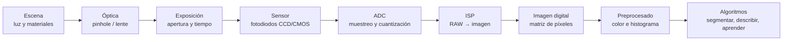
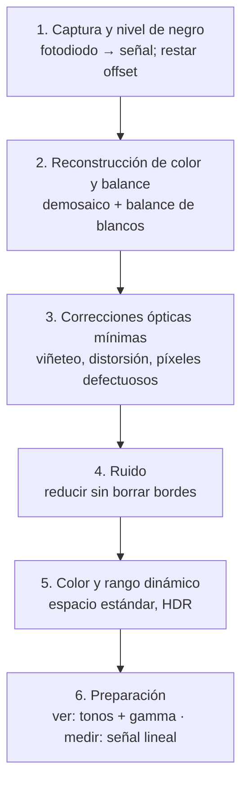
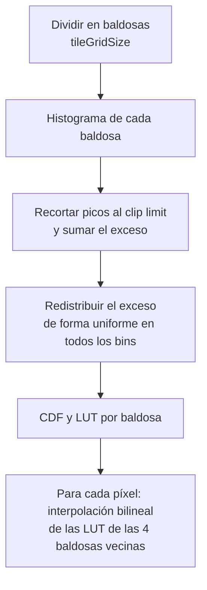
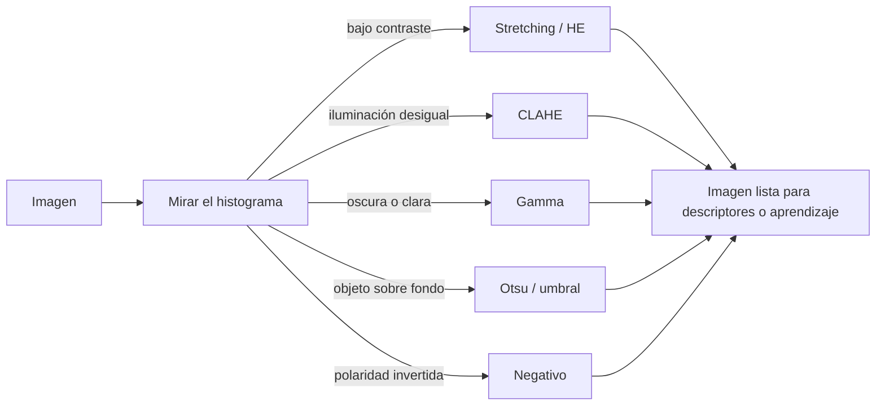

# Unidad 1 · Fundamentos de Visión por Computador e imagen digital

**Asignatura:** Visión por Computador (INSD4_VICO) · U-tad · Grado en Ingeniería del Software y Matemáticas

> **Convención de marcas.** El texto sin marca procede del material de la universidad (limpio de ruido del scraper y ampliado con explicaciones). Los bloques con **🆕** proceden de fuera del material: investigación, contenido que se perdió en el scraping y reconstruido, o ejemplos propios. Los avisos **⚠️** señalan discrepancias o erratas: para examinarte, usa el criterio del profesor; para trabajar, conoce ambos. El código de este documento está ejecutado y verificado; los scripts completos están en [`ejercicios/`](ejercicios/README.md).

---

## Índice

- [1. Introducción y objetivos](#1-introducción-y-objetivos)
  - [1.1 De qué va la unidad](#11-de-qué-va-la-unidad)
  - [1.2 Estructura](#12-estructura)
  - [1.3 Objetivos](#13-objetivos)
- [2. Visión física y biológica](#2-visión-física-y-biológica)
  - [2.1 La visión como cadena de transformación de información](#21-la-visión-como-cadena-de-transformación-de-información)
  - [2.2 Visión como sistema físico](#22-visión-como-sistema-físico)
  - [2.3 Espectro electromagnético](#23-espectro-electromagnético)
  - [2.4 Visión biológica](#24-visión-biológica)
- [3. Modelos de cámara](#3-modelos-de-cámara)
  - [3.1 Qué hace una cámara](#31-qué-hace-una-cámara)
  - [3.2 Cámara oscura o *pinhole*](#32-cámara-oscura-o-pinhole)
  - [3.3 Lente delgada](#33-lente-delgada)
  - [3.4 Comparativa: ¿cuándo usar qué?](#34-comparativa-cuándo-usar-qué)
- [4. Sensores de imagen y pipeline de formación (CCD vs CMOS)](#4-sensores-de-imagen-y-pipeline-de-formación-ccd-vs-cmos)
  - [4.1 El sensor: del fotón a la carga](#41-el-sensor-del-fotón-a-la-carga)
  - [4.2 ¿Qué es un ADC?](#42-qué-es-un-adc)
  - [4.3 Cómo funciona un sensor CCD](#43-cómo-funciona-un-sensor-ccd)
  - [4.4 Cómo funciona un sensor CMOS](#44-cómo-funciona-un-sensor-cmos)
  - [4.5 CCD frente a CMOS](#45-ccd-frente-a-cmos)
  - [4.6 Pipeline de formación de imagen (ISP)](#46-pipeline-de-formación-de-imagen-isp)
- [5. Imagen digital y gestión del color](#5-imagen-digital-y-gestión-del-color)
  - [5.1 Captura de color](#51-captura-de-color)
  - [5.2 Demosaico: mosaico Bayer y comparación con Triple-CCD](#52-demosaico-mosaico-bayer-y-comparación-con-triple-ccd)
  - [5.3 Imagen digital: tamaño, canales y memoria](#53-imagen-digital-tamaño-canales-y-memoria)
  - [5.4 Profundidad de color y cuantización](#54-profundidad-de-color-y-cuantización)
- [6. Operaciones puntuales basadas en histograma](#6-operaciones-puntuales-basadas-en-histograma)
  - [6.1 El histograma: el "pulso" de la imagen](#61-el-histograma-el-pulso-de-la-imagen)
  - [6.2 Operación de negativo (inversión de intensidades)](#62-operación-de-negativo-inversión-de-intensidades)
  - [6.3 Corrección de gamma](#63-corrección-de-gamma)
  - [6.4 Estiramiento de contraste (*stretching*)](#64-estiramiento-de-contraste-stretching)
  - [6.5 Segmentación de histograma o umbralización (*thresholding*)](#65-segmentación-de-histograma-o-umbralización-thresholding)
  - [6.6 Ecualización de histograma (HE)](#66-ecualización-de-histograma-he)
  - [6.7 Ecualización adaptativa de histograma (AHE)](#67-ecualización-adaptativa-de-histograma-ahe)
  - [6.8 CLAHE: ecualización adaptativa con limitación de contraste](#68-clahe-ecualización-adaptativa-con-limitación-de-contraste)
  - [6.9 Resumen comparativo: ¿qué operación usar?](#69-resumen-comparativo-qué-operación-usar)
- [7. Conclusiones](#7-conclusiones)
- [8. Ejercicios](#8-ejercicios)
- [9. Glosario](#9-glosario)
- [10. Fuentes](#10-fuentes)
  - [10.1 Material de la universidad](#101-material-de-la-universidad)
  - [10.2 Consultadas durante la elaboración 🆕](#102-consultadas-durante-la-elaboración)
  - [10.3 Referencias clásicas citadas de memoria 🆕 (no verificadas en esta sesión)](#103-referencias-clásicas-citadas-de-memoria--no-verificadas-en-esta-sesión)
- [11. Apéndice: discrepancias, erratas y contenido reconstruido](#11-apéndice-discrepancias-erratas-y-contenido-reconstruido)
  - [11.1 Discrepancias con el material (conserva el criterio del profesor para examinarte)](#111-discrepancias-con-el-material-conserva-el-criterio-del-profesor-para-examinarte)
  - [11.2 Contenido perdido en el scraping y cómo se reconstruyó 🆕](#112-contenido-perdido-en-el-scraping-y-cómo-se-reconstruyó)
  - [11.3 Notas sobre convenciones (no son leyes)](#113-notas-sobre-convenciones-no-son-leyes)

---

## 1. Introducción y objetivos

### 1.1 De qué va la unidad

La unidad recorre de extremo a extremo el proceso que transforma la **luz del mundo real en datos fiables para algoritmos**. El propósito es construir un mapa conceptual común que sirva de base al resto de la asignatura.

El itinerario de formación de imagen es:



El material lo resume así: **escena → óptica → sensor → representación digital → operaciones de realce y preparación de datos**.

> 💡 **Intuición:** cada píxel es una *medida*, la imagen es una *matriz* y procesarla es *transformar colecciones de valores* para volverlas más informativas. Ese cambio de mirada, "de la escena al número", es la idea central de la unidad.

### 1.2 Estructura

| Bloque | Pregunta que responde | Sección |
|---|---|---|
| Visión física y biológica | ¿Qué significa "ver" en términos de luz y percepción? | §2 |
| Modelos de cámara | ¿Cómo se proyecta un punto 3D en un plano 2D? | §3 |
| Sensores y pipeline | ¿Cómo se convierten fotones en números? | §4 |
| Imagen digital y color | ¿Cómo se representa y se gestiona el color? | §5 |
| Operaciones por histograma | ¿Cómo se realza y se prepara la imagen? | §6 |

Además, la unidad subraya la **evaluación y la reproducibilidad**: establecer contratos claros de datos, medir los efectos del preprocesado y dejar la imagen en condiciones para etapas posteriores (descriptores, invariancias, aprendizaje profundo).

> 🆕 **🔎 Más allá: qué es un "contrato de datos" de una imagen.** Antes de pasar una imagen a un algoritmo conviene fijar y comprobar siempre: resolución, tipo de dato (`uint8`, `uint16`, `float32`), rango (`[0,255]` o `[0,1]`), orden de canales (RGB u BGR; OpenCV usa **BGR**), espacio de color (sRGB, lineal, YCbCr…) y si hay corrección gamma aplicada. La mayoría de los "bugs misteriosos" de visión son violaciones de este contrato (véanse los casos de `uint8` y de BGR/RGB más adelante).

### 1.3 Objetivos

1. Comprender la relevancia y motivaciones de la Visión por Computador, distinguiendo entre visión biológica y visión artificial.
2. Describir la representación digital de una imagen.
3. Entender el modelo de formación de imágenes en una cámara.
4. Aplicar y entender transformaciones de color en una imagen.
5. Desarrollar pequeñas aplicaciones o scripts en Python con bibliotecas especializadas para manipular imágenes.
6. Analizar los resultados obtenidos y resolver problemas básicos de calidad de imagen.

**Resultado buscado (material):** criterio para tomar decisiones informadas en captura y preprocesado, y confianza para implementar *pipelines* sencillos pero sólidos en Python/OpenCV.

---

## 2. Visión física y biológica

### 2.1 La visión como cadena de transformación de información

"Ver" no es "tomar una fotografía". Es una **cadena de transformación de información** con dos sistemas:

- **Sistema físico** (la cámara): convierte la luz que llega de la escena en datos digitales.
- **Sistema biológico** (ojo y cerebro): realiza una transformación distinta con objetivos parecidos: hacer visibles estructuras útiles y **comprimir la complejidad del mundo** para tomar decisiones.

Como ingenieros de software interesan sus **abstracciones y limitaciones**, porque condicionan el diseño de *pipelines*, la elección de parámetros y la evaluación. Toda visión, natural o artificial, empieza con la **luz** (radiación electromagnética).

### 2.2 Visión como sistema físico

Desde el plano físico hay dos etapas:

1. **Interacción de la luz con la materia** de la escena. Un objeto *emite* luz propia (si es suficientemente caliente: el sol, una bombilla) o *refleja* la que recibe de otras fuentes (una manzana refleja la luz del sol).
2. **Detección** de esa luz por un sensor. La luz reflejada se dispersa en todas direcciones; parte es capturada por un sistema óptico (cristalino o lente) que concentra los rayos y forma una imagen enfocada sobre un plano receptor (retina o sensor).

> 📌 **Recordar:** la imagen formada **no es una copia perfecta de la realidad**, sino una *medición condicionada* por factores físicos.

**De qué depende la imagen (tres factores):**

| Factor | Qué significa | Ejemplo |
|---|---|---|
| **Iluminación** de la escena | Cuánta luz hay y de qué tipo | Un cuarto poco iluminado frente a un día soleado |
| **Geometría de la óptica** | Orificio o lente, si está bien enfocada… | Pinhole frente a lente de gran apertura |
| **Sensibilidad del detector** | Cómo responde el sensor (o la película) a la luz | Un sensor ruidoso en baja luz |

Estos tres factores determinan la **nitidez, el brillo, el contraste y la fidelidad** de la imagen resultante. Con la misma cámara, la imagen será muy distinta en la oscuridad (casi no se distingue nada) que a plena luz (muchos detalles).

### 2.3 Espectro electromagnético

Cuando la luz encuentra un objeto puede ser **reflejada, absorbida o transmitida**. La proporción depende de las propiedades del material y del tipo de luz.

> 🆕 **Formalización.** Para cada longitud de onda $\lambda$, la energía incidente se reparte así: $\rho(\lambda)+\alpha(\lambda)+\tau(\lambda)=1$, con $\rho$ la reflectancia, $\alpha$ la absorbancia y $\tau$ la transmitancia. La curva $\rho(\lambda)$ de un material es su **firma espectral**.

La luz se comporta a la vez como partícula y como onda; aquí se usa su comportamiento **ondulatorio**. Su **longitud de onda** $\lambda$ (en nanómetros, nm) es el espacio que recorre la onda en un periodo. El conjunto de todas las longitudes de onda posibles es el **espectro electromagnético**.

- **Luz visible**: aproximadamente de **380 nm a 780 nm**. Longitudes cortas (~400 nm) se ven azuladas; largas (~700 nm), rojizas.
- Por debajo: **ultravioleta (UV)**, rayos X y gamma. Por encima: **infrarrojo (IR)**, microondas y ondas de radio.
- Nuestros ojos **no miden la longitud de onda exacta**: tienen sensores con distintas sensibilidades espectrales que, combinados, producen la sensación de color en el cerebro.

> 🆕 **Regiones del espectro (valores aproximados, orientativos).**
>
> | Región | Longitud de onda aproximada | Uso típico en visión |
> |---|---|---|
> | Ultravioleta | < 380 nm | Fluorescencia, inspección, tintas de seguridad |
> | Visible | 380-780 nm | Fotografía y visión "normal" |
> | Infrarrojo cercano (NIR) | 0,78-1,4 µm | Clasificación de materiales (plásticos), visión nocturna activa |
> | Infrarrojo térmico (LWIR) | ~8-14 µm | Cámaras termográficas |
>
> ⚠️ Los límites exactos del visible varían según la fuente (380-750 nm es otra convención habitual). El material usa 380-780 nm.

**UV.** Longitudes más cortas que el violeta (< 380 nm). El ojo no lo ve (aunque lo siente indirectamente: fluorescencia, quemaduras solares) y muchas cámaras tampoco, porque lentes y filtros internos lo bloquean. Aplicaciones: lámparas UV en criminalística e inspección (revelan sustancias que emiten luz visible), fotolitografía, curado de resinas, tintas de seguridad.

**IR.** Longitudes mayores que el rojo (> 780 nm). No se ve, pero se *siente como calor*. Todo objeto caliente emite radiación térmica: las **cámaras termográficas** "ven" el calor, detectan personas en oscuridad total o miden temperaturas a distancia.

**Interacción selectiva (firmas espectrales):**

| Material | Comportamiento |
|---|---|
| Hoja verde | Refleja más en verde; absorbe más en rojo y azul |
| Metal pulido | Refleja la mayoría de la luz visible |
| Carbón | Absorbe casi toda la luz visible |
| Cristal transparente | Transmite la mayor parte del visible; puede absorber fuertemente en UV o IR |

> 🧪 **Ejemplo (material):** para identificar tipos de plástico en una planta de reciclaje se aprovecha que cada plástico tiene una **firma espectral distintiva en el infrarrojo cercano**.

> 💡 **Intuición:** el color de un objeto no es "suyo": es el resultado de *qué luz recibe* y *qué parte refleja*. Cambia la iluminación y cambia el color medido. Es la raíz del problema de la constancia de color que se verá en §5.

### 2.4 Visión biológica

**El ojo como cámara biológica.**

| Ojo | Cámara | Función |
|---|---|---|
| Córnea y cristalino | Lente | Enfocan la luz |
| Iris (abre/cierra la pupila) | Diafragma | Regula cuánta luz entra (apertura) |
| Retina | Sensor | Donde se forma la imagen |
| Nervio óptico | Cable de datos | Lleva las señales al cerebro |

**Fotorreceptores de la retina:**

| | **Bastones** | **Conos** |
|---|---|---|
| Sensibilidad | Muy alta: baja iluminación (en condiciones ideales, fotones individuales) | Requieren más luz |
| Color | No dan información de color | Responsables de la visión en color |
| Resolución espacial | Menor | Alta |
| Tipos | Uno | Tres, con sensibilidad máxima a distintas partes del espectro |
| Dominan | De noche | De día |

Por eso de noche vemos sobre todo en blanco y negro y con menos nitidez; de día, colores vivos y detalle fino.

**Distribución no uniforme.** En el centro de la retina, en la **mácula**, está la **fóvea**: una pequeña depresión con altísima densidad de conos y prácticamente sin bastones. Es nuestra **visión central aguda** (máxima resolución y color). En la **periferia** domina el bastón: más sensibilidad al movimiento y a luces débiles, menos detalle y color.

> 🧪 **Ejemplo:** por eso, para ver una estrella muy tenue de noche, se mira ligeramente "de reojo": la luz cae en la periferia, rica en bastones. *(Hecho conocido de astronomía; no figura en el material.)*

> 🆕 **⚠️ Matiz sobre los conos.** El material habla de conos "azules, rojos y verdes". Los nombres técnicos son **S, M, L** (corto, medio y largo), con máximos de sensibilidad hacia **~420, ~530 y ~560 nm**. El cono L está en la zona amarillo-verdosa, no en el rojo puro: "rojo" es una simplificación habitual.

**Variabilidad y daltonismo.** No todas las personas capturan el mismo rango efectivo del espectro; incluso sin problema aparente existen diferencias naturales de percepción del color. Además, una fracción significativa de la población tiene una **deficiencia de visión del color** (daltonismo):

| Tipo | Qué ocurre (material) |
|---|---|
| **Protanomalía / protanopia** | Caída de sensibilidad hacia los rojos; rojos y verdes se confunden; los rojos pueden verse más oscuros |
| **Deuteranomalía / deuteranopia** | Confusión rojo-verde con pérdida de matiz en verdes |
| **Tritanomalía / tritanopia** | Confusión azul-amarillo; azules y verdes claros pueden volverse intercambiables |
| **Acromatopsia / monocromacia** | Percepción casi sin color, como una escala de grises; el problema menos frecuente |

> 🆕 **Prevalencia orientativa (hombres, según color-blindness.com; no es una fuente científica primaria):** deuteranomalía ≈ 4,6 %; deuteranopia ≈ 1,3 %; protanomalía ≈ 1,1 %; protanopia ≈ 1,0 %; tritanopia ≈ 0,0001 %; acromatopsia ≈ 0,00003 %. En mujeres las deficiencias rojo-verde son mucho menos frecuentes (< 0,4 %). En conjunto, las deficiencias rojo-verde afectan a ~6-8 % de los hombres.

> 📌 **Recordar (material):** estas condiciones muestran que la "captura de color" biológica tiene limitaciones y variabilidades. En visión por computador a veces hay que tener en cuenta que cierto procesamiento de color **debería ser robusto a estas diferencias**.

> 🧪 **Ejemplo (🆕):** al diseñar un gráfico o un mapa de calor para usuarios humanos, evitar la pareja rojo/verde como único canal de información; los mapas de color perceptualmente uniformes y aptos para daltónicos (como *viridis*) están pensados para ello.

---

## 3. Modelos de cámara

### 3.1 Qué hace una cámara

Una cámara no es un dispositivo que "toma fotos": es un sistema de **selección y conversión de información**. Capta rayos de luz de la escena y los proyecta en un **plano imagen**, donde un sensor registra su intensidad.

| Elemento | Qué decide |
|---|---|
| **Óptica** (lente o sistema de lentes, u orificio) | Qué rayos forman la imagen |
| **Exposición** (apertura y tiempo de obturación) | Cuánta luz se deja entrar y durante cuánto tiempo |
| **Sensor de imagen** | Cómo se traduce la luz a señales eléctricas |
| **ISP** (*Image Signal Processor*) | Qué correcciones y ajustes se aplican al dato en bruto |

> 📌 **Resumen (material):** cada píxel es el resultado de decisiones físicas y electrónicas: **qué parte de la escena** se proyectó en él (óptica), **cuánta luz** se acumuló (exposición), **cómo el sensor tradujo** esa luz a un número y **qué correcciones** se aplicaron (ISP).

**Diagnóstico (material, ampliado 🆕):**

| Síntoma | Causas que hay que descartar |
|---|---|
| Imagen oscura | Exposición insuficiente (poca luz, tiempo corto, apertura pequeña) |
| Imagen borrosa | Enfoque, movimiento (tiempo largo) o ruido electrónico |
| Colores raros | Balance de blancos o iluminación |
| 🆕 Bandas o distorsión en movimiento | *Rolling shutter* o iluminación parpadeante (véase §4.4) |
| 🆕 Escalones en degradados | Pocos bits de profundidad (véase §5.4) |

### 3.2 Cámara oscura o *pinhole*

**Definición.** El modelo más sencillo: una caja o recinto oscuro sellado con un **pequeño orificio** (sin lente) por el que entra la luz y se proyecta una **imagen invertida** en la pared opuesta. Es la cámara estenopeica, en inglés *pinhole camera*.

**Qué hace.** Cada punto de la escena emite o refleja rayos en muchas direcciones; el orificio solo deja pasar unos pocos, que siguen en línea recta hasta un punto concreto de la pared. Es decir, **"ver es seleccionar rayos"**. La imagen sale **invertida** porque los rayos de la parte superior de la escena viajan hacia abajo dentro de la caja, y viceversa.

Su valor es la simplicidad conceptual: **no hay lentes, solo geometría**. Cada punto de la imagen corresponde a una **dirección específica en el espacio 3D**, lo que lo hace tan útil para calibración y reconstrucción 3D.

#### Geometría de la proyección 🆕

> 🆕 **Formalización.** Con el orificio en el origen, el eje óptico $Z$ y el plano imagen a distancia $f$ (en el modelo matemático se coloca delante del orificio para evitar la inversión), un punto $(X,Y,Z)$ se proyecta en:
>
> $$x = f\,\frac{X}{Z},\qquad y = f\,\frac{Y}{Z}$$
>
> En píxeles, con $f_x=f/p$ (focal expresada en píxeles, $p$ = tamaño de píxel) y punto principal $(c_x,c_y)$:
>
> $$u = f_x\,\frac{X}{Z}+c_x,\qquad v = f_y\,\frac{Y}{Z}+c_y,\qquad K=\begin{pmatrix} f_x&0&c_x\\0&f_y&c_y\\0&0&1\end{pmatrix}$$
>
> La **magnificación** (aumento) es $m=-d_i/d_o$ (el signo menos indica la inversión), con $d_i$ la distancia orificio-plano imagen y $d_o$ la distancia al objeto.

> 🧪 **Ejemplo resuelto (ejecutado, `ej01_camara_optica.py`).** Focal $f=35$ mm, píxel de 5 µm → $f_x=7000$ px; imagen 1920×1080 → $(c_x,c_y)=(960,540)$. El punto $(0{,}5;\;0{,}2;\;5)$ m se proyecta en
> $u=7000\cdot0{,}5/5+960=1660,\quad v=7000\cdot0{,}2/5+540=820$.
> Si el punto se aleja al doble ($Z=10$ m), su desplazamiento respecto al centro pasa de 700 px a 350 px: **el tamaño en la imagen es inversamente proporcional a la distancia**.

> ⚠️ **Error típico:** olvidar que $Z$ debe ser **positiva** (delante de la cámara) y que $u$ crece hacia la derecha pero $v$ crece **hacia abajo** en las imágenes.

#### El compromiso nitidez-luminosidad

| Orificio | Efecto |
|---|---|
| **Grande** | Entra más luz (imagen más brillante) pero pasan rayos mal dirigidos: de cada punto llegan rayos a puntos vecinos y la imagen se emborrona. Ese borrón se llama **borrón geométrico** o **círculo de confusión** |
| **Muy pequeño** | Rayos más ordenados (más definición geométrica) pero entra poquísima luz: imagen tenue, dominada por ruido o invisible; y aparece **difracción** |

**Difracción.** Cuando el orificio es muy pequeño la luz se comporta como onda y se "esparce" al pasar, generando también un disco de borrón.

> 🆕 **Fórmulas del compromiso (ejecutadas en `ej01_camara_optica.py`).** Con $D$ el diámetro del orificio, $d_i$ la distancia al plano imagen, $d_o$ la distancia al objeto y $\lambda$ la longitud de onda:
>
> $$b_{geom}=D\,\frac{d_o+d_i}{d_o}\;\;(\approx D\text{ si }d_o\gg d_i),\qquad b_{dif}=\frac{2{,}44\,\lambda\,d_i}{D},\qquad b_{tot}\approx\sqrt{b_{geom}^2+b_{dif}^2}$$
>
> $b_{geom}$ crece con $D$ (semejanza de triángulos); $b_{dif}$ decrece con $D$ (diámetro del disco de Airy). Hay un $D$ óptimo que minimiza la suma. Minimizando en cuadratura (con $d_o\gg d_i$) sale $D\approx\sqrt{2{,}44\,\lambda\,d_i}\approx1{,}56\sqrt{\lambda d_i}$. La fórmula de Rayleigh $D=1{,}9\sqrt{\lambda f}$ (citada, p. ej., en un artículo de astronomía estenopeica de arXiv) da un valor algo mayor: **la constante depende del criterio** (≈1,5-2), no es una ley exacta.
>
> **Ejemplo** ($d_i=50$ mm, objeto a 2 m, $\lambda=550$ nm): con $D=0{,}10$ mm domina la difracción (0,67 mm de disco de Airy frente a 0,10 mm geométrico); con $D=1{,}0$ mm domina el borrón geométrico (1,03 mm); el mínimo está en $D\approx0{,}26$ mm (borrón total ≈ 0,37 mm). Rayleigh daría 0,32 mm.

> ⚠️ **Matiz sobre el material.** Dice que la difracción aparece "cuando el tamaño del orificio se acerca al orden de la longitud de onda". Es una simplificación: con $\lambda\approx0{,}5$ µm y orificios de ~0,1-0,3 mm (los típicos) la difracción ya compite con el borrón geométrico, mucho antes de llegar a tamaños de ~µm. Para el examen, usa la frase del profesor; para calcular, usa las fórmulas anteriores.

**Por qué sigue siendo importante.** Aunque la cámara oscura real es impráctica (largas exposiciones por la poca luz), el **modelo pinhole** es fundamental en:

- Calibración de cámaras
- Visión estereoscópica
- Realidad aumentada
- Fotogrametría

> 📌 **Recordar:** el vídeo del material manipula dos parámetros (distancia objeto-orificio y diámetro $D$) para ver crecer o decrecer el borrón geométrico y comprobar que la imagen se forma invertida y que la magnificación crece al alejar el plano imagen. *(El vídeo no se extrajo; el comportamiento se ha reconstruido con las fórmulas anteriores.)*

### 3.3 Lente delgada

**Para qué.** Superar las limitaciones del pinhole. Una lente (o combinación) **hace converger** los rayos de un punto de la escena hacia un punto del plano imagen. Ventajas: imágenes **mucho más luminosas** (aperturas grandes) **sin sacrificar nitidez en el plano enfocado**, y exposiciones cortas. Contrapartida: se pierde la profundidad de campo "infinita" del pinhole: solo los objetos a cierta distancia salen nítidos.

**Modelo.** Una sola lente ideal que converge la luz. Su **distancia focal** $f$ es la distancia desde la lente al plano donde enfocan los objetos situados en el infinito (en cámaras reales, el sensor se coloca aproximadamente a $f$ para enfocar cosas lejanas).

> 🆕 **Ecuación de la lente delgada** (la que usa implícitamente el vídeo del material):
>
> $$\frac{1}{f}=\frac{1}{d_o}+\frac{1}{d_i},\qquad m=-\frac{d_i}{d_o}$$
>
> **Ejemplo** ($f=50$ mm). Objeto a 2 m → $d_i=1/(1/50-1/2000)=51{,}28$ mm, $m=-0{,}0256$. Objeto a 0,5 m → $d_i=55{,}56$ mm, $m=-0{,}111$. Para un objeto en el infinito, $d_i\to f=50$ mm. Para enfocar algo más cerca, la lente se aleja del sensor.

**Focal y campo de visión.** La focal fija el "zoom" geométrico: focales cortas (18 mm) dan campo de visión **amplio**; focales largas (200 mm) dan imágenes ampliadas de zonas pequeñas, como un telescopio.

> 🆕 $$\text{FOV}=2\arctan\!\left(\frac{w}{2f}\right)$$
> con $w$ el ancho del sensor. Para $w=36$ mm: $f=18$ mm → 90,0°; $f=50$ mm → 39,6°; $f=200$ mm → 10,3° (ejecutado). El campo de visión depende de la focal **y del tamaño del sensor**, no solo de la focal.

**Número f (número de apertura).** Se escribe f/2.8, f/4, f/8…: es $N=f/D$ (focal entre diámetro de apertura). **Número f menor = apertura grande = mucha luz**; número f grande = apertura pequeña = poca luz.

> 🆕 La luz que llega al sensor es proporcional a $1/N^2$. Pasar de f/2.8 a f/8 reduce la luz en $(8/2{,}8)^2\approx8{,}2$ veces, es decir, **3 "pasos" (stops)**. Cada paso completo (f/1.4, 2, 2.8, 4, 5.6, 8…) multiplica $N$ por $\sqrt2$ y divide la luz a la mitad.

**¿Por qué no usar siempre aperturas enormes?** Porque la apertura también afecta a la **profundidad de campo** y a la **difracción**.

**Profundidad de campo (DOF, *depth of field*).** Es el rango de distancias de la escena que aparecen **aceptablemente nítidas**. Al enfocar a cierta distancia, solo ese plano está perfectamente enfocado; un objeto algo más cerca o más lejos forma un circulito (círculo de confusión) en vez de un punto. "Aceptablemente" es subjetivo: se define con el **círculo de confusión máximo tolerable** $c$.

- **Apertura pequeña (N grande)** → círculos de confusión menores → **más DOF**.
- **Apertura grande (N bajo)** → **DOF estrecha**: solo una capa delgada de la escena sale enfocada.

> 🆕 **Fórmulas de DOF** (distancia de enfoque $s$, hiperfocal $H$):
>
> $$H=\frac{f^2}{N\,c}+f,\qquad D_{cerca}=\frac{H\,s}{H+(s-f)},\qquad D_{lejos}=\frac{H\,s}{H-(s-f)}\;(s<H)$$
>
> Si $s\ge H$, el límite lejano es infinito. Para $s\ll H$: $\text{DOF}\approx\dfrac{2\,N\,c\,s^2}{f^2}$.
>
> **Ejemplo ejecutado** ($f=50$ mm, enfoque a 3 m, $c=0{,}03$ mm, usual en sensor de 36 mm):
>
> | Apertura | Hiperfocal | Zona nítida | Diámetro de Airy |
> |---|---|---|---|
> | f/1.8 | 46,35 m | 2,82 – 3,20 m | 2,42 µm |
> | f/4 | 20,88 m | 2,63 – 3,49 m | 5,37 µm |
> | f/8 | 10,47 m | 2,34 – 4,18 m | 10,74 µm |
> | f/16 | 5,26 m | 1,92 – 6,83 m | 21,47 µm |
>
> Al cerrar el diafragma crece la zona nítida **pero también el disco de Airy**.

**Difracción en una lente: disco de Airy y PSF.** Incluso una lente perfecta convierte un punto en un patrón de difracción. 

> 🆕 La **PSF** (*point spread function*, respuesta al impulso) de una apertura circular es el patrón de Airy:
>
> $$I(r)=I_0\left[\frac{2J_1(x)}{x}\right]^2,\quad x=\frac{\pi r}{\lambda N}$$
>
> con $J_1$ la función de Bessel de primer orden. Su primer cero está en $x=3{,}832$, es decir $r=1{,}22\,\lambda N$ (verificado numéricamente), de modo que el **diámetro del disco de Airy** es $2{,}44\,\lambda\,N$. A f/8 y 550 nm: 10,74 µm, mayor que un píxel típico (3-6 µm): el sensor "ve" más resolución que la que la óptica puede dar. A mayor $N$, más difracción: por eso las lentes tienen una apertura "óptima" intermedia.

> ⚠️ **Error típico:** pensar que cerrar siempre el diafragma da más nitidez. Gana DOF pero pierde por difracción; además el borrón por desenfoque y el de difracción se combinan.

> 💡 **Intuición:** pinhole = "todo igual de (des)enfocado"; lente = "elijo qué plano está nítido a cambio de desenfocar el resto". Pagas con DOF para ganar luz.

**Código de DOF y Airy (ejecutado):**

```python
import numpy as np

def dof(f_mm, N, s_mm, c_mm=0.03):
    """Hiperfocal, límites cercano y lejano, y DOF total [mm]."""
    H = f_mm**2 / (N * c_mm) + f_mm
    near = H * s_mm / (H + (s_mm - f_mm))
    far = np.inf if s_mm >= H else H * s_mm / (H - (s_mm - f_mm))
    return H, near, far, far - near

lam = 550e-9
for N in (1.8, 4, 8, 16):
    H, near, far, tot = dof(50, N, 3000)
    airy = 2.44 * lam * N * 1e6          # µm
    print(f"f/{N:<4}: hiperfocal={H/1000:6.2f} m, de {near/1000:.2f} a {far/1000:.2f} m, Airy={airy:.2f} µm")
```

Salida esperada:

```
f/1.8 : hiperfocal= 46.35 m, de 2.82 a 3.20 m, Airy=2.42 µm
f/4   : hiperfocal= 20.88 m, de 2.63 a 3.49 m, Airy=5.37 µm
f/8   : hiperfocal= 10.47 m, de 2.34 a 4.18 m, Airy=10.74 µm
f/16  : hiperfocal=  5.26 m, de 1.92 a 6.83 m, Airy=21.47 µm
```

> 🆕 **🔎 Más allá: el triángulo de la exposición.** La cantidad de luz acumulada depende de la **apertura** ($1/N^2$), el **tiempo de obturación** $t$ y la **sensibilidad (ISO)**. Para igualar la exposición, cada paso que cierras la apertura se compensa duplicando $t$ (con el coste de más desenfoque por movimiento) o subiendo el ISO (con el coste de más ruido). No hay "gratis": exposición, DOF, desenfoque por movimiento y ruido se intercambian.

### 3.4 Comparativa: ¿cuándo usar qué?

| | **Cámara oscura** | **Lente delgada** |
|---|---|---|
| **Principio** | Proyección por orificio sin lente | Lente convergente que enfoca y concentra luz |
| **Ventajas** | Geometría pura, coste mínimo, sin aberraciones de lente | Mucha luz (aperturas grandes), control de enfoque/DOF, exposiciones cortas |
| **Contras** | Muy poca luz, imagen tenue, poca resolución útil | Aberraciones y distorsión que corregir, complejidad y coste óptico |
| **Usos típicos** | Demostración didáctica, arte, experimentos de proyección | Visión industrial, fotografía/vídeo, embebido y móvil |
| 🆕 **Papel en visión por computador** | Modelo matemático de la proyección (calibración, estéreo, RA, fotogrametría) | Lo que realmente hay delante del sensor; sus efectos (DOF, difracción, distorsión) hay que modelarlos o corregirlos |

> 📌 **Recordar:** el pinhole aporta la **geometría** (proyección perspectiva); la lente delgada aporta los **efectos físicos reales** (apertura, enfoque, profundidad de campo, exposición). Los dos modelos son aproximaciones complementarias.


---

## 4. Sensores de imagen y pipeline de formación (CCD vs CMOS)

### 4.1 El sensor: del fotón a la carga

Tras enfocar la luz sobre el plano imagen, el **sensor** la convierte en información. Un sensor típico es una **matriz de píxeles**. Cada píxel contiene un **fotodiodo**, un semiconductor sensible a la luz: al llegarle fotones genera electrones (carga) **en proporción a la intensidad luminosa y al tiempo de exposición**. Esa carga se lee como una señal (voltaje o número de electrones) que corresponde al brillo capturado.

Encima de cada píxel suele haber:

| Elemento | Función |
|---|---|
| **Filtro de color** (en sensores a color) | Deja pasar rojo, verde o azul (§5.1) |
| **Microlente** | Concentra la luz que cae sobre el píxel hacia el fotodiodo activo; sin ella parte de la luz incide en zonas no sensibles |
| **Capas metálicas de interconexión** | Propias de la fabricación del circuito integrado; a veces cubren parcialmente la superficie |

> 🆕 **🔎 Más allá.** La carga acumulada es proporcional a $\Phi\cdot t\cdot \eta$ (flujo de fotones, tiempo de exposición y eficiencia cuántica). Hay un máximo de electrones que un píxel puede almacenar antes de saturar (*full well capacity*, que se cita al hablar de CCD). El **rango dinámico** del sensor es, aproximadamente, la razón entre esa capacidad máxima y el ruido de lectura.

### 4.2 ¿Qué es un ADC?

El **convertidor analógico-digital** (*Analog-to-Digital Converter*, ADC) es **la frontera entre el mundo físico analógico y el mundo computacional digital**. Los sensores convierten luz (fenómeno continuo) en carga eléctrica (señal analógica continua); para procesarla hay que convertirla en **números discretos**. De su calidad (resolución en bits, ruido, velocidad) depende en gran medida la calidad final de la imagen. Un ADC con pocos bits introduce **banding** (saltos entre niveles de intensidad); uno ruidoso o mal calibrado añade error a cada medición.

**Cómo funciona en el contexto del sensor.** Al final de la exposición, un píxel tiene una carga proporcional a los fotones. Un pequeño amplificador la convierte en voltaje; el ADC lo compara con niveles de referencia y le asigna un valor digital.

La conversión involucra **dos operaciones** con limitaciones inherentes:

| Operación | Qué hace | Limitación |
|---|---|---|
| **Muestreo temporal** | El ADC no lee la señal de forma continua: toma muestras a intervalos discretos | La **frecuencia de muestreo** determina qué tan rápido pueden cambiar las señales que se capturan correctamente |
| **Cuantificación de amplitud** *(🆕 reconstruido: el texto del material se perdió)* | Asigna a cada valor continuo uno de $2^b$ niveles | Introduce un error de redondeo (error de cuantización) |

> 🆕 **Formalización de la cuantización.** Con $b$ bits hay $L=2^b$ niveles; con rango de entrada $V$, el paso es $\Delta=V/2^b$ y el error de redondeo está acotado por $\pm\Delta/2$. Modelándolo como uniforme, su varianza es $\sigma_q^2=\Delta^2/12$. La relación señal-ruido de cuantización (SQNR) mejora **≈ 6 dB por cada bit añadido**. Para una rampa uniforme a plena escala, $\text{SQNR}\approx6{,}02\,b+6{,}02$ dB (el conocido $6{,}02\,b+1{,}76$ dB corresponde a una senoidal a plena escala).
>
> **Ejemplo ejecutado** (`ej02_imagen_digital.py`, rampa de 100 003 muestras):
>
> | Bits | Niveles | Error máx. | SQNR medida (dB) | $6{,}02\,b+6{,}02$ |
> |---:|---:|---:|---:|---:|
> | 4 | 16 | 0,0333 | 29,54 | 30,10 |
> | 8 | 256 | 0,00196 | 54,15 | 54,18 |
> | 10 | 1024 | 0,00049 | 66,22 | 66,22 |
> | 12 | 4096 | 0,00012 | 78,27 | 78,26 |
> | 16 | 65 536 | 0,00001 | 102,35 | 102,34 |
>
> En un degradado de 1024 columnas, a 8 bit cada escalón dura ~4 columnas (inapreciable); a 4 bit, ~68 columnas (banding evidente).

> 💡 **Intuición:** el ADC es una regla con $2^b$ marcas. Con pocas marcas, todo lo que cae entre dos marcas se redondea a la más cercana y desaparecen los matices.

> 🆕 **Nota.** El muestreo espacial (la rejilla de píxeles) también es un muestreo de la señal continua de la escena: si hay detalle más fino que la mitad del paso de píxel, aparece *aliasing* (criterio de Nyquist). Es lo que provoca los falsos colores y *moiré* en detalles finos (§5.2).

### 4.3 Cómo funciona un sensor CCD

**Nombre.** CCD = ***Charge-Coupled Device*** (dispositivo de carga acoplada).

> ⚠️ **Errata del material:** lo escribe "Change-Coupled Device", pero el propio texto explica después la "transferencia de carga por acoplamiento (*Charge-Coupled*)". La forma correcta es *Charge*.

**Idea.** Un CCD es una **matriz de pozos de potencial** en un chip de silicio que atrapan y almacenan los electrones generados por los fotones. Cada pozo = un píxel.

**Lectura.** Se usa un mecanismo de **transferencia de carga por acoplamiento**. Analogía del material: una fila de cubos de agua (agua = carga). En vez de ir con un medidor a cada cubo, se **vuelca el agua de cada cubo al siguiente, secuencialmente**, hasta llegar al final de la fila, donde hay un medidor.

```
 cubo1 → cubo2 → cubo3 → … → cubo N → [medidor / amplificador de salida] → ADC
```

Toda la imagen se lee por el **mismo camino** y a través de uno o pocos amplificadores de salida. Consecuencias:

| Ventaja | Por qué |
|---|---|
| **Uniformidad** | Todo comparte el mismo circuito de lectura: el ruido o variación tiende a ser global y muy bajo |
| **Bajo ruido de lectura** | Muy poco ruido propio: ideal para señales débiles |
| **Respuesta muy lineal** | La carga es proporcional a la luz |
| **Gran *full well capacity*** | Cada píxel acumula muchos electrones antes de saturar → **rango dinámico alto** |

| Desventaja | Por qué *(el material solo desarrolla "lento"; el resto está reconstruido 🆕)* |
|---|---|
| **Lento** | Hay que desplazar la carga de millones de píxeles a lo largo de distancias largas por un único camino |
| **Poco flexible** | La lectura es rígida (toda la imagen, en orden); no se pueden leer regiones o filas aleatorias fácilmente |
| **Alto consumo** | Mover carga exige tensiones y potencia elevadas, y suelen necesitar circuitería de soporte aparte |

> 🆕 **Matiz de obturador.** En un CCD todos los píxeles empiezan y terminan la exposición simultáneamente (obturador global electrónico) en las variantes con zona de almacenamiento (*interline* y *frame transfer*). Un CCD *full-frame* sin esa zona suele necesitar un obturador mecánico. El material lo simplifica como "en un CCD todos los píxeles exponen a la vez".

### 4.4 Cómo funciona un sensor CMOS

**CMOS** = *Complementary Metal-Oxide-Semiconductor*. Es la evolución hacia sistemas más integrados, rápidos y versátiles, y hoy **domina el mercado** (cámaras de consumo, móviles…). La filosofía es casi opuesta a la del CCD: en lugar de mover la carga hasta un punto de lectura, **cada píxel tiene su propio circuito de lectura activo** ("píxel inteligente" o activo).

**Un píxel CMOS típico incluye:**

| Componente | Función |
|---|---|
| Fotodiodo | Genera la carga (igual que en CCD) |
| Transistor de *reset* | Vacía el fotodiodo (nivel inicial antes de la integración) |
| Transistor de transferencia | (En algunos diseños) mueve la carga a un pequeño nodo de almacenamiento |
| Transistor *source-follower* | Amplificador local: convierte la carga/voltaje en una señal de baja impedancia legible fuera del píxel |
| Transistor de selección (a veces) | Conecta o desconecta el píxel a la línea de lectura de su columna |

**Lectura.** Cada **fila** se activa de forma independiente; todos los píxeles de esa fila entregan su información **a la vez** a las líneas de columna, donde hay circuitos dedicados (amplificadores e incluso ADC) que la convierten en números. Con miles de columnas se leen **miles de píxeles en paralelo** por fila.

> 💡 **Analogía (material):** el CCD es **un único cajero** atendiendo a toda una cola; el CMOS es **un cajero por columna**, atendiendo a muchos clientes en paralelo.

**El coste: *rolling shutter*.** Como las filas se leen en instantes distintos, mientras otras aún se exponen, los objetos en movimiento rápido pueden salir **distorsionados**:

- Objetos **inclinados o arqueados** (efecto "gelatina").
- Una **hélice partida** en segmentos en posiciones distintas.
- Luces que varían entre leer la fila 1 y la fila 500 producen **bandas de iluminación** (*banding*).

> 🧪 **Ejemplo (🆕, ilustrativo).** Sensor de 1080 filas con lectura completa en 10 ms → 9,3 µs por fila. Un objeto que cruza la imagen a 2000 px/s se desplaza 20 px entre la primera y la última fila: una vertical se ve inclinada 20 px. Con un CCD o un CMOS *global shutter* sería una vertical.

**Solución: *global shutter*.** Algunos CMOS añaden un elemento de almacenamiento por píxel para capturar la carga **simultáneamente** en todo el sensor y leerla después con calma (conceptualmente como un CCD, manteniendo la lectura paralela CMOS). Coste: ocupa área o añade ruido. Muchos sensores CMOS de visión industrial son *global shutter* o tienen modos de alta velocidad con *global shutter*, sobre todo si hay movimiento.

> ⚠️ **Error típico:** usar un CMOS *rolling shutter* para medir geometría de objetos en movimiento (p. ej. una cinta transportadora). La medida estará sesgada por el instante de lectura de cada fila.

### 4.5 CCD frente a CMOS

| Aspecto | CCD | CMOS |
|---|---|---|
| Lectura | Transferencia de carga secuencial; 1 o pocos amplificadores | Lectura activa por píxel; ADC por columna en paralelo |
| Velocidad | Lenta (limitada por el desplazamiento de carga) | Alta |
| Uniformidad | Excelente | Mayor variación píxel a píxel (cada píxel tiene su circuito) |
| Ruido de lectura | Bajísimo (tradicional) | Históricamente mayor |
| Consumo | Alto | Bajo |
| Flexibilidad | Baja | Alta (se integran más funciones en el chip, lectura de regiones…) |
| Obturador | Global (en variantes con almacenamiento) | *Rolling* (habitual) o *global* (con almacenamiento por píxel) |
| Cuota actual | Nicho | Domina (consumo, móviles, y cada vez más visión industrial) |

> 🆕 **⚠️ Matiz de actualidad.** La ventaja histórica del CCD (ruido y uniformidad) se ha reducido mucho. Según un análisis de Adimec (2011, revisado en 2023): los CMOS modernos con *global shutter* alcanzan un ruido de lectura comparable o incluso mejor que los CCD, cerrando una brecha de ~6 dB de rango dinámico a igual tamaño de píxel. El CCD aún conserva ventajas en menor corriente oscura, uniformidad, MTF y estabilidad entre imágenes. Las cifras dependen de la generación del sensor: tómalas como orientativas.

### 4.6 Pipeline de formación de imagen (ISP)

Lo que entrega el sensor no es la imagen final. Los datos **RAW** representan solo la carga acumulada en cada píxel: sin correcciones, **sin color** y con artefactos del hardware. Las transformaciones que lo convierten en imagen utilizable se llaman **ISP** (*Image Signal Processor*) o **pipeline de formación de imagen**. Entenderlo es crucial porque **cada etapa afecta a la información disponible** para los algoritmos posteriores.



| Fase | Qué hace | Para qué |
|---|---|---|
| **1. Captura y nivel de negro** | Se quita el *offset* (nivel de negro) | Que el "0" sea oscuridad real |
| **2. Reconstrucción de color y balance** | Como cada píxel mide un solo color (patrón Bayer), se reconstruyen los tres canales (**demosaicing**) y se aplica **balance de blancos** | Neutralizar el iluminante |
| **3. Correcciones ópticas mínimas** | Se corrigen sombras de lente (**viñeteo**) y distorsión si hay que medir geometría; se marcan/interpolan **píxeles defectuosos** | Compensar la óptica y el sensor |
| **4. Ruido** | Reducción (sobre todo en crominancia) con filtros suaves | Estabilizar la señal sin perder detalle en contornos |
| **5. Color y rango dinámico** | Ajuste a un espacio estándar; si la escena tiene luces y sombras extremas, se combinan imágenes (**HDR**) | No perder detalle |
| **6. Preparación para ver o para medir** | Para visualizar: mapeo de tonos y **gamma**. Para visión por computador: mantener la señal **lineal** (sin gamma ni realce de nitidez) y trabajar con RAW o con un perfil "plano" | Cada uso necesita un resultado distinto |

> 📌 **Recordar (material):** "para visión por computador lo ideal es mantener la señal lineal y trabajar con RAW o con un perfil plano". Lo que se ve "bonito" no es necesariamente lo que mejor sirve a un algoritmo de medida.

> 🆕 **🔎 Más allá.** El orden real de las etapas varía entre fabricantes (p. ej. el balance de blancos puede ir antes o después del demosaico) y el ISP de un móvil añade muchas más (HDR multi-exposición, *tone mapping* local, reducción de ruido multi-frame). Por eso dos dispositivos "ven ligeramente distinto lo mismo": el sensor es parecido, el ISP no. Es la idea con la que cierran las conclusiones de la unidad.

---

## 5. Imagen digital y gestión del color

### 5.1 Captura de color

El color no es un atributo que "exista en la realidad": emerge de la interacción entre **luz, materia y percepción**. El reto es convertir el **espectro continuo** en una representación discreta, manejable y útil.

La solución de casi todos los sistemas digitales, inspirada en la visión humana, es **usar tres mediciones espectrales independientes** (R, G, B). Es una reducción de dimensionalidad: **poderosa** (permite capturar color en la práctica) pero **limitante**, porque *espectros distintos pueden producir las mismas tres medidas* (se llama **metamerismo**).

> 🆕 **Formalización.** Cada canal $c\in\{R,G,B\}$ mide $\;I_c=\int E(\lambda)\,\rho(\lambda)\,S_c(\lambda)\,d\lambda$, con $E$ la iluminación, $\rho$ la reflectancia del objeto y $S_c$ la sensibilidad espectral del canal. Dos espectros distintos pueden dar los mismos $(I_R,I_G,I_B)$.

Hay **dos aproximaciones** principales:

#### Triple-CCD: máxima fidelidad

Un **prisma** separa la luz en tres haces (rojo, verde, azul), cada uno dirigido a un **sensor distinto**. Cada posición se muestrea simultáneamente en las tres bandas.

| Ventajas | Desventajas |
|---|---|
| **Resolución cromática completa**: cada píxel tiene los tres canales | **Complejidad mecánica**: alineación precisa de varios sensores |
| **Mejor relación señal-ruido**: cada sensor recibe ~1/3 de la luz total, sin pérdida adicional por filtros | **Tamaño y peso** mayores |
| | **Coste** mucho mayor |

#### Sensor único con matriz de filtros (CFA, patrón Bayer)

La mayoría de los sistemas modernos usan **un solo sensor** cubierto por una **matriz de filtros de color** (*Color Filter Array*, CFA). El patrón más común es el **Bayer RGGB**: cada píxel tiene un filtro que transmite principalmente rojo, verde o azul.

```
 R G R G R G
 G B G B G B     2×2 repetido:  R G
 R G R G R G                    G B     → 50 % verde, 25 % rojo, 25 % azul
 G B G B G B
```

Hay **dos píxeles verdes por cada rojo y azul**, porque el sistema visual humano es más sensible al verde y este domina la percepción de la **luminancia**.

| Limitación de Bayer | Detalle |
|---|---|
| **Resolución cromática reducida** | La resolución efectiva del color es menor que la de luminancia |
| **Falso color** (*false color*) | Sobre todo en bordes de alto contraste entre colores |
| **Pérdida de información espectral** | Solo tres muestras espectrales limitan distinguir entre iluminantes |

> 📌 **Recordar:** un sensor con CFA **no guarda RGB**, sino una malla de muestras monocromas con "etiqueta" de color. **El demosaico no es decorativo: reconstruye dos tercios de la información** (cada píxel solo tiene 1 de los 3 valores).

### 5.2 Demosaico: mosaico Bayer y comparación con Triple-CCD

El material ofrece dos ejemplos de código: simular el mosaico Bayer y un demosaico básico, y simular un Triple-CCD ideal.

> ⚠️ **Bug en el código del material (verificado).** El mosaico se construye en **RGGB** y se demosaica con `cv.COLOR_BayerRG2BGR`. La nomenclatura de OpenCV **no coincide con la habitual**: según su documentación, `COLOR_BayerRG2BGR` equivale a un patrón **BGGR** y el patrón **RGGB** es `COLOR_BayerBG2RGB`. Resultado: **R y B intercambiados**. Prueba con un rojo puro:
>
> | Código | Resultado para rojo puro |
> |---|---|
> | `COLOR_BayerRG2BGR` y luego `[..., ::-1]` (el del material) | **[0, 0, 1]**: sale azul ✗ |
> | `COLOR_BayerBG2RGB` | [1, 0, 0] ✓ |
>
> En la imagen de prueba, el error medio absoluto frente al original es **0,196** con el código del material y **0,059** con el correcto. Si trabajas con otra disposición del sensor (BGGR, GRBG, GBRG), **verifica siempre con un color puro** antes de fiarte del nombre de la constante.

**Código corregido y completo (ejecutado, `ej03_bayer_vs_triple.py`):**

```python
import numpy as np, cv2 as cv

def mosaic_rggb(rgb):
    H, W, _ = rgb.shape
    m = np.zeros((H, W), np.float32)
    R = np.zeros((H, W), bool); G = R.copy(); B = R.copy()
    R[0::2, 0::2] = True
    G[0::2, 1::2] = True; G[1::2, 0::2] = True
    B[1::2, 1::2] = True
    m[R] = rgb[..., 0][R]; m[G] = rgb[..., 1][G]; m[B] = rgb[..., 2][B]
    return m

def demosaic_rggb(mosa):
    m16 = np.clip(mosa * 65535, 0, 65535).astype(np.uint16)   # OpenCV: 8/16 bit
    rgb = cv.cvtColor(m16, cv.COLOR_BayerBG2RGB)              # RGGB en nomenclatura OpenCV
    return rgb.astype(np.float32) / 65535.0

rojo = np.zeros((8, 8, 3), np.float32); rojo[..., 0] = 1
print(demosaic_rggb(mosaic_rggb(rojo))[3:5, 3:5].reshape(-1, 3).mean(0))   # → [1. 0. 0.]
```

**Demosaico bilineal propio.** Interpolar cada canal con un núcleo de convolución sobre su máscara de muestras: verde con $\tfrac14\begin{pmatrix}0&1&0\\1&4&1\\0&1&0\end{pmatrix}$; rojo y azul con $\tfrac14\begin{pmatrix}1&2&1\\2&4&2\\1&2&1\end{pmatrix}$. Verificado: coincide con el de OpenCV fuera de 2 px de borde (diferencia máxima $10^{-5}$).

**Ejemplo 2 del material (Triple-CCD ideal):** cada canal a resolución completa más ruido gaussiano opcional, `np.clip(rgb + N(0,σ), 0, 1)`. *(El material imprime el array completo; basta con comprobar su forma.)*

**Comparación medida** (imagen sintética 64×64: rampas en R y G, borde en B y una franja de barras de **1 px** rojo/cian, que es el peor caso para el demosaico; PSNR en dB):

| σ del ruido | Zona suave: Triple / Bayer | Franja 1 px: Triple / Bayer |
|---:|---:|---:|
| 0,00 | ∞ / 103,4 | ∞ / 4,3 |
| 0,02 | 34,8 / 36,3 | 37,2 / 4,3 |
| 0,05 | 26,5 / 29,3 | 28,8 / 4,4 |

- **Falso color:** en la franja, el rojo puro (1,0,0) sale **magenta** (1,0,1) y el cian (0,1,1) sale **lavado** (1;0,5;1).
- **Qué observar (material):** sin demosaico no aparecen falsos colores por interpolación; si se iguala el ruido por canal, el triple sensor retiene mejor el croma en bordes finos. ✓ (franja: ~33 dB de diferencia).
- 🆕 **Sorpresa instructiva:** en la **zona suave con ruido**, Bayer sale mejor que Triple-CCD. El demosaico interpola, es decir, **promedia vecinos**, y eso reduce ruido; una rampa suave no pierde nada al promediar. Es un efecto de esta señal de prueba y de suponer el mismo $\sigma$ en ambos sensores, no una ventaja general.

> 🆕 **🔎 Más allá.** Existen otros esquemas: el sensor Foveon apila tres capas sensibles a distintas profundidades, y algunos sensores usan patrones distintos de Bayer (p. ej. X-Trans). Los demosaicos modernos (gradiente corregido, VNG, basados en redes) reducen el falso color respecto al bilineal.

### 5.3 Imagen digital: tamaño, canales y memoria

Una vez capturada y procesada, la imagen es una **matriz digital de píxeles**. Propiedades fundamentales: **resolución** (y su relación con forma y memoria), **número de canales** y **profundidad de color** (bits por canal).

**Resolución espacial** = ancho × alto en píxeles. Cada píxel es la unidad mínima. $N_{px}=W\cdot H$: 1920×1080 = 2 073 600 px (~2 MP); una cámara de 20 MP produce ~20 millones (p. ej. 5472×3648 = 19 961 856 px).

**Relación de aspecto** = ancho : alto. 1920×1080 → 16:9. La misma escena en 16:9 muestra más a los lados y menos arriba/abajo que en 4:3.

**Memoria (sin comprimir):**

$$\text{bytes}=W\cdot H\cdot C\cdot\frac{b}{8}$$

con $C$ canales y $b$ bits por canal.

> 🧪 **Ejemplos ejecutados (`ej02_imagen_digital.py`):**
>
> | Caso | Píxeles | Tamaño |
> |---|---:|---:|
> | Full HD RGB 8 bit | 2 073 600 | 6,22 MB (5,93 MiB) |
> | Full HD gris 8 bit | 2 073 600 | 2,07 MB |
> | 20 MP RGB 8 bit | 19 961 856 | 59,89 MB |
> | 20 MP RAW 12 bit (1 canal) | 19 961 856 | 29,94 MB |
> | 4K RGB 16 bit | 8 294 400 | 49,77 MB |
> | Vídeo Full HD RGB, 30 fps | – | ≈ 187 MB por segundo |
>
> (MB = $10^6$ bytes; MiB = $2^{20}$ bytes.)

**Compromiso de resolución.** Más resolución da más detalle pero exige más cómputo y almacenamiento; menos resolución aligera pero puede perder información. A veces se usan **pirámides de imágenes** (varias resoluciones) para compensar.

**Canales ($C$).** Indica cuántos valores se guardan por píxel y qué representan:

| Tipo | Canales | Descripción |
|---|---|---|
| **Escala de grises (monocroma)** | 1 | Intensidad del negro al blanco. Sensores monocromos, fotos en blanco y negro o la luminancia $Y'$ de una imagen en color. Con paleta de colores (índices), pero normalmente 1 canal = *grayscale* puro |
| **RGB a color** | 3 | Un valor de intensidad por canal R, G y B |
| **Otros espacios de color** | 3 (o más) | YUV/YCbCr, HSV, Lab… |

> 🆕 **Espacios de color (el material solo los menciona; resumen propio).**
>
> | Espacio | Canales | Cuándo conviene |
> |---|---|---|
> | **RGB / sRGB** | R, G, B | Captura y visualización; poco robusto a cambios de iluminación |
> | **HSV / HSL** | Matiz, saturación, valor | Segmentar por color (el matiz se separa del brillo) |
> | **YCbCr / YUV** | Luma + dos crominancias | Compresión y operaciones solo sobre la luminosidad (stretching, CLAHE) sin alterar el color |
> | **CIELAB** | $L^*$, $a^*$, $b^*$ | Distancias de color perceptualmente uniformes |
>
> **Gris desde RGB.** Los pesos dependen del estándar: Rec.601 (OpenCV, `cvtColor` a gris) usa $Y=0{,}299R+0{,}587G+0{,}114B$; Rec.709 usa $Y=0{,}2126R+0{,}7152G+0{,}0722B$. Verde puro $(0,255,0)$ → gris 150 con Rec.601 y 182 con Rec.709 (ejecutado). Los pesos reflejan la mayor sensibilidad al verde.

#### Codificación: sRGB y luz lineal

> 📌 **Material:** en sRGB estándar los valores están **comprimidos** (no son lineales). Si sumas R+G+B en sRGB no obtienes la luminosidad real lineal; por eso a veces se convierte a YUV o similar para separar la luminancia. Trabajar directamente en sRGB en lugar de hacer los cambios en lineal y convertir después produce resultados distintos (el vídeo del material lo ilustra).

> 🆕 **Fórmulas de sRGB** (valores en $[0,1]$):
>
> $$\text{lineal}(u)=\begin{cases}u/12{,}92 & u\le0{,}04045\\[2pt] \left(\dfrac{u+0{,}055}{1{,}055}\right)^{2{,}4} & u>0{,}04045\end{cases}\qquad
> u(v)=\begin{cases}12{,}92\,v & v\le0{,}0031308\\[2pt] 1{,}055\,v^{1/2{,}4}-0{,}055 & v>0{,}0031308\end{cases}$$
>
> $u$ = valor codificado (sRGB), $v$ = luz lineal. El exponente efectivo ronda 2,2.
>
> **Ejemplo ejecutado.** Promediar un píxel negro (0) y uno blanco (1):
> - promediando los **valores sRGB**: 0,5
> - promediando en **luz lineal** y volviendo a sRGB: **0,735**
>
> Lo físicamente correcto (p. ej. al reducir una imagen, difuminar o mezclar luces) es lo segundo: la luz se suma en lineal.

```python
import numpy as np

def srgb_to_linear(x):
    x = np.asarray(x, np.float32)
    return np.where(x <= 0.04045, x / 12.92, ((x + 0.055) / 1.055) ** 2.4).astype(np.float32)

def linear_to_srgb(v):
    v = np.clip(np.asarray(v, np.float32), 0, 1)
    return np.where(v <= 0.0031308, 12.92 * v, 1.055 * v ** (1 / 2.4) - 0.055).astype(np.float32)

print(float(linear_to_srgb((srgb_to_linear(0.0) + srgb_to_linear(1.0)) / 2)))   # → 0.7354
```

> ⚠️ **Error típico:** operar con valores sRGB como si fueran lineales (sumar, promediar, mezclar). Suele "funcionar", pero oscurece mezclas y bordes.

### 5.4 Profundidad de color y cuantización

La **profundidad de color** es el número de bits por canal; determina la **precisión y el rango** de intensidades.

- **Pocos niveles → saltos.** Un degradado de cielo azul en 8 bit a veces muestra **bandas** (*banding*); en 10 bit se reducen mucho (el material dice que "desaparecen").
- **La cuantización** convierte un valor continuo en un entero discreto, con un error medio de ±0,5 niveles: en 8 bit ≈ 0,5/255 ≈ **0,2 %**; en 16 bit ≈ 0,5/65 535 ≈ **0,0008 %**. Ese error puede volverse **ruido visible si se amplifica** la imagen.
- **Más bits = mayor rango dinámico** si se planifica la escala. En 8 bit, si 255 es el blanco de referencia, no se pueden representar intensidades 10 veces superiores (saturan); con 12 bit se mapea un rango mayor. A veces se usa **companding** (curvas logarítmicas) para meter más rango en los mismos bits (HDR en 10 bit logarítmico).
- **Flujo recomendado:** procesar a **alta profundidad** y bajar a 8 bit solo al final (visualizar o almacenar), a veces con ***dithering*** para minimizar el banding. En visión, si el rango dinámico importa (imagen médica o científica), se mantienen **16 bit** o formato HDR.

> ⚠️ **Matiz.** "En 10 bit desaparecen las bandas" es una simplificación: el escalón se reduce 4 veces (de 256 a 1024 niveles), con lo que el banding se vuelve mucho menos visible, no necesariamente invisible en degradados muy suaves o con contraste fuerte.

**Conversión segura float ↔ uint8 (ejecutado).** El vídeo del material trata tres cosas: convertir de `float` a `uint8`, estimar tamaños de memoria y ver el banding al bajar de 16 a 8 bit. Resumen:

| Operación | Mal | Bien |
|---|---|---|
| `float` [0,1] → `uint8` | `(f*255).astype(np.uint8)`: **trunca** (0,999→254) y **desborda** (1,2→50) | `np.clip(np.rint(f*255), 0, 255).astype(np.uint8)` |
| Sumar en `uint8` | `200 + 100` = **44** (da la vuelta) | `cv.add` satura a 255; o convertir a `int`/`float` antes |
| Entrada a OpenCV | Pasar `float64` sin comprobar rango | Fijar tipo y rango (contrato de datos, §1.2) |

> 🆕 **Nota.** `cv.add` y similares tratan un array de pocos elementos (≤4) como un **escalar**; para probar la saturación usa imágenes (p. ej. 2×2), no vectores de 1 elemento.

> 📌 **Recordar:** `uint8` suma y resta **módulo 256** en NumPy; solo OpenCV satura. Una resta `a - b` de `uint8` con $b>a$ no da negativo: da un valor enorme.


---

## 6. Operaciones puntuales basadas en histograma

### 6.1 El histograma: el "pulso" de la imagen

Con las piezas anteriores (matriz de píxeles, canales, espacios de color) se puede ya **leer la distribución de los números**.

**Definición.** El histograma es un **resumen estadístico**: cuenta cuántos píxeles hay en cada nivel de intensidad (en escala de grises) o en cada rango de un canal (en color).

> 🆕 **Formalización.** Para una imagen de $N=M\cdot P$ píxeles con $L$ niveles ($L=256$ en 8 bit): $h(r_k)=n_k$ (número de píxeles con valor $r_k$) y el histograma normalizado $p(r_k)=n_k/N$, que cumple $\sum_k p(r_k)=1$ y se interpreta como una distribución de probabilidad.

```python
import numpy as np
h = np.bincount(img.ravel(), minlength=256)      # histograma de una imagen uint8 en gris
p = h / h.sum()                                  # histograma normalizado
```

**Cómo leerlo (material, ampliado 🆕):**

| Forma del histograma | Diagnóstico | Operación habitual |
|---|---|---|
| Todo apilado en las zonas **oscuras** | Subexpuesta | Gamma $<1$, ecualización |
| Todo apilado en las **luces** | Lavada / sobreexpuesta | Gamma $>1$, ecualización |
| Estrecho, sin extremos (todo en tonos medios) | **Falta de contraste** | Stretching, ecualización |
| **Dos montículos** separados | Fondo y objeto bien diferenciados | Umbralización (Otsu) |
| Mucho ocupado a ambos lados, nada en medio | Contraste alto, posibles saturaciones | Cuidado al realzar |
| Iluminación muy desigual (a pesar de buen rango global) | Necesita tratamiento local | AHE / CLAHE |

> 💡 **Intuición:** antes de modificar una imagen, **escucha lo que su histograma te dice**. Es como tomar el pulso a un paciente antes de recetar.

**Operación puntual.** Todas las técnicas de esta sección son *puntuales*: el nuevo valor de un píxel depende solo de **su valor anterior**, $s=T(r)$ (no de sus vecinos). Por eso se implementan como una **tabla de consulta** (LUT, *look-up table*) de 256 entradas: se calcula $T$ una vez y se aplica a toda la imagen. (Las versiones *adaptativas* AHE/CLAHE usan una LUT por zona.)

```python
lut = np.array([T(k) for k in range(256)], dtype=np.uint8)
out = lut[img]                  # o bien cv.LUT(img, lut): aplica la LUT a toda la imagen
```

**Convención de notación.** $r$ = valor de entrada, $s$ = valor de salida, $L-1$ = nivel máximo (255 en 8 bit). Las fórmulas del material (que se perdieron como imágenes) se reconstruyen con esta notación.

### 6.2 Operación de negativo (inversión de intensidades)

**Idea.** Como el negativo de los antiguos rollos: lo oscuro se vuelve claro y lo claro, oscuro. Se crea la **versión complementaria** de la imagen: píxeles negros → blanco y viceversa, con los niveles intermedios invertidos proporcionalmente.

> 🆕 **Fórmula** (reconstruida): para un canal $r$ con niveles $0\ldots L-1$:
>
> $$s = (L-1) - r\qquad(\text{en } [0,1]:\; s=1-r)$$
>
> $r$ puede ser cualquier canal RGB, **solo la luminancia $Y$** (en YCbCr) o el canal que corresponda al espacio de color elegido.

**Nota matemática (material):** es una **involución**: aplicarla dos veces devuelve el original, $(L-1)-\big((L-1)-r\big)=r$.

**Para qué sirve:**

- Un algoritmo espera por defecto **objetos oscuros sobre fondo claro**, pero la imagen los tiene claros sobre oscuro: invertir facilita el procesamiento.
- Mejorar la visibilidad de detalles: en imágenes **médicas o astronómicas**, a veces la versión negativa resalta estructuras que en la original pasan desapercibidas.

**Código del material (inversión segura por tipo de dato):**

```python
import numpy as np
import cv2 as cv

def invert_image(img):
    """uint8/uint16: bitwise_not (equivale a max - x). float: asume [0,1] y aplica 1 - x."""
    if img.dtype == np.uint8 or img.dtype == np.uint16:
        return cv.bitwise_not(img)
    elif np.issubdtype(img.dtype, np.floating):
        return np.clip(1.0 - img, 0.0, 1.0).astype(img.dtype)
    else:
        raise TypeError(f"Tipo no soportado: {img.dtype}")
```

> 🧪 **Verificado (`ej04_operaciones_puntuales.py`):** `invert(invert(x)) == x` es **exacto** en `uint8` y `uint16`; en `float32` el error máximo es $3\times10^{-8}$ (redondeo de $1-(1-x)$), así que se compara **con tolerancia** (`np.allclose`).

> 📌 **Recordar:** `cv.bitwise_not` equivale a $2^b-1-x$ solo con enteros sin signo. Con `int` con signo (o con `-x` en NumPy `uint8`) el resultado es distinto o da la vuelta.

> ⚠️ **Error típico:** invertir una imagen en color en espacio sRGB y esperar un "negativo físico". Es un negativo *de los códigos de pantalla*, no de la luz.

### 6.3 Corrección de gamma

**Idea.** Aclarar u oscurecer **de forma no lineal**, ajustando el brillo percibido. A diferencia de subir o bajar el brillo uniformemente, aplica una **curva exponencial**: cambia cuánto se enfatizan sombras o luces **sin invertir** los valores, solo redistribuyéndolos.

> 🆕 **Fórmula** (reconstruida; con $r,s\in[0,1]$):
>
> $$s=c\,r^{\gamma}\qquad(c=1\text{ habitualmente})$$
>
> Para 8 bit: $s_{255}=255\,(r/255)^{\gamma}$. (El material usa $\alpha$ como exponente en su código; $\alpha\equiv\gamma$.)

| Exponente | Curva | Efecto | Histograma |
|---|---|---|---|
| $\gamma<1$ (p. ej. 0,5) | **Cóncava** | **Aclara** las zonas oscuras; la imagen se ve más clara, sin saturar las luces | Se desplaza hacia **niveles altos** |
| $\gamma=1$ | Recta | Identidad | Igual |
| $\gamma>1$ (p. ej. 2,0) | **Convexa** | **Oscurece**: reduce el brillo de las luces y profundiza sombras | Se desplaza hacia **niveles bajos** (más detalle en luces altas) |

> 🧪 **Ejemplo numérico:** para $r=0{,}25$: $\gamma=0{,}5\Rightarrow s=0{,}25^{0{,}5}=0{,}50$ (sube); $\gamma=2\Rightarrow s=0{,}0625$ (baja). Con $r=0$ o $r=1$ la salida no cambia: **los extremos se conservan**.
>
> **Medido** (`ej04`, imagen "moon", media original 112,2): $\gamma=0{,}5\to168{,}6$; $\gamma=0{,}7\to143{,}2$; $\gamma=1{,}6\to68{,}8$.

> 📌 **Nota (material):** en ambos casos el **orden de los píxeles** de oscuro a claro se mantiene (no es un negativo): la función es monótona creciente; lo que cambia es la distribución del histograma.

**Usos.** Foto subexpuesta → $\gamma<1$ aclara sombras sin quemar las luces existentes. Escena demasiado clara → $\gamma>1$ recupera detalle en luces. Es además clave en la **visualización**: el estándar **sRGB** incluye una corrección gamma para que las imágenes se vean naturales. El ajuste de la **curva de tonos** en edición es esencialmente ajustar gamma por rangos.

#### ¿En sRGB directo o en luz lineal?

El material propone aclarar/oscurecer "correctamente" una imagen sRGB: **linealizar → aplicar gamma → volver a sRGB**; o, para conservar el color, elevar solo la **luma** $Y'$.

> 🧪 **Verificado:** las dos rutas **no dan lo mismo**. La diferencia máxima entre $x^\alpha$ directo en sRGB y "lineal → $x^\alpha$ → sRGB" es 0,082 ($\alpha=0{,}5$), 0,059 ($\alpha=0{,}6$), 0,025 ($\alpha=1{,}6$) y 0,029 ($\alpha=2$); en una imagen real ($\alpha=0{,}5$) llega a **21 niveles** de 255 (media 3,15). Por ejemplo, $x=0{,}5$, $\alpha=0{,}5$: 0,7071 en sRGB directo frente a 0,7102 vía lineal. Las diferencias se concentran en sombras y tonos medios.
>
> *(Hipótesis inicial descartada:* como sRGB es ≈ gamma 2,2, se podría pensar que ambas rutas coinciden; no lo hacen por el tramo lineal de las sombras y el desfase entre 2,4 y 2,2.)

> ⚠️ **Bugs en el código del material (verificados).** El ejemplo `gamma_on_srgb`:
> 1. **Usa funciones sin definirlas** en esa lección (`srgb_to_linear`, `gamma_linear`, `linear_to_srgb`); las define más tarde (lección de stretching), con otra firma (`srgb_to_linear` recibe `uint8`).
> 2. **Rama `apply_on_luma=True`: R y B intercambiados.** Pasa `u8[..., ::-1]` (BGR) a `cv.COLOR_RGB2YCrCb` (que espera RGB) y devuelve el resultado como RGB. Con $\alpha=1$ (que debería ser la identidad) un naranja (0,9; 0,5; 0,1) sale (0,098; 0,498; 0,898).
> 3. Los ejemplos de histograma no incluyen las llamadas finales ("comparar antes/después").

**Versión corregida y probada:**

```python
import numpy as np
import cv2 as cv

def srgb_to_linear(x):
    x = np.asarray(x, np.float32)
    return np.where(x <= 0.04045, x / 12.92, ((x + 0.055) / 1.055) ** 2.4).astype(np.float32)

def linear_to_srgb(v):
    v = np.clip(np.asarray(v, np.float32), 0, 1)
    return np.where(v <= 0.0031308, 12.92 * v, 1.055 * v ** (1 / 2.4) - 0.055).astype(np.float32)

def gamma_on_srgb(img_srgb01, alpha, apply_on_luma=False):
    """img_srgb01: float [0,1] en sRGB (orden RGB). alpha<1 aclara, alpha>1 oscurece."""
    if not apply_on_luma:
        return linear_to_srgb(np.clip(srgb_to_linear(img_srgb01), 0, 1) ** alpha)
    u8 = np.ascontiguousarray(np.clip(img_srgb01 * 255.0, 0, 255).astype(np.uint8))   # RGB
    ycrcb = cv.cvtColor(u8, cv.COLOR_RGB2YCrCb)                                         # RGB -> YCrCb
    Y, Cr, Cb = cv.split(ycrcb)
    Y = np.clip((Y.astype(np.float32) / 255.0) ** alpha, 0, 1)
    out = cv.merge([(Y * 255.0 + 0.5).astype(np.uint8), Cr, Cb])
    return cv.cvtColor(out, cv.COLOR_YCrCb2RGB).astype(np.float32) / 255.0

def histogram(img01, bins=256):
    return np.histogram(img01.ravel(), bins=bins, range=(0, 1))
# comparar histograma antes/después para alpha=0.6 y alpha=1.6
```

Comprobación: con $\alpha=1$ en la rama de luma la diferencia máxima con el original es **1 nivel** (redondeo de la conversión); con $\alpha=0{,}5$ las medias de R, G, B pasan de (0,555; 0,415; 0,379) a (0,694; 0,563; 0,527): aclara conservando el orden de canales.

> 🆕 **Implementación rápida.** Con enteros, lo habitual es una LUT: `lut = (255*(np.arange(256)/255)**gamma).round().astype(np.uint8); out = cv.LUT(img, lut)`.

### 6.4 Estiramiento de contraste (*stretching*)

**Idea.** Expandir el rango de intensidades para **usar todo el espectro disponible**, del negro al blanco. Una foto "apagada" (negros grisáceos, blancos poco brillantes) tiene el histograma concentrado en un intervalo estrecho. El stretching toma el valor más oscuro presente y lo lleva a negro puro, el más claro a blanco puro, y **redistribuye linealmente** el resto: el histograma "se estira" y gana contraste.

> 💡 **Intuición (material):** es **recalibrar la regla** con la que mides los tonos. El auto-contraste detecta el rango "útil" y lo expande para que 0 signifique "negro de verdad" y 255 "blanco de verdad". Aumenta la pendiente de los gradientes y los detalles se vuelven legibles… **si eliges bien dónde empiezan y acaban los "extremos"**.

> 🆕 **Fórmula** (reconstruida): con umbrales de entrada $a<b$ (los extremos elegidos):
>
> $$s=\begin{cases}0 & r\le a\\[2pt]\dfrac{r-a}{b-a}\,(L-1) & a<r<b\\[6pt] L-1 & r\ge b\end{cases}$$
>
> Todo lo que está por debajo de $a$ cae a negro; por encima de $b$ sube a blanco; lo intermedio se estira linealmente. Con $a=r_{\min}$, $b=r_{\max}$: *min-max*. Con percentiles (p. ej. 1 y 99): *auto-contraste robusto*.

**Cuándo aplicarlo.** Contraste bajo o mal aprovechado: foto con **niebla** o iluminación muy suave; **documentos antiguos escaneados** grisáceos (fondo más blanco, letras más negras); primer paso de realce con poca luz.

> ⚠️ **Límite (material):** **no crea detalles nuevos**; solo mejora la distribución. Una zona completamente plana sigue plana, ahora en otro nivel.

**Elegir los extremos: min-max frente a percentiles (🆕 experimentos de `ej04`).**

| Caso | Resultado |
|---|---|
| **1.** Imagen que solo usa el rango 60-160 | min-max: rango usado 39 % → 100 %; desviación típica 28,9 → **73,6**; la **entropía no cambia** (5,87 bits): no se crea información |
| **2.** La luna: ya tiene píxeles en 0 y 255 pero casi todo está entre 58 y 141 | **min-max no cambia nada** (los extremos ya están ocupados); percentiles 1-99: std 13,3 → **31,1** |
| **3.** Caso 1 más **2 píxeles extremos** (0 y 255) | min-max: std 28,9 (ni se inmuta); percentiles: **83,5** |

> ⚠️ **Error típico:** usar min-max con **ruido o píxeles "calientes"**: un solo píxel en 255 arruina el estiramiento. Los percentiles son robustos, a costa de **saturar** el $1\%$ de cada cola (se pierde algo de información: en la luna la entropía baja de 4,88 a 4,78 bits).

#### Auto-contraste en luz lineal con *soft-knee* (código del material)

Para no "cortar" las altas luces, el material estira en **luz lineal** sobre la luminancia (Rec.709), reescala los canales para conservar los cromas y suaviza la zona alta con una logística centrada en 0,85 (*soft-knee*). **Qué se gana (material):** contraste global realista en sombras y medios sin "reventar" especulares ni cielos.

```python
import cv2 as cv, numpy as np
# srgb_to_linear / linear_to_srgb_f32 como en §5.3 (el material las define con entrada uint8)

def autocontrast_softknee_lin(gray_lin, plow=1.0, phigh=99.0, knee_strength=6.0):
    gl = gray_lin.reshape(-1)
    lo, hi = np.percentile(gl, [plow, phigh]); lo, hi = float(lo), float(hi - 1e-6)
    t = np.clip((gray_lin - lo) / (hi - lo), 0.0, 1.0)              # tramo lineal normalizado
    knee = 1.0 / (1.0 + np.exp(-knee_strength * (t - 0.85)))        # logística centrada en 0.85
    mix = 0.25
    return np.clip((1 - mix) * t + mix * (t - 0.15 * knee), 0.0, 1.0)   # compresión suave final

# Uso: Ylin = 0.2126 R + 0.7152 G + 0.0722 B (en lineal); Yadj = autocontrast(Ylin);
# lin_adj = lin * (Yadj + eps) / (Ylin + eps)   -> mantiene los cromas; luego a sRGB
```

> 🧪 **Verificado** con una imagen de bajo contraste (rango 0,15-0,65): los percentiles 1 y 99 de la luminancia lineal pasan de 0,020 y 0,363 a 0,000 y 0,972, con un máximo de 0,973. El material usa un fichero `entrada.png` externo: sustitúyelo por tu imagen.

### 6.5 Segmentación de histograma o umbralización (*thresholding*)

**Idea.** Separar elementos de la imagen según su intensidad: se elige un **umbral** $T$ y se convierte la imagen en **binaria** (blanco y negro). Todos los píxeles por encima de cierto nivel serán blancos (p. ej. objetos) y los de debajo negros (fondo), o al revés. Simplifica muchísimo: **píxel activo o inactivo**.

> 🆕 **Fórmula** (reconstruida): para una imagen $f$ y un umbral $T$,
>
> $$g(x,y)=\begin{cases}255 & f(x,y)>T\\ 0 & f(x,y)\le T\end{cases}$$
>
> (Variante invertida: $>$ ↔ $\le$.)

**¿Qué umbral?** Mira el histograma. Si hay objeto y fondo diferenciados, verás **dos grupos** de barras: uno del fondo y otro del objeto. Ejemplo: texto negro sobre papel blanco escaneado → un pico a la izquierda (el texto) y otro a la derecha (el papel). **Elegir un umbral en el valle entre ambos picos** separa casi perfectamente texto y fondo.

En imágenes complejas (el material usa una foto de dos **tucanes**) puede no haber separación clara; según el umbral se identifican bien o mal los objetos. Entonces ayudan métodos automáticos como **Otsu**.

**Aplicaciones (material):**

| Área | Uso |
|---|---|
| **OCR** | Binarizar el documento: letras negras sobre blanco puro |
| **Control de calidad industrial** | Piezas sobre una cinta: se ilumina para que sean mucho más claras (o más oscuras) que el fondo y se umbraliza |
| **Fotografía científica** | Separar células del fondo del portaobjetos |

> ⚠️ **Error típico (material):** la elección del umbral es **crítica**. Si es demasiado alto, partes oscuras del objeto se confunden con el fondo (y viceversa). Medido en la imagen del fotógrafo: $T=50$ → 71,7 % de píxeles activos; $T=102$ (Otsu) → 67,9 %; $T=180$ → 31,9 %.

#### Método de Otsu

> 🆕 **Idea.** Elegir $T$ que **maximice la varianza entre clases** (equivale a minimizar la varianza dentro de cada clase). Con el histograma normalizado $p$, para un umbral $t$:
>
> $$\omega_0(t)=\sum_{k\le t}p_k,\quad\omega_1=1-\omega_0,\quad\mu_0(t)=\frac{\sum_{k\le t}k\,p_k}{\omega_0},\quad\mu_1(t)=\frac{\sum_{k>t}k\,p_k}{\omega_1}$$
> $$\sigma_B^2(t)=\omega_0\,\omega_1\,\big[\mu_0-\mu_1\big]^2=\omega_0(\mu_0-\mu_T)^2+\omega_1(\mu_1-\mu_T)^2=\frac{\big(\mu_T\,\omega_0-\mu(t)\big)^2}{\omega_0(1-\omega_0)}$$
>
> con $\mu_T=\sum k\,p_k$ la media global y $\mu(t)=\sum_{k\le t}k\,p_k$. Se evalúa $\sigma_B^2$ para todos los $t$ y se toma el máximo: **cálculo en una pasada con sumas acumuladas**.

> 🧪 **Ejemplo resuelto** (3 bits, $L=8$, $N=100$ píxeles, histograma $h=[10,20,5,0,0,5,25,35]$; $\mu_T=4{,}5$):
>
> | $t$ | $\omega_0$ | $\omega_1$ | $\mu_0$ | $\mu_1$ | $\sigma_B^2$ |
> |---:|---:|---:|---:|---:|---:|
> | 0 | 0,10 | 0,90 | 0,000 | 5,000 | 2,250 |
> | 1 | 0,30 | 0,70 | 0,667 | 6,143 | 6,298 |
> | **2** | 0,35 | 0,65 | 0,857 | 6,462 | **7,146** |
> | **3** | 0,35 | 0,65 | 0,857 | 6,462 | **7,146** |
> | **4** | 0,35 | 0,65 | 0,857 | 6,462 | **7,146** |
> | 5 | 0,40 | 0,60 | 1,375 | 6,583 | 6,510 |
> | 6 | 0,65 | 0,35 | 3,154 | 7,000 | 3,365 |
>
> Hay **empate** en $t=2,3,4$ (los niveles 3 y 4 están vacíos: cualquier umbral en el valle separa igual); la implementación suele devolver el primero (2). Verificado: las dos expresiones de $\sigma_B^2$ dan los mismos valores.

```python
import numpy as np

def otsu_threshold(img):
    """Otsu para uint8 en una pasada con sumas acumuladas."""
    h = np.bincount(img.ravel(), minlength=256).astype(np.float64); p = h / h.sum()
    w0 = np.cumsum(p); mu = np.cumsum(p * np.arange(256)); muT = mu[-1]
    with np.errstate(divide="ignore", invalid="ignore"):
        sb = (muT * w0 - mu) ** 2 / (w0 * (1 - w0))
    return int(np.nanargmax(sb))
# otsu_threshold(camera) = 102 ; cv.threshold(img, 0, 255, cv.THRESH_BINARY + cv.THRESH_OTSU)[0] = 102 ; skimage.filters.threshold_otsu = 102
```

**Umbral multi-clase (material).** Generaliza a $K$ clases con $K-1$ umbrales maximizando $\sigma_B^2=\sum_k\omega_k(\mu_k-\mu_T)^2$. El código del material hace una **búsqueda $O(L^2)$** sobre pares $(t_1,t_2)$ con 256 niveles ("suficiente para docencia").

> 🧪 **Verificado:** `multi_otsu_2thresholds(camera)` devuelve **(87, 176)**, igual que `skimage.filters.threshold_multiotsu(camera, classes=3)`. Tarda menos de 1 s. Para más clases el coste crece exponencialmente: usa la implementación de scikit-image.

> 🆕 **🔎 Más allá.** Otsu falla si hay **iluminación desigual** (el histograma deja de ser bimodal): en ese caso se usa umbral **adaptativo/local** (`cv.adaptiveThreshold`) o se corrige antes la iluminación (p. ej. con CLAHE o restando el fondo). También falla si las clases tienen tamaños muy distintos (p. ej. un objeto diminuto sobre un fondo enorme).

### 6.6 Ecualización de histograma (HE)

**Idea.** Mejora **automática y global** del contraste: **redistribuir las frecuencias** de los niveles de gris para que el histograma sea más uniforme ("aplanarlo"). Las zonas oscuras ganan brillo, las claras se atenúan algo y afloran detalles. Es **no lineal y adaptativa a la imagen** (a diferencia del stretching, que es lineal y solo mira mínimo y máximo): se basa en la **forma acumulada** del histograma. Cada píxel pasa a un nuevo valor **proporcional a cuántos píxeles eran más oscuros que él**.

> 💡 **Analogía (material):** el histograma es una cola donde algunos niveles de gris están a rebosar y otros casi vacíos; la ecualización redistribuye a la gente por **todas las taquillas** disponibles.

#### Algoritmo

> 🆕 **Fórmulas** (reconstruidas; el material describe los pasos en texto y las ecuaciones se perdieron):
>
> 1. **Histograma:** $h(r_k)=n_k$ para $k=0,\ldots,L-1$.
> 2. **Acumulada (CDF):** $\text{cdf}(k)=\sum_{j\le k}n_j$ — "cuántos píxeles son tan oscuros o más que $k$".
> 3. **Función de probabilidad (PMF) acumulada:** $\;\text{cdf}(k)/N$.
> 4. **Mapeo:** $\;s_k=\operatorname{round}\!\Big((L-1)\,\dfrac{\text{cdf}(k)-\text{cdf}_{\min}}{N-\text{cdf}_{\min}}\Big)$, con $\text{cdf}_{\min}$ el primer valor no nulo de la CDF.
> 5. **Aplicar** la LUT $r_k\mapsto s_k$ a la imagen.
>
> (La versión de libro, $s_k=(L-1)\,\text{cdf}(k)/N$, no usa $\text{cdf}_{\min}$; la variante con $\text{cdf}_{\min}$ hace que el nivel mínimo presente pase exactamente a 0. El código del material usa esta última, igual que OpenCV.)

> 🧪 **Ejemplo resuelto a mano** (3 bits, $L=8$, imagen 4×4, $N=16$):
>
> ```
> Imagen            h = [1, 3, 4, 6, 1, 1, 0, 0]   (niveles 0..7)
> 0 1 1 2           cdf = [1, 4, 8, 14, 15, 16, 16, 16]     cdf_min = 1
> 1 2 2 3           s_k = round(7·(cdf−1)/15):
> 2 3 3 3             k=0 → 0 ; k=1 → 7·3/15=1,4 → 1 ; k=2 → 7·7/15=3,27 → 3 ;
> 3 3 4 5             k=3 → 7·13/15=6,07 → 6 ; k=4 → 7·14/15=6,53 → 7 ; k=5 → 7
> LUT = [0, 1, 3, 6, 7, 7, 7, 7]
> Resultado         0 1 1 3
>                   1 3 3 6
>                   3 6 6 6
>                   6 6 7 7
> ```
>
> (Verificado por código.) Los niveles 4 y 5 se **funden** en el 7: la ecualización puede **perder** distinciones entre niveles cercanos poco poblados.

**Código del material (con `mask` opcional, para `uint8` y `uint16`)** — verificado: coincide **píxel a píxel** con `cv.equalizeHist` (0 de 262 144 píxeles distintos):

```python
import numpy as np

def equalize_hist_uint(img, mask=None):
    assert img.ndim == 2 and img.dtype in (np.uint8, np.uint16)
    L = 256 if img.dtype == np.uint8 else 65536
    data = img[mask > 0] if mask is not None else img.reshape(-1)
    if data.size == 0:
        return img.copy()
    hist = np.bincount(data, minlength=L).astype(np.float64)
    cdf = np.cumsum(hist); N = cdf[-1]
    if np.count_nonzero(hist) == 1:                 # imagen constante
        return img.copy()
    cdf_min = cdf[np.nonzero(cdf)][0]
    lut = np.floor((cdf - cdf_min) / (N - cdf_min) * (L - 1) + 0.5)
    return np.clip(lut, 0, L - 1).astype(img.dtype)[img]
```

> 📌 **Nota.** La versión con `mask` del material calcula la LUT solo con los píxeles de la máscara y la aplica a toda la imagen. He simplificado la rama de máscara vacía; el comportamiento sin máscara es idéntico.

**¿Por qué el histograma no queda "plano"?** Porque los valores son **discretos** y muchos píxeles se mueven en bloque a niveles cercanos; además, si había picos muy marcados (grandes zonas uniformes) siguen apareciendo "montañitas". El objetivo no es un histograma recto, sino una **ocupación más equilibrada del rango**. (En la luna ecualizada se ven picos separados por huecos.)

**Dónde destaca (material):** radiografías (huesos y tejidos se distinguen mejor), fotografías aéreas, escenas nocturnas con casi todo negro y algunas luces.

**Límites:** puede **introducir ruido o aspecto artificial**, porque al estirar tanto el contraste local amplifica el ruido. Medido en `ej05` con ruido débil ($\sigma=2$) sobre zonas planas: HE lo multiplica hasta **$\sigma\approx34{,}9$**.

> ⚠️ **Error típico (🆕):** ecualizar **cada canal R, G, B por separado**: cambia las proporciones entre canales y por tanto el **matiz**. Medido sobre una imagen de color: el cambio medio de matiz es ≈ 38,7 unidades (escala 0-180 de OpenCV) con HE por canal RGB, frente a ≈ 2,4 si se ecualiza **solo la luminancia** (canal $L$ en Lab, o $Y$ en YCrCb). Para imágenes en color se opera sobre la luminancia.

### 6.7 Ecualización adaptativa de histograma (AHE)

**Problema de la HE global.** Aplica el mismo criterio a toda la imagen, sin distinguir regiones. Si hay una zona clara y otra muy oscura, mejorar una puede sobreexponer la otra.

**Idea de AHE** (*Adaptive Histogram Equalization*). En vez de un único histograma, se calculan **histogramas por zonas o vecindarios** más pequeños y se ecualiza cada parte por separado. Se puede imaginar dividiendo la imagen en una cuadrícula (o tomando, para cada píxel, su vecindario cercano). Así las partes oscuras de una esquina se estiran **independientemente** de las claras de otra.

> 🧪 **Ejemplo (material):** un sujeto a **contraluz** (oscuro) con fondo soleado. La HE global puede arruinar el fondo al intentar aclarar al sujeto; la AHE aclara al sujeto con el histograma de **su vecindario** sin tocar tanto el cielo.

**Pros y contras:**

| Pro | Contra |
|---|---|
| Potencia muchísimo el **contraste local**; revela detalles que ni la HE global mostraba | **Amplifica el ruido**: pequeñas variaciones en zonas uniformes se vuelven manchas contrastadas |
| Excelente con iluminación muy heterogénea (exteriores con sombras y sol; imágenes médicas con tejidos distintos) | Sin control, **rara vez se usa pura** |
| | Con baldosas aparecen **saltos entre regiones** (cada baldosa se transforma con su LUT) |

**Código del material (tal cual funciona):** `ahe_uint8(gray_u8, tile_h=64, tile_w=64, strength=1.0)`: recorre baldosas, calcula su LUT con la ecualización (`_he_lut_uint8`) y la aplica; `strength<1` mezcla con la original para contener el realce. **Es una versión simplificada sin interpolación entre baldosas**, hecha para ilustrar el concepto local.

> 🧪 **Verificado:** en la luna, `ahe_uint8` da std 74,4 (con `strength=0,5`: 40,8) y admite baldosas que no dividen exactamente la imagen (100×100 sobre 512×512).

> ⚠️ **Matiz (🆕).** La AHE original (Pizer et al., 1987) usa una **ventana deslizante centrada en cada píxel**. La versión por baldosas **sin interpolar** del material produce los **saltos de frontera**; los implementaciones prácticas (CLAHE) interpolan entre baldosas.

**Medido (`ej05`, luna 512×512, baldosas de 64 px):**

| Método | Desv. típica | Entropía (bits) | Salto en frontera de baldosa / salto interior |
|---|---:|---:|---:|
| Original | 13,3 | 4,88 | 2,85 / 1,47 |
| HE global | 74,0 | 4,72 | 25,18 / 12,12 |
| **AHE (sin interpolar)** | 74,4 | **7,68** | **75,15** / 23,68 |
| CLAHE (clip 2) | 18,5 | 5,83 | 6,43 / 3,46 |

La AHE sin interpolar casi triplica el salto en las **fronteras** de baldosa frente al interior: son las "baldosas" visibles que describe el material. La alta entropía (7,68 bits) indica que además está **amplificando textura y ruido**.

### 6.8 CLAHE: ecualización adaptativa con limitación de contraste

**Idea.** Evitar el exceso de contraste y ruido de la AHE. Es similar (divide en regiones y ecualiza cada una) pero **limita cuánto se puede amplificar el contraste** en cada región.

**Mecanismo (material):** se fija un **umbral de acumulación** en el histograma local: si un nivel de gris supera cierta frecuencia (un pico muy alto de píxeles del mismo valor en esa ventana), **esa frecuencia extra se redistribuye** a otros niveles *antes* de aplicar la ecualización. Así no se permite que un tono domine exageradamente en una región pequeña.

**Efecto visual.** CLAHE suaviza los resultados de la AHE: **mejora de detalle local controlada**, imagen más natural. Muchos programas la usan por defecto para contraste local.

#### Algoritmo completo (🆕, implementado y verificado en `ej05_he_ahe_clahe.py`)



1. **Recorte.** El límite en cuentas por bin es $\text{clip\_count}=\max\!\big(\lfloor \text{clipLimit}\cdot A/L\rfloor,\,1\big)$ con $A$ el área de la baldosa y $L=256$. Es decir, `clipLimit` es un **múltiplo de la altura media del histograma**: $\text{clipLimit}=1$ ≈ histograma plano (sin cambio de contraste); valores grandes ≈ AHE.
2. **Redistribución.** El exceso total $E=\sum\max(h_k-\text{clip\_count},0)$ se reparte por igual entre los $L$ bins (más el resto a saltos regulares).
3. **LUT.** La CDF del histograma recortado, escalada a $[0,L-1]$.
4. **Interpolación bilineal.** Cada píxel combina las LUT de las **cuatro baldosas vecinas** (centradas en los centros de baldosa) con pesos bilineales: elimina los saltos de frontera.

> 🧪 **Verificado:** mi implementación reproduce `cv.createCLAHE(clipLimit=2.0, tileGridSize=(8,8))` con diferencia **máxima de 2 niveles** (media 0,2; ~20 % de píxeles difieren en 1-2 niveles por detalles de redondeo y reparto del resto). El criterio de `clip_count` lo he deducido del comportamiento de OpenCV; la documentación solo describe el parámetro como "umbral para la limitación de contraste".

**Uso en OpenCV:**

```python
import cv2 as cv
clahe = cv.createCLAHE(clipLimit=2.0, tileGridSize=(8, 8))   # defaults de OpenCV: clipLimit=40.0, (8, 8)
out = clahe.apply(gray_u8)                                   # imagen de 1 canal (uint8 o uint16)

# Imagen en color: sólo sobre la luminancia (canal L de Lab), para no alterar el matiz
lab = cv.cvtColor(bgr, cv.COLOR_BGR2LAB)
L, a, b = cv.split(lab)
out_bgr = cv.cvtColor(cv.merge([clahe.apply(L), a, b]), cv.COLOR_LAB2BGR)
```

> ⚠️ **Error típico:** usar el valor por defecto `clipLimit=40` pensando que es "suave". Con 40 CLAHE se parece mucho a AHE (más ruido). Valores razonables para empezar: 2-4.

**Efecto del clip limit y ruido (medido, `ej05`).** Imagen sintética con ruido $\sigma=2$ y tres zonas planas; mido la desviación típica de una zona plana tras cada método:

| Método | $\sigma$ en zona plana | Amplificación |
|---|---:|---:|
| Original | 2,03 | 1× |
| HE global | 34,88 | ≈17× |
| AHE (sin interpolar) | 73,32 | ≈36× |
| **CLAHE clip 2** | **5,89** | ≈3× |
| CLAHE clip 40 | 65,76 | ≈32× |

| clip | Desv. típica global (luna) | $\sigma$ zona plana ruidosa |
|---:|---:|---:|
| 1,0 | 15,4 | 3,98 |
| 2,0 | 18,5 | 5,89 |
| 4,0 | 23,7 | 9,71 |
| 10,0 | 35,8 | 20,88 |
| 40,0 | 65,4 | 65,76 |

> 📌 **Recordar:** el `clipLimit` es el **mando de equilibrio** entre contraste local y ruido: pequeño → casi sin cambios; grande → tiende a AHE.

**Cuándo usarla (material):** en la mayoría de los casos donde AHE sería útil pero preocupa el ruido. Imágenes médicas (**TAC, resonancias**) para resaltar estructuras sin amplificar el grano; fotografía con **iluminación muy desigual** (paisajes con sol y sombra profunda, interiores con lámparas y rincones oscuros). *Lo mejor de ambos mundos: contraste local mejorado pero controlado.* El vídeo final del material compara las operaciones puntuales de histograma y sus histogramas (no extraído; la comparación está en la figura que genera `ej04`/`ej05`).

### 6.9 Resumen comparativo: ¿qué operación usar?

| Operación | Fórmula | Local/Global | Qué corrige | Riesgo principal |
|---|---|---|---|---|
| **Negativo** | $s=(L-1)-r$ | Global | Cambiar la "polaridad" (objeto claro/oscuro) | Ninguno (involución) |
| **Gamma** | $s=r^{\gamma}$ | Global | Brillo no lineal (sombras o luces) | Trabajar en sRGB en lugar de lineal; cambiar color si se aplica por canal |
| **Stretching** | lineal entre $a$ y $b$ | Global | Rango mal aprovechado | Extremos mal elegidos; no crea información |
| **Umbralización / Otsu** | $g=[f>T]$ | Global | Separar objeto y fondo | Umbral inadecuado; iluminación desigual |
| **HE** | $s_k\propto\text{cdf}(k)$ | Global | Contraste pobre o sesgado | Ruido; aspecto artificial; cambia el matiz si se aplica por canal RGB |
| **AHE** | HE por baldosa | Local | Iluminación heterogénea | Ruido y saltos entre baldosas |
| **CLAHE** | HE por baldosa con recorte e interpolación | Local | Lo mismo, controlado | Ajustar `clipLimit` y baldosa |

**Flujo de trabajo (resumen de la unidad):**



> 📌 **Recordar (conclusión del material):** no es un catálogo de trucos sueltos, sino un **flujo que prepara cualquier imagen para lo que venga después**. Si hay que segmentar, no se "prueban umbrales a ciegas": se lee la separación que propone el histograma. Si se alimenta un modelo que aprende, conviene **haber estabilizado la distribución de intensidades y normalizado el color**: los algoritmos son menos caprichosos con datos consistentes. Y si algo falla, hay base para diagnosticar: ¿la captura?, ¿la iluminación?, ¿el rango mal aprovechado?, ¿un umbral mal colocado?

> ⚠️ **Matiz (🆕).** Cada operación **cambia la distribución de los datos**; si las aplicas a un conjunto de imágenes para entrenar o evaluar, hazlo siempre igual en entrenamiento y en producción, y mide su efecto (es el "contrato de datos" de §1.2).


---

## 7. Conclusiones

La unidad enlaza cinco ideas que conviene tener siempre presentes:

1. **La imagen es una medida física, no una verdad.** Depende de la luz, de la materia ($\rho+\alpha+\tau=1$), de la óptica, del sensor y del ISP. Cada eslabón introduce límites (difracción, ruido, cuantización, mosaico de color).
2. **La cámara es un modelo.** El *pinhole* da la geometría ($u=f_x X/Z+c_x$); la lente delgada resuelve el compromiso nitidez-luz ($1/f=1/d_o+1/d_i$, $N=f/D$) a costa de profundidad de campo.
3. **Digitalizar es perder de forma controlada.** Muestreo (resolución) y cuantización (bits) fijan cuánta información sobrevive; el sensor único con Bayer **inventa** dos de cada tres valores por demosaico.
4. **Los números tienen contrato.** Tipo, rango, orden de canales, espacio de color y gamma deben ser explícitos; la mayoría de los errores de visión son violaciones de ese contrato.
5. **Preprocesar es decidir sobre la distribución.** Mirar el histograma antes de actuar; elegir entre negativo, gamma, stretching, umbral, HE o CLAHE según el diagnóstico; operar sobre la **luminancia** en color; y medir el efecto.

---

## 8. Ejercicios

Los ejercicios están en [`ejercicios/`](ejercicios/README.md); todos se ejecutan con `python ejXX_*.py`, usan imágenes incluidas en `scikit-image`/`scipy` (sin descargas) y tienen semillas fijas.

| Ejercicio | Nivel | Tema | Sección |
|---|---|---|---|
| `ej01_camara_optica.py` | ⭐ | Pinhole, lente delgada, FOV, profundidad de campo, Airy | §3 |
| `ej02_imagen_digital.py` | ⭐ | Memoria, `uint8`, cuantización, *banding*, luz lineal | §4.2, §5.3-5.4 |
| `ej03_bayer_vs_triple.py` | ⭐⭐ | Demosaico propio frente a OpenCV, falso color | §5.1-5.2 |
| `ej04_operaciones_puntuales.py` | ⭐⭐ | Negativo, gamma, stretching, Otsu | §6.2-6.5 |
| `ej05_he_ahe_clahe.py` | ⭐⭐⭐ | HE, AHE, CLAHE propios, ruido y *clip limit* | §6.6-6.8 |

---

## 9. Glosario

| Español | English | Definición breve |
|---|---|---|
| Albedo / reflectancia | Reflectance | Fracción de luz reflejada por una superficie ($\rho$). |
| Cámara oscura | Pinhole camera | Cámara sin lente con un orificio diminuto. |
| Lente delgada | Thin lens | Modelo ideal de lente: $1/f=1/d_o+1/d_i$. |
| Distancia focal | Focal length | Distancia lente-sensor para un objeto en el infinito. |
| Campo de visión | Field of view (FOV) | Ángulo que abarca la cámara: $2\arctan(w/2f)$. |
| Número f | f-number | $N=f/D$; la luz recibida escala con $1/N^2$. |
| Profundidad de campo | Depth of field (DOF) | Rango de distancias que se ven nítidas. |
| Distancia hiperfocal | Hyperfocal distance | Enfoque que hace nítido hasta el infinito. |
| Disco de Airy | Airy disk | Mancha de difracción de una apertura circular. |
| Difracción | Diffraction | Dispersión de la luz al pasar por una apertura pequeña. |
| Fotodiodo | Photodiode | Elemento que convierte fotones en carga. |
| Convertidor analógico-digital | Analog-to-digital converter (ADC) | Muestrea y cuantifica la señal del sensor. |
| Cuantización | Quantization | Redondeo a $2^b$ niveles; error $\sigma^2=\Delta^2/12$. |
| *Banding* | Banding | Escalones visibles por pocos niveles. |
| Sensor CCD | Charge-coupled device | Transfiere la carga píxel a píxel hasta una salida común. |
| Sensor CMOS | CMOS image sensor | Cada píxel amplifica; lectura por filas/columnas. |
| Obturador rodante / global | Rolling / global shutter | Exposición por filas escalonada / simultánea. |
| Procesador de señal de imagen | Image signal processor (ISP) | Cadena de etapas que convierte RAW en imagen final. |
| Matriz de filtros de color | Color filter array (CFA) | Mosaico de filtros R, G, B sobre el sensor. |
| Patrón Bayer | Bayer pattern | CFA RGGB: 50 % verde, 25 % rojo, 25 % azul. |
| Demosaico | Demosaicing | Interpolación de los canales que faltan en cada píxel. |
| Falso color | Color aliasing / false color | Artefacto de color en bordes finos tras el demosaico. |
| Metamerismo | Metamerism | Espectros distintos que se perciben como el mismo color. |
| Luz lineal | Linear light | Valores proporcionales a la energía luminosa. |
| Gamma / función de transferencia | Gamma / transfer function | Curva no lineal de codificación (sRGB ≈ 2,2). |
| Luminancia / luma | Luminance / luma | Brillo percibido (luz lineal) / brillo codificado ($Y'$). |
| Resolución | Resolution | Número de píxeles (ancho × alto). |
| Profundidad de bits | Bit depth | Bits por canal y píxel. |
| Histograma | Histogram | Recuento de píxeles por nivel de intensidad. |
| Operación puntual | Point operation | Salida que depende solo del valor del propio píxel. |
| Tabla de consulta | Look-up table (LUT) | Tabla precalculada $r\mapsto s$. |
| Negativo | Negative / inversion | $s=(L-1)-r$. |
| Corrección gamma | Gamma correction | $s=r^\gamma$. |
| Estiramiento de contraste | Contrast stretching | Reescalado lineal de $[a,b]$ a $[0,L-1]$. |
| Umbralización | Thresholding | Binarización por un nivel $T$. |
| Método de Otsu | Otsu's method | Umbral que maximiza la varianza entre clases. |
| Ecualización de histograma | Histogram equalization (HE) | Mapeo por CDF para repartir los niveles. |
| Ecualización adaptativa | Adaptive HE (AHE) | HE por zonas locales. |
| CLAHE | Contrast-limited AHE | AHE con recorte de histograma e interpolación. |
| Límite de recorte | Clip limit | Tope de altura del histograma local en CLAHE. |

---

## 10. Fuentes

### 10.1 Material de la universidad
- U-tad, *Visión por Computador (INSD4_VICO)*, Unidad 1 (extracción de la plataforma, `unit_1.md`).

### 10.2 Consultadas durante la elaboración 🆕
- OpenCV, documentación de `cv::CLAHE` / `createCLAHE` (parámetros `clipLimit` y `tileGridSize`) y de las constantes de conversión Bayer (`COLOR_Bayer*`): [docs.opencv.org](https://docs.opencv.org).
- Pinhole óptimo, aproximación $\approx1{,}9\sqrt{\lambda f}$: arXiv:1107.0820 (<https://arxiv.org/abs/1107.0820>).
- Prevalencia de las deficiencias del color y picos de los conos: [color-blindness.com](https://www.color-blindness.com).
- Estado actual de CCD frente a CMOS: Adimec (nota técnica del fabricante; texto de divulgación, no revisado por pares).

### 10.3 Referencias clásicas citadas de memoria 🆕 (no verificadas en esta sesión)
- Otsu, N. (1979). *A threshold selection method from gray-level histograms*. IEEE Trans. SMC.
- Pizer, S. M. et al. (1987). *Adaptive histogram equalization and its variations*. CVGIP.
- Zuiderveld, K. (1994). *Contrast limited adaptive histogram equalization*. Graphics Gems IV.
- IEC 61966-2-1 (sRGB); ITU-R BT.601 y BT.709 (coeficientes de luminancia).
- Gonzalez, R. y Woods, R., *Digital Image Processing* (capítulo de transformaciones de intensidad).

Las fórmulas y valores numéricos de este documento se han recalculado con los scripts de `ejercicios/`; las referencias de §10.3 solo respaldan la autoría de los métodos.

---

## 11. Apéndice: discrepancias, erratas y contenido reconstruido

### 11.1 Discrepancias con el material (conserva el criterio del profesor para examinarte)

| # | Dónde | Qué dice el material | Qué ocurre / corrección | Sección |
|---|---|---|---|---|
| 1 | Código de demosaico | `cv.COLOR_BayerRG2BGR` para un patrón RGGB | En OpenCV el nombre se lee al revés: RGGB ↔ `COLOR_BayerBG2RGB`. Con el código del material, rojo y azul salen intercambiados. | §5.2 |
| 2 | `gamma_on_srgb(..., apply_on_luma=True)` | Pasa BGR a una conversión RGB→YCrCb | R y B intercambiados (naranja → azulado con $\alpha=1$); corregido. Además usa funciones no definidas hasta una lección posterior. | §6.3 |
| 3 | Sensor CCD | "*Change-Coupled* Device" | Es *Charge-Coupled* Device (dispositivo de carga acoplada). | §4.3 |
| 4 | Cámara *pinhole* | Orificio más pequeño → más nitidez | Solo hasta cierto punto: por debajo del óptimo domina la **difracción**. | §3.2 |
| 5 | Visión biológica | Conos L ≈ "rojos" | Su pico (~560 nm) está en el amarillo-verdoso; "rojo" es una simplificación. | §2.4 |
| 6 | Gamma sobre sRGB | Propone aplicar gamma vía luz lineal | Correcto, pero **no equivale** a $x^\alpha$ directo en sRGB: difieren hasta 21 niveles de 255. | §6.3 |
| 7 | Ejemplo de soft-knee | Usa `entrada.png` | Fichero no incluido; se sustituye por una imagen de librería. | §6.4 |
| 8 | `clipLimit` de CLAHE | (Se usa 2.0 en los ejemplos) | El valor por defecto de OpenCV es **40**, casi AHE. | §6.8 |

### 11.2 Contenido perdido en el scraping y cómo se reconstruyó 🆕

| Contenido perdido | Reconstrucción |
|---|---|
| Vídeos ("Reproducir Vídeo") | Se describen por su título; el contenido se cubre con las secciones correspondientes. |
| Tarjetas "Click to flip" y pestañas | Se completaron con investigación (p. ej. contras del CCD, espacios de color). |
| Fórmulas en MathML (negativo, gamma, stretching, umbral, HE) | Reescritas en LaTeX y verificadas numéricamente. |
| Pestaña de cuantización del ADC | Reconstruida: $\Delta=V/2^b$, $\sigma^2=\Delta^2/12$, SQNR. |
| Pestañas de espacios de color | Reconstruidas: RGB, HSV, YCbCr, Lab. |
| Comparativa final de operaciones de histograma | Sustituida por §6.9 y la figura que genera `ej04`/`ej05`. |

### 11.3 Notas sobre convenciones (no son leyes)
- La rejilla de 8×8 baldosas de CLAHE, los percentiles 1-99 y el 0,85 del *soft-knee* son **convenciones prácticas**, no valores teóricos.
- Los tiempos y diferencias numéricas medidas (p. ej. 21 niveles de diferencia entre rutas de gamma) dependen de la imagen usada; se indican como orientativos.
